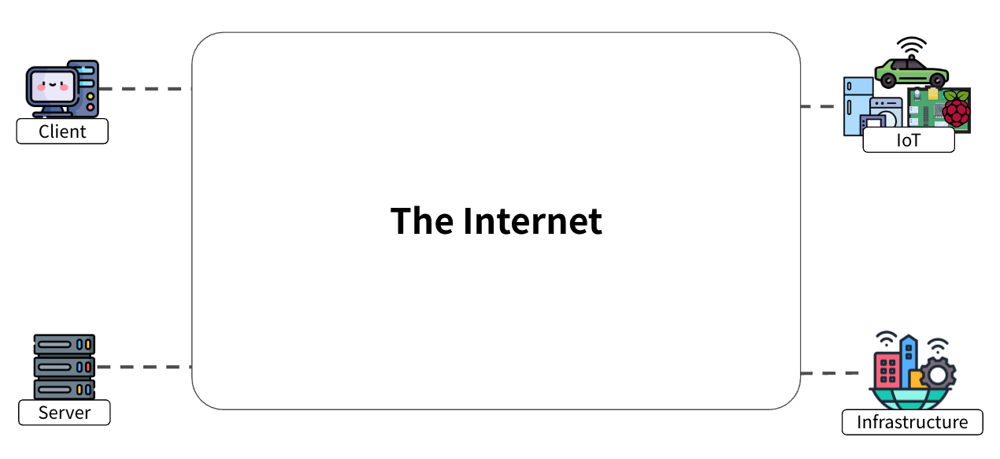
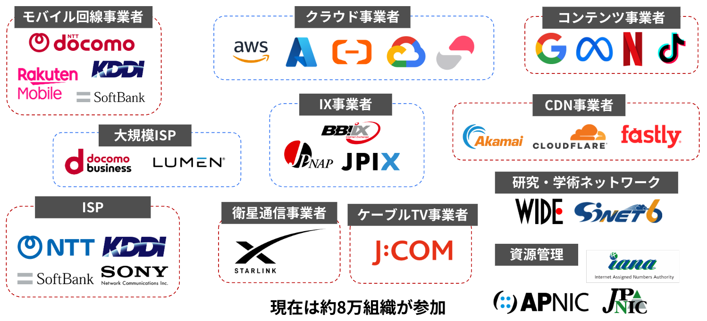
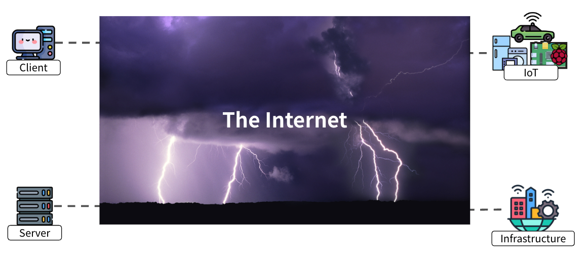
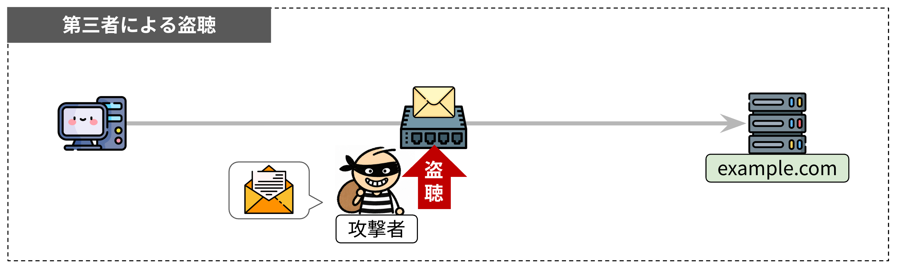
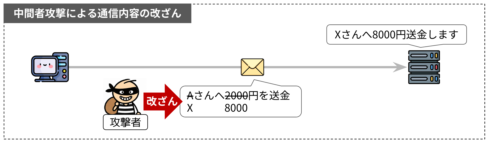

# イントロダクション

## インターネットの正体

現代では、コンピュータだけでなく、車や掃除機、洗濯機といった家電から街やインフラまでがインターネットにつながっています。

*インターネットにつながるさまざまな機器*

まず、インターネットの正体について知る必要があります。
インターネットは、どこかに実体が1つ存在するものではありません。無数のコンピュータが有線・無線で相互に接続されることで形成される、巨大なコンピュータ・ネットワークの集合体です。

このネットワークは、単一の組織が運営しているわけではありません。役割の異なる多様な組織がネットワークを持ち寄り、相互に接続することで成り立っています。

*インターネットに参加する組織*

::: danger 「約8万の組織」の補足
これはAS番号の割り当て数を基に述べているため、AS番号を複数持つ組織が存在する以上正確ではありません。
:::

## 経路上の全員を信頼できるわけではない

インターネットには、さまざまな組織が自由に参加しています。そのため、経路上に存在するすべての組織や通信機器を信頼できるとは限りません。
AS番号は個人でも取得できるため、中には悪意を持ってネットワークを運用している者が存在する可能性もあります。

通信先までの経路によっては、そうした組織が運用する通信機器を経由して通信することもあり得ます。

*危険が潜むインターネット*

では、経路上に信頼できない通信機器が存在すると、どのようなことが起こるのでしょうか。

まず考えられるのが、通信内容の盗聴です。平文で通信している場合、経路上の通信機器は、その通信内容をそのまま読み取ることができてしまいます。
例えば、Webサイトにログインする際に入力したIDやパスワード、クレジットカード番号などの機密情報が、経路上の通信機器に筒抜けになってしまいます。

次に、通信内容の改ざんです。経路上に割り込んだ攻撃者は、通信内容を読むだけでなく書き換えることもできます。

そして、通信相手のなりすましです。通信相手が本物のサーバーではなく、攻撃者が用意した偽のサーバーである可能性があります。

たとえ通信が暗号化でき、通信内容の改ざんを検知できたとしても、相手が偽物であれば、機密情報を自分から渡してしまうことになります。

## TLSとは

こうした危険なインターネットで安全に通信をするために用いられるのがTLS（Transport Layer Security）です。最新バージョンはTLS 1.3で、2018年にIETFによって[RFC 8446](https://datatracker.ietf.org/doc/html/rfc8446)として標準化されました。2026年7月には、その内容に修正を加えた改訂版の[RFC 9846](https://datatracker.ietf.org/doc/html/rfc9846)が発行され、現在はこれがTLS 1.3の仕様です。

RFC 9846では、TLSの目的が次のように述べられています。

> The primary goal of TLS is to provide a secure channel between two communicating peers; the only requirement from the underlying transport is a reliable, in-order data stream.
>   
>訳）TLSの主な目的は、通信を行う2つのピアの間に安全な通信路を提供することである。下位のトランスポートに求められる唯一の要件は、信頼性があり順序が保証されたデータストリームであることだけである。
>
> 引用元: [RFC 9846 §1 Introduction](https://datatracker.ietf.org/doc/html/rfc9846#section-1)

RFC 9846はこの引用に続けて、安全な通信路が満たすべき性質として認証（Authentication）、機密性（Confidentiality）、完全性（Integrity）の3つを挙げています。先ほどのなりすまし、盗聴、改ざんにそれぞれ対応するもので、ネットワークを完全に支配する攻撃者がいても成り立つべきだとされています。

## TLSはどこで動作するのか

TLSは、TCP/IPモデルではトランスポート層とアプリケーション層のちょうど境目で動作します。TCPの上に乗る形で実装されるため、モデル上はアプリケーション層の一部として扱われることも多く、俗に「レイヤ4.5」と呼ばれることもあります。OSI参照モデルにはきれいに対応しませんが、おおむねセッション層からプレゼンテーション層（5〜6層）にあたります。

したがって、暗号化されるのは、TLSより上位層のメッセージだけです。TCPやIPのヘッダは平文のまま残るので、通信相手のIPアドレスやポート番号は経路上から見えます。

## TLSの歴史

TLSはSSLの後継規格であり、現代ではTLSが標準です。

SSLはもともとNetscape社が開発したプロトコルで、TLS 1.0以降はIETFが標準化を引き継ぎ、RFCとして仕様が公開されています。各バージョンの仕様と現在の扱いは表1の通りです。

| バージョン | 仕様 | 公開年 | 現在の扱い |
| --- | --- | --- | --- |
| SSL 2.0 | （Netscape社による仕様） | 1995 | [RFC 6176](https://datatracker.ietf.org/doc/html/rfc6176)により使用禁止（2011） |
| SSL 3.0 | [RFC 6101](https://datatracker.ietf.org/doc/html/rfc6101)（歴史的文書として記録） | 1996 | [RFC 7568](https://datatracker.ietf.org/doc/html/rfc7568)により廃止（2015） |
| TLS 1.0 | [RFC 2246](https://datatracker.ietf.org/doc/html/rfc2246) | 1999 | [RFC 8996](https://datatracker.ietf.org/doc/html/rfc8996)により廃止（2021） |
| TLS 1.1 | [RFC 4346](https://datatracker.ietf.org/doc/html/rfc4346) | 2006 | [RFC 8996](https://datatracker.ietf.org/doc/html/rfc8996)により廃止（2021） |
| TLS 1.2 | [RFC 5246](https://datatracker.ietf.org/doc/html/rfc5246) | 2008 | 現役（利用可能） |
| TLS 1.3 | [RFC 8446](https://datatracker.ietf.org/doc/html/rfc8446)、改訂版の[RFC 9846](https://datatracker.ietf.org/doc/html/rfc9846) | 2018、2026 | 現役（最新版・推奨） |

*SSL/TLSの各バージョンと現在の扱い*

なお、SSL 1.0は設計段階で脆弱性が見つかり、一般に公開されることはありませんでした。

::: tip 「SSL」という呼び方について
WebサイトでTLSによる暗号化通信を有効にすることを「SSL化」、TLSで使うサーバー証明書を「SSL証明書」と呼ぶことがあります。SSL時代の名残で今も広く使われている呼び方ですが、現在のWebサイトでSSLが使われることはまずなく、「SSL」とあっても実際にはTLSが使われていると考えて問題ありません。
:::

## 参考文献

本ページの図で使用したロゴの出典は[参考文献](/references#イントロダクションの図で使用したロゴ)にまとめています。
