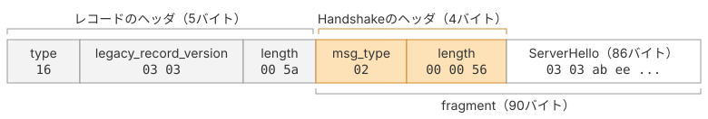

# Handshakeプロトコル

## Handshakeメッセージの構造

ハンドシェイクに属するメッセージ（ClientHello、ServerHello、Certificateなど）は、共通のヘッダに包まれてレコードのペイロードに入ります。

> ```rust
> struct {
>     HandshakeType msg_type;    /* handshake type */
>     uint24 length;             /* remaining bytes in message */
>     select (Handshake.msg_type) {
>         case client_hello:          ClientHello;
>         case server_hello:          ServerHello;
>         ...
>     };
> } Handshake;
>
> enum {
>     client_hello(1),
>     server_hello(2),
>     new_session_ticket(4),
>     end_of_early_data(5),
>     encrypted_extensions(8),
>     certificate(11),
>     certificate_request(13),
>     certificate_verify(15),
>     finished(20),
>     key_update(24),
>     message_hash(254),
>     (255)
> } HandshakeType;
> ```
>
> 引用元: [RFC 9846 §4 Handshake Protocol](https://datatracker.ietf.org/doc/html/rfc9846#section-4)

先頭1バイトがメッセージの種類、続く3バイトが本体の長さです。レコード層と同じ「タイプ＋長さ＋中身」の形が入れ子になっているだけで、新しい考え方は出てきません。



*ServerHelloを運ぶレコードの先頭*

`02 00 00 56`は「msg_type = 2（ServerHello）、本体86バイト」という意味です。

## 実装

### 定数の追加

`common.go`に種別の定数を足します。本書で扱う6つをまとめて定義しておきます。

::: code-group

```go [common.go]
// @see https://datatracker.ietf.org/doc/html/rfc9846#section-4
type HandshakeType uint8

const (
	TypeClientHello         HandshakeType = 1
	TypeServerHello         HandshakeType = 2
	TypeEncryptedExtensions HandshakeType = 8
	TypeCertificate         HandshakeType = 11
	TypeCertificateVerify   HandshakeType = 15
	TypeFinished            HandshakeType = 20
)
```

:::

### handshakeの構造体を定義する

`handshake.go`を作ります。3バイト長（uint24）はGoに対応する型がないので、`[3]byte`として素直に持ちます。
レコードと同じように、コンストラクタと、バイト列への書き出し、読み取りを実装します。

::: code-group

```go [handshake.go]
package tls13

import "errors"

var errHandshakeTooShort = errors.New("tls13: handshake message too short")

type Handshake struct {
	HandshakeType HandshakeType
	Length        [3]byte
	Body          []byte
}

func NewHandshake(handshakeType HandshakeType, body []byte) *Handshake {
	length := len(body)
	return &Handshake{
		HandshakeType: handshakeType,
		Length:        [3]byte{byte(length >> 16), byte(length >> 8), byte(length)},
		Body:          body,
	}
}

func (h *Handshake) Marshal() []byte {
	buf := make([]byte, 4, 4+len(h.Body))
	buf[0] = byte(h.HandshakeType)
	copy(buf[1:], h.Length[:])
	return append(buf, h.Body...)
}

func UnmarshalHandshake(data []byte) (*Handshake, error) {
	if len(data) < 4 {
		return nil, errHandshakeTooShort
	}
	length := int(data[1])<<16 | int(data[2])<<8 | int(data[3])
	if len(data) != 4+length {
		return nil, errors.New("tls13: handshake length mismatch")
	}
	return &Handshake{
		HandshakeType: HandshakeType(data[0]),
		Length:        [3]byte{data[1], data[2], data[3]},
		Body:          data[4:],
	}, nil
}
```

:::

## 本ページで書いたコード

::: code-group

```[tree]
.
├── go.mod
├── common.go
├── record.go
└── handshake.go
```

```go [common.go]
package tls13

// @see https://datatracker.ietf.org/doc/html/rfc9846#section-5.1
type ContentType uint8

const (
	ContentTypeChangeCipherSpec ContentType = 20
	ContentTypeAlert            ContentType = 21
	ContentTypeHandshake        ContentType = 22
	ContentTypeApplicationData  ContentType = 23
)

// @see https://datatracker.ietf.org/doc/html/rfc9846#section-4.2.2
type TLSVersion uint16

const (
	TLS_VERSION_1_2 TLSVersion = 0x0303
	TLS_VERSION_1_3 TLSVersion = 0x0304
)

const maxPayloadLen = 1<<14 + 256

// @see https://datatracker.ietf.org/doc/html/rfc9846#section-4
type HandshakeType uint8

const (
	TypeClientHello         HandshakeType = 1
	TypeServerHello         HandshakeType = 2
	TypeEncryptedExtensions HandshakeType = 8
	TypeCertificate         HandshakeType = 11
	TypeCertificateVerify   HandshakeType = 15
	TypeFinished            HandshakeType = 20
)
```

```go [handshake.go]
package tls13

import "errors"

var errHandshakeTooShort = errors.New("tls13: handshake message too short")

type Handshake struct {
	HandshakeType HandshakeType
	Length        [3]byte
	Body          []byte
}

func NewHandshake(handshakeType HandshakeType, body []byte) *Handshake {
	length := len(body)
	return &Handshake{
		HandshakeType: handshakeType,
		Length:        [3]byte{byte(length >> 16), byte(length >> 8), byte(length)},
		Body:          body,
	}
}

func (h *Handshake) Marshal() []byte {
	buf := make([]byte, 4, 4+len(h.Body))
	buf[0] = byte(h.HandshakeType)
	copy(buf[1:], h.Length[:])
	return append(buf, h.Body...)
}

func UnmarshalHandshake(data []byte) (*Handshake, error) {
	if len(data) < 4 {
		return nil, errHandshakeTooShort
	}
	length := int(data[1])<<16 | int(data[2])<<8 | int(data[3])
	if len(data) != 4+length {
		return nil, errors.New("tls13: handshake length mismatch")
	}
	return &Handshake{
		HandshakeType: HandshakeType(data[0]),
		Length:        [3]byte{data[1], data[2], data[3]},
		Body:          data[4:],
	}, nil
}
```

:::
