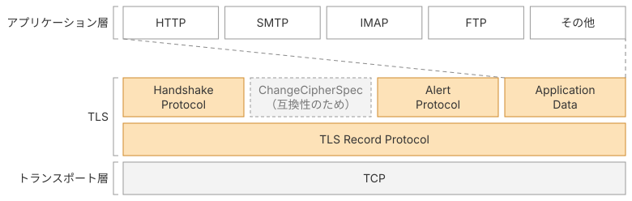
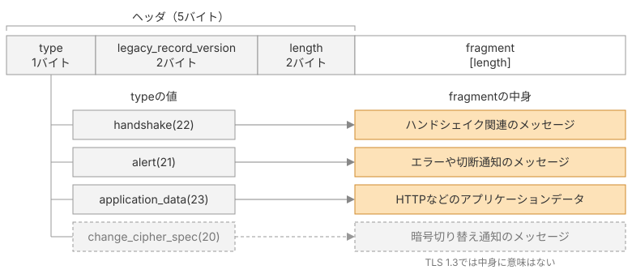
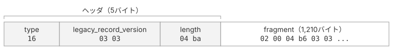

# Recordプロトコル

[第1章](/01_overview/intro)では、TLS 1.3通信の全体像と、本書で作るクライアントの完成形を確認しました。本章では、TLSにおけるすべてのメッセージに共通する入れ物であるレコードと、ハンドシェイクメッセージの共通ヘッダを実装します。

## TLSメッセージの層構造とレコード

図1に示すように、TLSはトランスポート層とアプリケーション層の間に入るプロトコルです。下位層はTCP、上位層はHTTPやFTPなどのアプリケーションプロトコルで、TLSは上位層から受け取ったデータを暗号化してTCPに渡し、TCPから受け取ったデータを復号して上位層に渡します。



*TLSの層構造*

TLSがTCPに渡すデータの単位がRecord（レコード）です。
TLSには、ハンドシェイク用の入れ物、アプリケーションデータ用の入れ物、エラー通知用の入れ物などがありますが、すべての入れ物はレコードに包まれて送信されます。そのため、TLSのメッセージにおける共通の構造がレコードというわけです。

## レコードの種類

レコードには、中身が平文か暗号文かで2つの名前が付いています。

- TLSPlaintext: 暗号化されていないデータを包むレコード
- TLSCiphertext: 暗号化されたデータを包むレコード

名前は違いますが、ヘッダの形も長さの決め方も同じで、違うのは中身が平文か暗号文かという点だけです。
バイト列として見れば同じ構造なので、ひとつの読み書きコードで両方を扱えます。

本ページで実装するのはTLSPlaintextです。

## TLSPlaintext

TLSPlaintextの構造は、RFCで次のように定義されています。

> ```rust
> struct {
>     ContentType type;
>     ProtocolVersion legacy_record_version;
>     uint16 length;
>     opaque fragment[TLSPlaintext.length];
> } TLSPlaintext;
> 
> enum {
>     invalid(0),
>     change_cipher_spec(20),
>     alert(21),
>     handshake(22),
>     application_data(23),
>     (255)
> } ContentType;
> ```
>
> 引用元: [RFC 9846 §5.1 Record Layer](https://datatracker.ietf.org/doc/html/rfc9846#section-5.1)

図示すると図2のようになります。先頭の`type`、`legacy_record_version`、`length`の5バイトがヘッダで、その後ろに、長さフィールドが示すバイト数の`fragment`が続きます。

`fragment`に何が入っているかは`type`で決まります。ハンドシェイクメッセージを運ぶhandshake、エラーや切断を通知するalert、HTTPなどの上位層のデータを運ぶapplication_data、そしてchange_cipher_specの4種類です。change_cipher_specはTLS 1.2以前との互換のために残されているだけで、TLS 1.3では中身に意味はありません。

レコードは中身を問わない入れ物で、ヘッダを読めば「どのプロトコルのデータが何バイト入っているか」がわかる、という構造です。



*TLSPlaintextのデータ構造*

## バイト列を読んでみる

これが読めると、第1章でサーバーから返ってきたバイト列の先頭が解読できます。



*サーバーから届いたレコードの先頭*

- `0x16`（10進数で22）= handshake。ハンドシェイクメッセージが入っています
- `0x0303`。TLSのバージョンは1.2です。（TLS 1.2を名乗る理由は後述します）
- `0x04ba`（10進数で1210）。この後に1,210バイトの中身が続きます

つまりレコードの読み取りは「先頭5バイトを読む → `length`を見る → その分だけ読む」の2段階でできます。この読み取り手順が、これから書くコードの仕様そのものです。

## 実装

### まずは定数を置く

プロジェクト直下に`common.go`を作り、レコードのヘッダに利用するContentTypeやProtocolVersionなどの定数を定義します。

※ 定数の上に`// @see`でRFCの該当箇所を書いています。値の根拠を後から辿れるようにするためで、以降の章でも定数を足すたびに同じ形で書いていきます。

::: code-group

```go [common.go]
package tls13

// @see https://datatracker.ietf.org/doc/html/rfc9846#section-5.1
type ContentType uint8

const (
	ContentTypeChangeCipherSpec ContentType = 20
	ContentTypeAlert            ContentType = 21
	ContentTypeHandshake        ContentType = 22
	ContentTypeApplicationData  ContentType = 23
)

// @see https://datatracker.ietf.org/doc/html/rfc9846#section-4.2.2
type TLSVersion uint16

const (
	TLS_VERSION_1_2 TLSVersion = 0x0303
	TLS_VERSION_1_3 TLSVersion = 0x0304
)

const maxPayloadLen = 1<<14 + 256
```

:::

### 構造体を定義する

前述したRFCに記載されているTLSPlaintextの構造をGoの構造体で再現します。

::: code-group

```go [record.go]
package tls13

type TLSPlaintext struct {
	Type    ContentType
	Version TLSVersion
	Length  uint16
	Payload []byte
}
```

:::

### コンストラクタの実装

コンストラクタを実装します。コンストラクタは、引数として`ContentType`とPayloadに入れるバイト列を受け取ります。
`Length`は`fragment`の長さから決まるので、呼び出し側に渡させる必要はありません。

VersionはTLS 1.2で固定します。

::: code-group

```go [record.go]
func NewTLSPlaintext(contentType ContentType, fragment []byte) *TLSPlaintext {
	return &TLSPlaintext{
		Type:    contentType,
		Version: TLS_VERSION_1_2,
		Length:  uint16(len(fragment)),
		Payload: fragment,
	}
}
```

:::

::: info なぜTLS 1.3なのにTLS 1.2の値を入れるのか
フィールド名が`legacy_record_version`となっているとおり、この値は互換性のために残されているだけで、実際のバージョンを表していません。経路上の古い機器（middlebox）は見慣れないバージョン番号を見ると、異常なデータとして扱い、パケットを廃棄することがあるため、TLS 1.3のレコードは原則としてTLS 1.2の値`0x0303`を名乗ります。最初のClientHelloを運ぶレコードだけは、`0x0301`でもよいことになっています。本当のバージョン交渉はClientHelloの拡張で行います。RFC 9846は`legacy_record_version`を非推奨（deprecated）のフィールドとし、受信側はどんな用途にも使わずに無視するよう定めています。

> legacy_record_version:  MUST be set to 0x0303 for all records generated by a TLS 1.3 implementation other than an initial ClientHello (i.e., one not generated after a HelloRetryRequest), where it MAY also be 0x0301 for compatibility purposes.  This field is deprecated and MUST be ignored for all purposes.
> <br><br>
> 訳）legacy_record_version: TLS 1.3実装が生成するすべてのレコードで0x0303にしなければならない。ただし最初のClientHello（HelloRetryRequestの後に生成されたものではないもの）では、互換性のために0x0301でもよい。このフィールドは非推奨であり、いかなる目的でも無視しなければならない。
>
> 引用元: [RFC 9846 §5.1 Record Layer](https://datatracker.ietf.org/doc/html/rfc9846#section-5.1)

:::

### バイト列に書き出す関数を用意しておく

送受信では直接のバイト列にする必要があるので、書き出し用のメソッドを実装しておきます。

::: code-group

```go [record.go]
func (p *TLSPlaintext) Marshal() []byte {
	buf := make([]byte, 5, 5+len(p.Payload))
	buf[0] = byte(p.Type)
	binary.BigEndian.PutUint16(buf[1:], uint16(p.Version))
	binary.BigEndian.PutUint16(buf[3:], p.Length)
	return append(buf, p.Payload...)
}
```

:::

### 読み取り用の関数を用意しておく

サーバーからの応答を受け取るのに必要となるため、レコードを読み取る関数も実装しておきます。

どこまでが1つのレコードかは、ヘッダの`length`で判断できます。ヘッダは常に5バイト固定なので、まず5バイト読んで`length`を取り出し、その分だけ本体を読めば、レコードをちょうど1つ分だけ取り出せます。読み取った値は`TLSPlaintext`に詰めて返します。

バイト数が揃うまで読み続ける`io.ReadFull`という便利な関数が用意されているのでこれを使います。

::: code-group

```go [record.go]
var errPayloadTooLarge = errors.New("tls13: payload too large")

func ReadRecord(r io.Reader) (*TLSPlaintext, error) {
	hdr := make([]byte, 5)
	if _, err := io.ReadFull(r, hdr); err != nil {
		return nil, err
	}
	length := binary.BigEndian.Uint16(hdr[3:])
	if int(length) > maxPayloadLen {
		return nil, errPayloadTooLarge
	}
	payload := make([]byte, length)
	if _, err := io.ReadFull(r, payload); err != nil {
		return nil, err
	}
	return &TLSPlaintext{
		Type:    ContentType(hdr[0]),
		Version: TLSVersion(binary.BigEndian.Uint16(hdr[1:])),
		Length:  length,
		Payload: payload,
	}, nil
}
```

:::

## 本ページで書いたコード

::: code-group

```[tree]
.
├── go.mod
├── common.go
└── record.go
```

```go [common.go]
package tls13

// @see https://datatracker.ietf.org/doc/html/rfc9846#section-5.1
type ContentType uint8

const (
	ContentTypeChangeCipherSpec ContentType = 20
	ContentTypeAlert            ContentType = 21
	ContentTypeHandshake        ContentType = 22
	ContentTypeApplicationData  ContentType = 23
)

// @see https://datatracker.ietf.org/doc/html/rfc9846#section-4.2.2
type TLSVersion uint16

const (
	TLS_VERSION_1_2 TLSVersion = 0x0303
	TLS_VERSION_1_3 TLSVersion = 0x0304
)

const maxPayloadLen = 1<<14 + 256
```

```go [record.go]
package tls13

import (
	"encoding/binary"
	"errors"
	"io"
)

var errPayloadTooLarge = errors.New("tls13: payload too large")

type TLSPlaintext struct {
	Type    ContentType
	Version TLSVersion
	Length  uint16
	Payload []byte
}

func NewTLSPlaintext(contentType ContentType, fragment []byte) *TLSPlaintext {
	return &TLSPlaintext{
		Type:    contentType,
		Version: TLS_VERSION_1_2,
		Length:  uint16(len(fragment)),
		Payload: fragment,
	}
}

func (p *TLSPlaintext) Marshal() []byte {
	buf := make([]byte, 5, 5+len(p.Payload))
	buf[0] = byte(p.Type)
	binary.BigEndian.PutUint16(buf[1:], uint16(p.Version))
	binary.BigEndian.PutUint16(buf[3:], p.Length)
	return append(buf, p.Payload...)
}

func ReadRecord(r io.Reader) (*TLSPlaintext, error) {
	hdr := make([]byte, 5)
	if _, err := io.ReadFull(r, hdr); err != nil {
		return nil, err
	}
	length := binary.BigEndian.Uint16(hdr[3:])
	if int(length) > maxPayloadLen {
		return nil, errPayloadTooLarge
	}
	payload := make([]byte, length)
	if _, err := io.ReadFull(r, payload); err != nil {
		return nil, err
	}
	return &TLSPlaintext{
		Type:    ContentType(hdr[0]),
		Version: TLSVersion(binary.BigEndian.Uint16(hdr[1:])),
		Length:  length,
		Payload: payload,
	}, nil
}
```

:::
