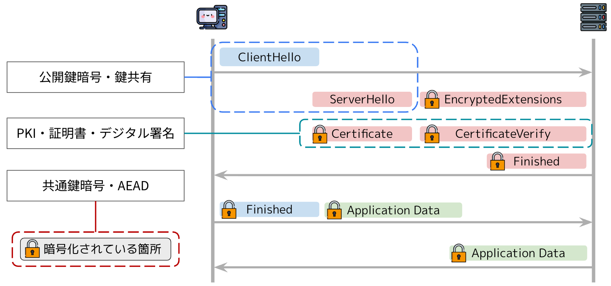
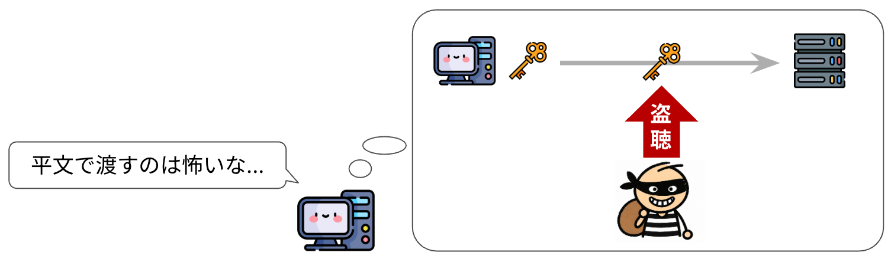
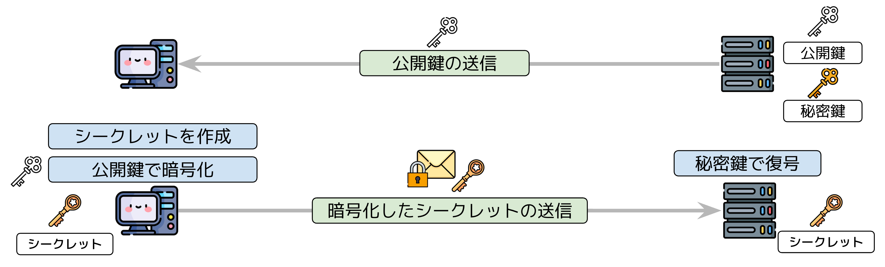
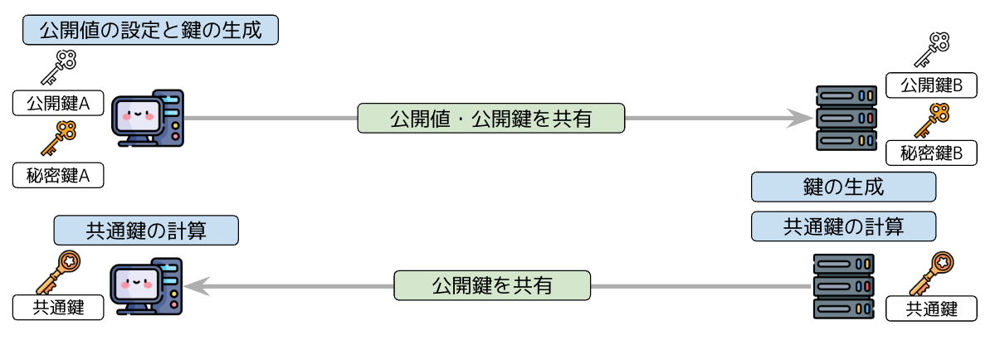
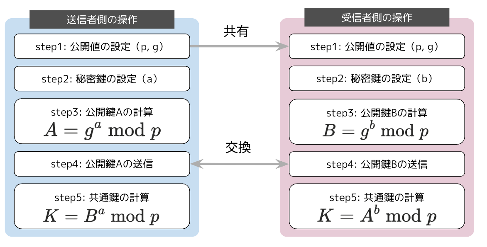

# 鍵配送問題と鍵交換

## key_share拡張とsupported_groups拡張の役割

前のページで残した`supported_groups`と`key_share`は、どちらも鍵交換のための拡張です。

本ページでは、この鍵交換について解説します。すでに知っているよという方は[実装](#実装)までスキップして問題ありません。

## 鍵配送問題

まず、TLSでは通信の暗号化に共通鍵暗号方式を利用しています。



共通鍵暗号方式で暗号化するには、両者が同じ鍵を持っている必要があります。しかし、その鍵をどうやって相手と共有するのでしょうか。ここには2つ問題があります。

- TLS通信ではお互い「はじめまして」の状態から始まることが多く、事前に鍵を共有しておくことは難しい
- 通信路は安全ではないので、鍵をそのまま送る単純な共有はNG

鍵を送る経路が安全でないから暗号化したいのに、暗号化するには鍵を送らなければならない。この鶏と卵の問題を鍵配送問題と呼びます。



## 鍵配送問題の解決

TLSでは、盗聴される可能性のある通信路でも、両者だけが知る秘密の値を共有する仕組みを使います。これを鍵交換と呼びます。

::: info 共有秘密と共通鍵
本書では、鍵交換で共有する秘密の値を共有秘密、通信の暗号化に使う鍵を共通鍵と呼び分けます。共有秘密は共通鍵の材料となる値で、[RFC 9846 §7.4](https://datatracker.ietf.org/doc/html/rfc9846#section-7.4)のshared secretにあたります。
:::

秘密の値をそのまま送れないなら、暗号化して送るという方法が考えられます。TLS 1.2までは、この考え方に基づくRSA鍵交換が使われていました。まずはその仕組みと課題を見てから、TLS 1.3で使う、秘密の値を送らずに両者が計算で求める方法へ進みます。

## 共有秘密を暗号化して送る方法

公開鍵暗号で共有秘密を送る方法の代表が、TLS 1.2まで広く使われていたRSA鍵交換です。図1のとおり、サーバーはまず、自分の公開鍵をクライアントに送ります。クライアントは、共有秘密にする値を作り、サーバーの公開鍵で暗号化して送り返します。サーバーは、自分だけが持つ秘密鍵で共有秘密を復号します。公開鍵で暗号化した共有秘密は対応する秘密鍵でしか復号できないので、経路上の盗聴者は共有秘密を知ることができません。図1のシークレットが、共有秘密にあたります。



*RSA鍵交換の流れ*

TLS 1.3は、RSA鍵交換を廃止しました。

> Static RSA and Diffie-Hellman cipher suites have been removed; all public-key based key exchange mechanisms now provide forward secrecy.
> <br><br>
> 訳）静的RSAおよび静的ディフィー・ヘルマンの暗号スイートは削除された。公開鍵に基づく鍵交換方式はすべて、前方秘匿性を提供するものになった。
>
> 引用元: [RFC 9846 §1.3 Major Differences from TLS 1.2](https://datatracker.ietf.org/doc/html/rfc9846#section-1.3)

前方秘匿性は、長く使い続ける秘密鍵が将来漏れても、攻撃者が過去の通信を復号できない性質です。RSA鍵交換には前方秘匿性がありません。RSA鍵交換では、共有秘密がサーバーの長期の秘密鍵で復号できる形で経路を流れるので、通信を記録しておいた攻撃者は、後からサーバーの秘密鍵を手に入れると過去の通信をすべて復号できてしまいます。

前方秘匿性は[コラム: 前方秘匿性](/09_column/forward-secrecy)にまとめています。

## 共有秘密を計算で導き出す方法

TLS 1.3の鍵交換は、ディフィー・ヘルマン鍵共有を土台にしています。本節では、原型であるディフィー・ヘルマン鍵共有を説明してから、TLS 1.3が実際に使う方式を説明します。

### ディフィー・ヘルマン鍵共有

DH（Diffie-Hellman：ディフィー・ヘルマン）鍵共有は、公開してよい値だけを送り合い、両者がそれぞれの手元の計算で同じ共有秘密を導き出す方式です。秘密の値そのものを送らずに、相手と同じ秘密の値を持つという考え方は、1976年にホイットフィールド・ディフィーとマーティン・ヘルマンが論文「New Directions in Cryptography」[^dh1976]で示しました。

図2のとおり、クライアントとサーバーは、それぞれ秘密鍵と公開鍵を作ります。クライアントは計算に使う公開値と自分の公開鍵をサーバーに送り、サーバーは自分の公開鍵をクライアントに送ります。両者は、受け取った相手の公開鍵と自分の秘密鍵から、同じ共有秘密を計算します。図2と図3では、共有秘密を共通鍵と書いています。



*ディフィー・ヘルマン鍵共有のイメージ図*

手順を数式で追うと図3のとおりです。送信者が計算するB<sup>a</sup> mod pと、受信者が計算するA<sup>b</sup> mod pは、どちらもg<sup>ab</sup> mod pに等しくなるので、両者は同じ共有秘密Kを得られます。



*ディフィー・ヘルマン鍵共有の計算手順*

DH鍵共有では、共有秘密そのものは経路を流れないので、盗聴者が通信をすべて見ても共有秘密は分かりません。また、両者が値を持ち寄って共有秘密を導き出すので、RSA鍵交換のように一方が決めた値を相手に渡す形にはなりません。ただし、DH鍵共有だけでは、受け取った公開鍵が本当に通信相手のものかを確かめられません。TLSは、通信相手が本物かどうかを、証明書と署名で別に確かめます。

### 楕円曲線DHとECDHE

DHと同じ考え方を楕円曲線という数学の上で行うのが楕円曲線DH（ECDH）です。短い鍵で高い強度を実現できるため、現代のTLSではこちらが使われます。

そのECDHで、鍵ペアを接続ごとに作り直して使い捨てるのがECDHEです。末尾のEはephemeral（一時的）の意味です。同じ鍵ペアを使い回すと、その秘密鍵が将来漏れたときに過去の通信をすべて復号されてしまいます。毎回捨ててしまえば、復号に必要な秘密鍵はその接続が終わった時点でどこにも残りません。この性質が前方秘匿性で、TLS 1.3がECDHEだけを残した理由です。

TLS 1.3ではECDHEによる鍵交換が標準です。使える鍵交換方式はNamed Groupと呼ばれ、[RFC 9846 §4.3.7](https://datatracker.ietf.org/doc/html/rfc9846#section-4.3.7)の`NamedGroup`で定義されています。楕円曲線を使うECDHEと、有限体上のDHの2種類に分かれています。

RFC発行後に追加されたものもあり、最新の一覧は[IANAのレジストリ](https://www.iana.org/assignments/tls-parameters/tls-parameters.xhtml#tls-parameters-8)にあります。X25519MLKEM768のようなハイブリッド方式（ECDHEと耐量子KEMの組み合わせ）はそちらに載っています。

| Named Group | 種類 | 備考 |
|---|---|---|
| X25519 | 楕円曲線 | 現在最も一般的 |
| secp256r1 (P-256) | 楕円曲線 | NIST標準曲線 |
| X448 | 楕円曲線 | X25519より高強度だが利用例は少ない |
| ffdhe2048〜8192 | 有限体DH | ECDHEではないDH方式 |
| X25519MLKEM768など | ハイブリッド | ECDHE + 耐量子KEM |

*TLS 1.3で使えるNamed Groupの主なもの*

本書では表1の中からX25519を選びます。X25519は多くのTLS実装が対応している楕円曲線で、[RFC 8447](https://datatracker.ietf.org/doc/html/rfc8447)がレジストリに追加したRecommended列でも`Y`が付いています。表1のX25519MLKEM768も、X25519にMLKEMを組み合わせた方式です。

## 実装

鍵交換に必要な情報をClientHelloに載せるため、本ページでは`supported_groups`と`key_share`の2つの拡張を実装します。クライアントは、1つ目の拡張で対応している方式を申告し、2つ目の拡張に選んだ方式の公開鍵を入れます。

共有秘密を計算するには、ClientHelloを送った後、返ってきたServerHelloからサーバーの公開鍵を取り出す必要があるので、導出は次ページ以降で行います。

### supported_groups拡張

対応している鍵交換方式をサーバーに申告する拡張です。先ほどの一覧のうち、本書が対応するのはX25519だけなので、それを1つ入れます。

まず`NamedGroup`の定数を`common.go`に足します。

::: code-group

```go [common.go]
// @see https://datatracker.ietf.org/doc/html/rfc9846#section-4.3.7
type NamedGroup uint16

const X25519 NamedGroup = 0x001d
```

:::

拡張の中身はRFCで次のように定義されています。

> ```c
> struct {
>     NamedGroup named_group_list<2..2^16-1>;
> } NamedGroupList;
> ```
>
> 引用元: [RFC 9846 §4.3.7 Supported Groups](https://datatracker.ietf.org/doc/html/rfc9846#section-4.3.7)

`NamedGroup`を並べて2バイトの長さで包むだけです。

::: code-group

```go [extensions.go]
func SupportedGroupsExtension() Extension {
	groups := appendUint16(nil, uint16(X25519))
	return Extension{Type: extSupportedGroups, Payload: withUint16Length(groups)}
}
```

:::

ここに挙げるのはあくまで「使える方式」の一覧です。そのうちどれの公開鍵を実際に送るのかは、次の`key_share`で指定します。

### key_share拡張

> ```c
> struct {
>     NamedGroup group;
>     opaque key_exchange<1..2^16-1>;
> } KeyShareEntry;
> ```
>
> ```c
> struct {
>     KeyShareEntry client_shares<0..2^16-1>;
> } KeyShareClientHello;
> ```
>
> 引用元: [RFC 9846 §4.3.8 Key Share](https://datatracker.ietf.org/doc/html/rfc9846#section-4.3.8)

`key_exchange`に入るのが32バイトのX25519公開鍵です。鍵ペアの生成はClientHelloを組み立てる`main`側で行うので、この関数は公開鍵を引数`publicKey`で受け取ります。`KeyShareEntry`が「グループ2バイト + 公開鍵」、`KeyShareClientHello`がそのエントリの並びです。長さプレフィックスが2重になるのはこのためで、内側の`withUint16Length(publicKey)`が公開鍵の長さ、外側が`client_shares`の長さです。

::: code-group

```go [extensions.go]
func KeyShareExtension(publicKey []byte) Extension {
	entry := appendUint16(nil, uint16(X25519))
	entry = append(entry, withUint16Length(publicKey)...)
	return Extension{Type: extKeyShare, Payload: withUint16Length(entry)}
}
```

:::

## 本ページで書いたコード

::: code-group

```[tree]
.
├── go.mod
├── common.go
├── record.go
├── handshake.go
├── bytes.go
├── client_hello.go
└── extensions.go
```

```go [common.go]
package tls13

// @see https://datatracker.ietf.org/doc/html/rfc9846#section-5.1
type ContentType uint8

const (
	ContentTypeChangeCipherSpec ContentType = 20
	ContentTypeAlert            ContentType = 21
	ContentTypeHandshake        ContentType = 22
	ContentTypeApplicationData  ContentType = 23
)

// @see https://datatracker.ietf.org/doc/html/rfc9846#section-4.2.2
type TLSVersion uint16

const (
	TLS_VERSION_1_2 TLSVersion = 0x0303
	TLS_VERSION_1_3 TLSVersion = 0x0304
)

// @see https://datatracker.ietf.org/doc/html/rfc9846#section-4
type HandshakeType uint8

const (
	TypeClientHello         HandshakeType = 1
	TypeServerHello         HandshakeType = 2
	TypeEncryptedExtensions HandshakeType = 8
	TypeCertificate         HandshakeType = 11
	TypeCertificateVerify   HandshakeType = 15
	TypeFinished            HandshakeType = 20
)

// @see https://datatracker.ietf.org/doc/html/rfc9846#appendix-B.4
type CipherSuite uint16

const TLS_AES_128_GCM_SHA256 CipherSuite = 0x1301

// @see https://datatracker.ietf.org/doc/html/rfc9846#section-4.3
type extensionType uint16

const (
	extServerName          extensionType = 0
	extSupportedGroups     extensionType = 10
	extSignatureAlgorithms extensionType = 13
	extSupportedVersions   extensionType = 43
	extKeyShare            extensionType = 51
)

// @see https://datatracker.ietf.org/doc/html/rfc9846#section-4.3.7
type NamedGroup uint16

const X25519 NamedGroup = 0x001d

// @see https://datatracker.ietf.org/doc/html/rfc9846#section-4.3.3
type SignatureScheme uint16

const (
	RSA_PKCS1_SHA256       SignatureScheme = 0x0401
	ECDSA_SECP256R1_SHA256 SignatureScheme = 0x0403
	ECDSA_SECP384R1_SHA384 SignatureScheme = 0x0503
	RSA_PSS_RSAE_SHA256    SignatureScheme = 0x0804
	RSA_PSS_RSAE_SHA384    SignatureScheme = 0x0805
	RSA_PSS_RSAE_SHA512    SignatureScheme = 0x0806
)

const maxPayloadLen = 1<<14 + 256
```

```go [extensions.go]
package tls13

type Extension struct {
	Type    extensionType
	Payload []byte
}

func (e Extension) Marshal() []byte {
	buf := appendUint16(nil, uint16(e.Type))
	return append(buf, withUint16Length(e.Payload)...)
}

func SupportedVersionsExtension() Extension {
	versions := appendUint16(nil, uint16(TLS_VERSION_1_3))
	return Extension{Type: extSupportedVersions, Payload: withUint8Length(versions)}
}

func ServerNameExtension(name string) Extension {
	entry := append([]byte{0}, withUint16Length([]byte(name))...)
	return Extension{Type: extServerName, Payload: withUint16Length(entry)}
}

func SignatureAlgorithmsExtension() Extension {
	var algorithms []byte
	for _, a := range []SignatureScheme{
		ECDSA_SECP256R1_SHA256, ECDSA_SECP384R1_SHA384,
		RSA_PSS_RSAE_SHA256, RSA_PSS_RSAE_SHA384, RSA_PSS_RSAE_SHA512,
		RSA_PKCS1_SHA256,
	} {
		algorithms = appendUint16(algorithms, uint16(a))
	}
	return Extension{Type: extSignatureAlgorithms, Payload: withUint16Length(algorithms)}
}

func SupportedGroupsExtension() Extension {
	groups := appendUint16(nil, uint16(X25519))
	return Extension{Type: extSupportedGroups, Payload: withUint16Length(groups)}
}

func KeyShareExtension(publicKey []byte) Extension {
	entry := appendUint16(nil, uint16(X25519))
	entry = append(entry, withUint16Length(publicKey)...)
	return Extension{Type: extKeyShare, Payload: withUint16Length(entry)}
}
```

:::

[^dh1976]: W. Diffie and M. E. Hellman, "New Directions in Cryptography", IEEE Transactions on Information Theory, vol. 22, no. 6, 1976. [PDF](https://ee.stanford.edu/~hellman/publications/24.pdf)
