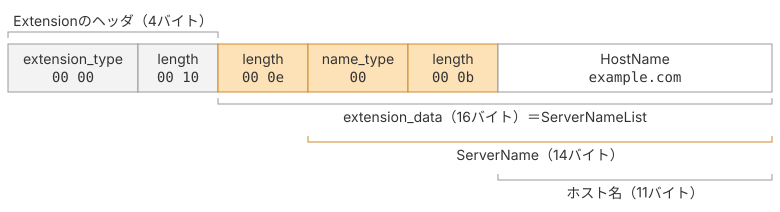

# Extension（拡張）を実装する

## 拡張とは

拡張は、ハンドシェイクメッセージに後から機能を足すための仕組みです。RFCで定義されたメッセージのフィールドはそのままに、新しい機能を追加できます。つまり、RFCを改定せずにTLSの機能を広げられます。TLS 1.3ではバージョンの交渉も鍵交換の材料の受け渡しも拡張で行うため、追加機能というより交渉の本体になっています。

拡張の種類もRFC 8446で固定されているわけではありません。RFC 8446（2018年8月）の登場以降も、表1のように拡張が追加され続けています。

| 拡張 | 番号 | 追加したRFC | 何をするもの |
|---|---|---|---|
| `compress_certificate` | 27 | [RFC 8879](https://datatracker.ietf.org/doc/html/rfc8879)（2020年12月） | 証明書チェーンを圧縮して送り、ハンドシェイクのバイト数を減らす |
| `quic_transport_parameters` | 57 | [RFC 9001](https://datatracker.ietf.org/doc/html/rfc9001)（2021年5月） | QUICのトランスポートパラメータをTLSハンドシェイクに載せて改ざんから守る |
| `delegated_credential` | 34 | [RFC 9345](https://datatracker.ietf.org/doc/html/rfc9345)（2023年7月） | 証明書の秘密鍵を渡さずに、短命な資格情報を配下のサーバーへ委譲する |
| `encrypted_client_hello` | `0xfe0d`（10進数で65037） | [RFC 9849](https://datatracker.ietf.org/doc/html/rfc9849)（2026年3月） | ClientHelloごと暗号化し、`server_name`が経路上から見えないようにする |

*RFC 8446の後に追加された拡張の例*

## 拡張のデータ構造

拡張の入れ物はRFCで次のように定義されています。

> A number of TLS messages contain tag-length-value encoded extensions structures.
>
> ```c
> struct {
>     ExtensionType extension_type;
>     opaque extension_data<0..2^16-1>;
> } Extension;
> ```
>
> 引用元: [RFC 9846 §4.3 Extensions](https://datatracker.ietf.org/doc/html/rfc9846#section-4.3)

種別と中身を持つだけの構造です。`extension_data<0..2^16-1>`はLengthを2バイトで前置する可変長データを表すので、バイト列にすると「種別2バイト + Length2バイト + 中身」になります。`Marshal`はその通りに組み立てます。

`extension_data`の中身の構造は、拡張ごとに別のRFCで決まっています。図1は、本ページで実装する`server_name`拡張を例に、ClientHelloに入る20バイトを並べたものです。先頭の4バイトはどの拡張でも同じ形で、`extension_data`の中に`server_name`拡張の構造が入ります。`extension_data`の中にも長さのフィールドがあり、長さで包む形が入れ子になっています。



*server_name拡張のバイト列*

## 実装

### 定数を足す

拡張の種別と、`signature_algorithms`で使う署名方式の番号を`common.go`に追加します。

::: code-group

```go [common.go]
// @see https://datatracker.ietf.org/doc/html/rfc9846#section-4.3
type extensionType uint16

const (
	extServerName          extensionType = 0
	extSupportedGroups     extensionType = 10
	extSignatureAlgorithms extensionType = 13
	extSupportedVersions   extensionType = 43
	extKeyShare            extensionType = 51
)

// @see https://datatracker.ietf.org/doc/html/rfc9846#section-4.3.3
type SignatureScheme uint16

const (
	RSA_PKCS1_SHA256       SignatureScheme = 0x0401
	ECDSA_SECP256R1_SHA256 SignatureScheme = 0x0403
	ECDSA_SECP384R1_SHA384 SignatureScheme = 0x0503
	RSA_PSS_RSAE_SHA256    SignatureScheme = 0x0804
	RSA_PSS_RSAE_SHA384    SignatureScheme = 0x0805
	RSA_PSS_RSAE_SHA512    SignatureScheme = 0x0806
)
```

:::

### 構造体を実装する

::: code-group

```go [extensions.go]
package tls13

type Extension struct {
	Type    extensionType
	Payload []byte
}

func (e Extension) Marshal() []byte {
	buf := appendUint16(nil, uint16(e.Type))
	return append(buf, withUint16Length(e.Payload)...)
}
```

:::

これで前のページのコンパイルエラーが解消されます。

残りは`extension_data`の中身を作る関数です。中身の構造は拡張ごとにRFCで別々に定義されています。
1つずつ拡張の役割と定義を見ながら書いていきます。

### supported_versions

`supported_versions`は、クライアントが対応するTLSのバージョンをサーバーに伝える拡張です。対応するバージョンを優先順位の高い順に並べます。

TLS 1.2までは、`legacy_version`に相当するフィールド（当時は`client_version`）に、クライアントが対応する最高バージョンを指定していました。サーバーは、提示されたバージョンと自分が対応するバージョンをもとに、通信に使用するバージョンを選択していました。

この方法には、サーバーが対応していない新しいバージョンを提示されると、接続を切断してしまう場合があるという問題がありました。本来であれば、双方が対応する古いバージョンを選択して通信を続けられますが、一部のサーバーは接続を切断してしまうのです。この問題はバージョン非寛容（version intolerance）と呼ばれ、TLS 1.1やTLS 1.2への移行時から問題となっていました。

そこでTLS 1.3では、`legacy_version`をTLS 1.2を表す`0x0303`に固定し、バージョン交渉を`supported_versions`拡張に移しました。TLS 1.3に対応していないサーバーでも、未知の拡張を無視することで、TLS 1.2以前のバージョンを選択できます。一方、TLS 1.3に対応するサーバーは、この拡張を確認してTLS 1.3を選択できます。

つまり、TLS 1.3のバージョン交渉は、`supported_versions`拡張によって行われます。この拡張がないClientHelloではTLS 1.3を交渉できず、`legacy_version`に`0x0304`を指定してもTLS 1.3としては扱われません。

> ```c
> struct {
>     select (Handshake.msg_type) {
>         case client_hello:
>              ProtocolVersion versions<2..254>;
>
>         case server_hello: /* and HelloRetryRequest */
>              ProtocolVersion selected_version;
>     };
> } SupportedVersions;
> ```
>
> 引用元: [RFC 9846 §4.3.1 Supported Versions](https://datatracker.ietf.org/doc/html/rfc9846#section-4.3.1)

ClientHelloに入れるときは`versions<2..254>`です。上限が254なので長さは1バイトに収まり、ここだけ`withUint8Length`を使います。ServerHelloでは長さのない`selected_version`が1つ返ってきますが、その読み取りはServerHelloのページで扱います。

::: code-group

```go [extensions.go]
func SupportedVersionsExtension() Extension {
	versions := appendUint16(nil, uint16(TLS_VERSION_1_3))
	return Extension{Type: extSupportedVersions, Payload: withUint8Length(versions)}
}
```

:::

### server_name

接続先のホスト名をサーバーに伝える拡張です。SNI（Server Name Indication）とも呼ばれます。

1つのIPアドレスで複数のWebサイトを提供している場合、サーバーはどのサイト宛の接続なのかを判断する必要があります。

HTTPには接続先のホスト名を伝える`Host`ヘッダがありますが、HTTPのリクエストが送られるのはTLSの接続が確立された後です。そのため、TLSのハンドシェイク中には`Host`ヘッダを利用できません。

そこで、`server_name`拡張を使い、TLSのハンドシェイクの段階で接続先のホスト名をサーバーに伝えます。

> ```c
> struct {
>     NameType name_type;
>     select (name_type) {
>         case host_name: HostName;
>     } name;
> } ServerName;
>
> enum {
>     host_name(0), (255)
> } NameType;
>
> opaque HostName<1..2^16-1>;
>
> struct {
>     ServerName server_name_list<1..2^16-1>
> } ServerNameList;
> ```
>
> 引用元: [RFC 6066 §3 Server Name Indication](https://datatracker.ietf.org/doc/html/rfc6066#section-3)

`ServerName`は「名前の種別1バイト + ホスト名」です。種別は`host_name(0)`しか定義されていないので0を直接書きます。それを`ServerNameList`として2バイトのLengthで包みます。

::: code-group

```go [extensions.go]
func ServerNameExtension(name string) Extension {
	entry := append([]byte{0}, withUint16Length([]byte(name))...)
	return Extension{Type: extServerName, Payload: withUint16Length(entry)}
}
```

:::

### signature_algorithms

`signature_algorithms`はクライアントが検証できるデジタル署名の方式を、サーバーに伝える拡張です。

署名や証明書の検証については第6章で説明します。ここでは、クライアントがデジタル署名の検証に利用できる署名方式を一覧にして送るもの、と考えてください。

構造は`supported_groups`と同様で、対応する署名方式を複数並べます。サーバーはこの情報をもとに、ハンドシェイクで使用する署名方式を選択します。

> ```c
> struct {
>     SignatureScheme supported_signature_algorithms<2..2^16-2>;
> } SignatureSchemeList;
> ```
>
> 引用元: [RFC 9846 §4.3.3 Signature Algorithms](https://datatracker.ietf.org/doc/html/rfc9846#section-4.3.3)

::: code-group

```go [extensions.go]
func SignatureAlgorithmsExtension() Extension {
	var algorithms []byte
	for _, a := range []SignatureScheme{
		ECDSA_SECP256R1_SHA256, ECDSA_SECP384R1_SHA384,
		RSA_PSS_RSAE_SHA256, RSA_PSS_RSAE_SHA384, RSA_PSS_RSAE_SHA512,
		RSA_PKCS1_SHA256,
	} {
		algorithms = appendUint16(algorithms, uint16(a))
	}
	return Extension{Type: extSignatureAlgorithms, Payload: withUint16Length(algorithms)}
}
```

:::

残る2つ、`supported_groups`と`key_share`は鍵交換の申告と公開鍵そのものです。どの曲線を選ぶのか、公開鍵が何なのかという話とセットになるので、次のページでまとめて実装します。

## 本ページで書いたコード

::: code-group

```[tree]
.
├── go.mod
├── common.go
├── record.go
├── handshake.go
├── bytes.go
├── client_hello.go
└── extensions.go
```

```go [common.go]
package tls13

// @see https://datatracker.ietf.org/doc/html/rfc9846#section-5.1
type ContentType uint8

const (
	ContentTypeChangeCipherSpec ContentType = 20
	ContentTypeAlert            ContentType = 21
	ContentTypeHandshake        ContentType = 22
	ContentTypeApplicationData  ContentType = 23
)

// @see https://datatracker.ietf.org/doc/html/rfc9846#section-4.2.2
type TLSVersion uint16

const (
	TLS_VERSION_1_2 TLSVersion = 0x0303
	TLS_VERSION_1_3 TLSVersion = 0x0304
)

// @see https://datatracker.ietf.org/doc/html/rfc9846#section-4
type HandshakeType uint8

const (
	TypeClientHello         HandshakeType = 1
	TypeServerHello         HandshakeType = 2
	TypeEncryptedExtensions HandshakeType = 8
	TypeCertificate         HandshakeType = 11
	TypeCertificateVerify   HandshakeType = 15
	TypeFinished            HandshakeType = 20
)

// @see https://datatracker.ietf.org/doc/html/rfc9846#appendix-B.4
type CipherSuite uint16

const TLS_AES_128_GCM_SHA256 CipherSuite = 0x1301

// @see https://datatracker.ietf.org/doc/html/rfc9846#section-4.3
type extensionType uint16

const (
	extServerName          extensionType = 0
	extSupportedGroups     extensionType = 10
	extSignatureAlgorithms extensionType = 13
	extSupportedVersions   extensionType = 43
	extKeyShare            extensionType = 51
)

// @see https://datatracker.ietf.org/doc/html/rfc9846#section-4.3.3
type SignatureScheme uint16

const (
	RSA_PKCS1_SHA256       SignatureScheme = 0x0401
	ECDSA_SECP256R1_SHA256 SignatureScheme = 0x0403
	ECDSA_SECP384R1_SHA384 SignatureScheme = 0x0503
	RSA_PSS_RSAE_SHA256    SignatureScheme = 0x0804
	RSA_PSS_RSAE_SHA384    SignatureScheme = 0x0805
	RSA_PSS_RSAE_SHA512    SignatureScheme = 0x0806
)

const maxPayloadLen = 1<<14 + 256
```

```go [extensions.go]
package tls13

type Extension struct {
	Type    extensionType
	Payload []byte
}

func (e Extension) Marshal() []byte {
	buf := appendUint16(nil, uint16(e.Type))
	return append(buf, withUint16Length(e.Payload)...)
}


func SupportedVersionsExtension() Extension {
	versions := appendUint16(nil, uint16(TLS_VERSION_1_3))
	return Extension{Type: extSupportedVersions, Payload: withUint8Length(versions)}
}

func ServerNameExtension(name string) Extension {
	entry := append([]byte{0}, withUint16Length([]byte(name))...)
	return Extension{Type: extServerName, Payload: withUint16Length(entry)}
}

func SignatureAlgorithmsExtension() Extension {
	var algorithms []byte
	for _, a := range []SignatureScheme{
		ECDSA_SECP256R1_SHA256, ECDSA_SECP384R1_SHA384,
		RSA_PSS_RSAE_SHA256, RSA_PSS_RSAE_SHA384, RSA_PSS_RSAE_SHA512,
		RSA_PKCS1_SHA256,
	} {
		algorithms = appendUint16(algorithms, uint16(a))
	}
	return Extension{Type: extSignatureAlgorithms, Payload: withUint16Length(algorithms)}
}
```

:::
