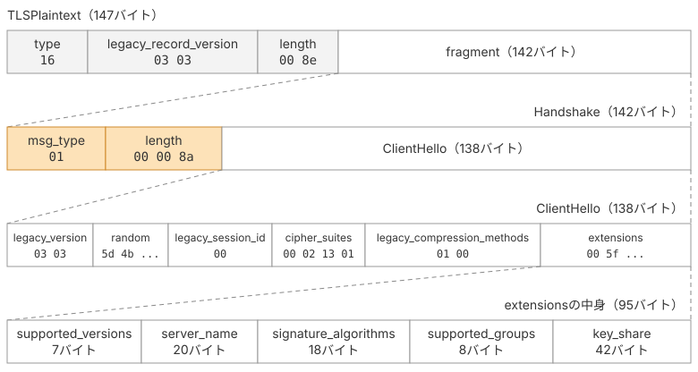

# ClientHelloを送る

前ページまでで、ClientHelloとその拡張、レコードとハンドシェイクの構造を実装しました。

本ページでは、これらを組み合わせて`cmd/main.go`を書き、実際にClientHelloをサーバーへ送信します。X25519の鍵ペアを生成し、ClientHelloを組み立ててTCPで送信したあと、サーバーから返ってきたバイト列を確認します。

## 実装

### ClientHelloを組み立てて包む

ClientHelloを送信するには、第2章で作ったHandshakeとTLSPlaintextの2つの枠で包む必要があります。

最終的に送信するレコードは、次の構造になります。

```text
TLSPlaintext（type=22, version, length）
└── Handshake（msg_type=1, length）
    └── ClientHello
```



::: code-group

```go [cmd/main.go]
package main

import (
	"bytes"
	"crypto/ecdh"
	"crypto/rand"
	"encoding/hex"
	"fmt"
	"io"
	"net"
	"time"

	"tls13"
)

const (
	serverName = "example.com"
	addr       = "example.com:443"
)

func main() {
	priv, err := ecdh.X25519().GenerateKey(rand.Reader)
	if err != nil {
		panic(err)
	}
	var random [32]byte
	rand.Read(random[:])

	ch := tls13.NewClientHello(random, []tls13.Extension{
		tls13.SupportedVersionsExtension(),
		tls13.ServerNameExtension(serverName),
		tls13.SignatureAlgorithmsExtension(),
		tls13.SupportedGroupsExtension(),
		tls13.KeyShareExtension(priv.PublicKey().Bytes()),
	})
	h := tls13.NewHandshake(tls13.TypeClientHello, ch.Marshal())
	rec := tls13.NewTLSPlaintext(tls13.ContentTypeHandshake, h.Marshal())
```

:::

まず、ClientHelloに必要なX25519の鍵ペアと32バイトの乱数を生成しています。

`NewClientHello`に渡すのは、乱数と拡張のリストです。拡張には、前ページまでに作った5つを指定しています。`priv.PublicKey().Bytes()`は32バイトのX25519公開鍵で、`key_share`拡張に格納します。

ClientHelloができたら、内側から順に包んでいきます。`ch.Marshal()`を`NewHandshake`に渡し、その結果をさらに`NewTLSPlaintext`で包むだけです。各フィールドの長さはコンストラクタが計算するため、ここで意識する必要はありません。

### TCPで送る

`net.Dial`でTCP接続を確立し、組み立てたレコードをバイト列に変換して送信します。

::: code-group

```go [cmd/main.go]
	conn, err := net.Dial("tcp", addr)
	if err != nil {
		panic(err)
	}
	defer conn.Close()

	out := rec.Marshal()
	fmt.Printf("--> send %d bytes\n%s\n", len(out), hex.Dump(out))
	if _, err := conn.Write(out); err != nil {
		panic(err)
	}
```

:::

送信する前に`hex.Dump`でバイト列を表示しています。これまで実装してきた各フィールドが、実際にどのようなバイト列になっているかを確認するためです。

### サーバーの応答を読む

続いて、サーバーから返ってきたレコードを読み取ります。

読み取りには、第2章で作った`ReadRecord`を使います。この関数は、先頭5バイトのヘッダを読み取り、`length`で指定された長さだけ本体を読み取ります。

::: code-group

```go [cmd/main.go]
	var raw bytes.Buffer
	r := io.TeeReader(conn, &raw)
	conn.SetReadDeadline(time.Now().Add(2 * time.Second))

	for i := 1; ; i++ {
		if _, err := tls13.ReadRecord(r); err != nil {
			break
		}
		fmt.Printf("<-- record %d: %d bytes\n%s\n", i, raw.Len(), hex.Dump(raw.Bytes()))
		raw.Reset()
	}
}
```

:::

サーバーからは複数のレコードが返ってくるため、ループで繰り返し読み取ります。

本来はハンドシェイクの進行状況に応じて読み取りを終えますが、今回は応答を確認するだけなので、2秒の読み取り期限を設け、エラーが発生したらループを抜けるようにしています。

また、受信したバイト列をそのまま確認できるように、`io.TeeReader`を使って`raw`にもコピーしています。今回はレコードの内容を解析しないため、`ReadRecord`の戻り値は`_`で捨てています。

ここはClientHelloを送信して応答を確認するための一時的な実装なので、細かい部分はあまり気にせず進めて構いません。

## 動かしてレスポンスを読む

実装できたら、実際に動かしてみましょう。

ClientHelloをサーバーが受け付けると、次のようにServerHelloを含むレコードが返ってきます。実装に誤りがある場合は、Alertが返されたり、接続が切断されたりすることがあります。

```sh
$ go run ./cmd
--> send 147 bytes
00000000  16 03 03 00 8e 01 00 00  8a 03 03 5d 4b 5a eb f0  |...........]KZ..|
00000010  e3 10 8f 70 86 25 40 85  92 d0 04 66 09 ee 4f ab  |...p.%@....f..O.|
00000020  a1 fe ea 47 59 6a 7c d0  c6 ba db 00 00 02 13 01  |...GYj|.........|
00000030  01 00 00 5f 00 2b 00 03  02 03 04 00 00 00 10 00  |..._.+..........|
00000040  0e 00 00 0b 65 78 61 6d  70 6c 65 2e 63 6f 6d 00  |....example.com.|
00000050  0d 00 0e 00 0c 04 03 05  03 08 04 08 05 08 06 04  |................|
00000060  01 00 0a 00 04 00 02 00  1d 00 33 00 26 00 24 00  |..........3.&.$.|
00000070  1d 00 20 34 5b 7b 85 f2  bb f7 47 0a 0a 95 d0 c9  |.. 4[{....G.....|
00000080  ba c3 41 ec 33 5b 4d 25  34 4b 62 13 34 8e 1a 67  |..A.3[M%4Kb.4..g|
00000090  26 e9 0b                                          |&..|

<-- record 1: 95 bytes
00000000  16 03 03 00 5a 02 00 00  56 03 03 d4 0e 06 94 67  |....Z...V......g|
00000010  66 5c ab 77 59 fe 76 d9  9b 54 54 11 fd e7 f1 e2  |f\.wY.v..TT.....|
00000020  ac 20 e1 0a 98 a0 25 10  7a 53 65 00 13 01 00 00  |. ....%.zSe.....|
00000030  2e 00 33 00 24 00 1d 00  20 20 b7 68 d3 6a 40 73  |..3.$...  .h.j@s|
00000040  a4 65 c0 e6 c1 71 93 ba  aa 0e eb 63 3e 23 9d 8e  |.e...q.....c>#..|
00000050  9c a2 7e 32 57 85 86 c8  15 00 2b 00 02 03 04     |..~2W.....+....|

<-- record 2: 6 bytes
00000000  14 03 03 00 01 01                                 |......|

<-- record 3: 3832 bytes
00000000  17 03 03 0e f3 fa 19 e4  48 ec c6 ac d4 ca 48 b6  |........H.....H.|
00000010  1f de 0b 77 0e 5c d6 8b  0e 4f 2d a5 65 46 c4 5f  |...w.\...O-.eF._|
00000020  68 8d ec bb 3a 63 03 54  a9 6b 06 dd 17 b0 95 fd  |h...:c.T.k......|
00000030  ea 64 ef 06 cd 73 ed c4  1c 2a c9 aa 90 e5 44 44  |.d...s...*....DD|
00000040  f2 af 9d 27 81 98 2d 3c  f4 6d 51 31 2b 54 47 eb  |...'..-<.mQ1+TG.|
00000050  22 32 e4 38 d0 58 be 15  fc d7 07 d4 72 0d 07 53  |"2.8.X......r..S|
                   （中略）
00000ef0  85 5c 99 5b 7d eb 3a 26                           |.\.[}.:&|
```

受信した3つのレコードを順番に見ていきましょう。先頭の1バイトがレコードの種別を表しています。

1つ目は`0x16`、handshakeです。中身はServerHelloです。次のページで、このメッセージの構造を詳しく見ていきます。

2つ目は`0x14`、change_cipher_specです。ヘッダを除くと、中身は`0x01`の1バイトだけです。これは、TLS 1.3の通信をTLS 1.2に似せ、古いネットワーク機器との互換性を保つために送られるダミーのレコードです。TLS 1.3では暗号化の切り替えに使われず、受信側は無視します（[RFC 9846 §E.4](https://datatracker.ietf.org/doc/html/rfc9846#appendix-E.4)）。

3つ目は`0x17`、application_dataです。ただし、中身はまだアプリケーションデータではありません。EncryptedExtensions、Certificate、CertificateVerify、Finishedなど、ServerHelloに続くハンドシェイクメッセージが暗号化されて入っています。

TLS 1.3では、暗号化されたレコードの外側の種別は`0x17`（application_data）になります。実際のメッセージの種別も暗号化されるため、外側のヘッダを見ただけでは、何が入っているのか分かりません。

現時点ではServerHelloを解析しておらず、サーバーの公開鍵も取り出していません。

次のページではServerHelloを読み取って共有秘密を計算します。そして、第4章で暗号鍵を導出し、第5章で暗号化されたレコードを復号します。

## 本ページで書いたコード

::: code-group

```[tree]
.
├── cmd/
│   └── main.go
├── go.mod
├── common.go
├── record.go
├── handshake.go
├── bytes.go
├── client_hello.go
└── extensions.go
```

```go [cmd/main.go]
package main

import (
	"bytes"
	"crypto/ecdh"
	"crypto/rand"
	"encoding/hex"
	"fmt"
	"io"
	"net"
	"time"

	"tls13"
)

const (
	serverName = "example.com"
	addr       = "example.com:443"
)

func main() {
	priv, err := ecdh.X25519().GenerateKey(rand.Reader)
	if err != nil {
		panic(err)
	}
	var random [32]byte
	rand.Read(random[:])

	ch := tls13.NewClientHello(random, []tls13.Extension{
		tls13.SupportedVersionsExtension(),
		tls13.ServerNameExtension(serverName),
		tls13.SignatureAlgorithmsExtension(),
		tls13.SupportedGroupsExtension(),
		tls13.KeyShareExtension(priv.PublicKey().Bytes()),
	})
	h := tls13.NewHandshake(tls13.TypeClientHello, ch.Marshal())
	rec := tls13.NewTLSPlaintext(tls13.ContentTypeHandshake, h.Marshal())

	conn, err := net.Dial("tcp", addr)
	if err != nil {
		panic(err)
	}
	defer conn.Close()

	out := rec.Marshal()
	fmt.Printf("--> send %d bytes\n%s\n", len(out), hex.Dump(out))
	if _, err := conn.Write(out); err != nil {
		panic(err)
	}

	var raw bytes.Buffer
	r := io.TeeReader(conn, &raw)
	conn.SetReadDeadline(time.Now().Add(2 * time.Second))

	for i := 1; ; i++ {
		if _, err := tls13.ReadRecord(r); err != nil {
			break
		}
		fmt.Printf("<-- record %d: %d bytes\n%s\n", i, raw.Len(), hex.Dump(raw.Bytes()))
		raw.Reset()
	}
}
```

:::
