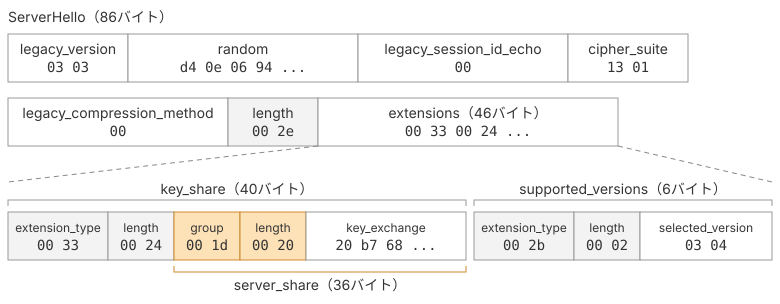

# ServerHelloと共有秘密

本ページでは、サーバーから受け取ったServerHelloをパースし、選択された暗号スイートや鍵交換方式を確認します。そして、サーバーの公開鍵とクライアントの秘密鍵を使って共有秘密を計算します。

## ServerHelloのデータ構造

ServerHelloは、RFCで次のように定義されています。

> ```c
> struct {
>     ProtocolVersion legacy_version = 0x0303;    /* TLS v1.2 */
>     Random random;
>     opaque legacy_session_id_echo<0..32>;
>     CipherSuite cipher_suite;
>     uint8 legacy_compression_method = 0;
>     Extension extensions<6..2^16-1>;
> } ServerHello;
> ```
>
> 引用元: [RFC 9846 §4.2.3 Server Hello](https://datatracker.ietf.org/doc/html/rfc9846#section-4.2.3)



フィールドの並びはClientHelloとほぼ同じですが、いくつか違いがあります。ClientHelloの`cipher_suites`には候補を複数並べましたが、ServerHelloの`cipher_suite`には、サーバーが選んだ暗号スイートが1つだけ入ります。また、`legacy_compression_methods`は`legacy_compression_method`となり、長さフィールドのない1バイト固定の値になります。

拡張にも違いがあります。`supported_versions`には選択されたTLSのバージョンが1つ、`key_share`にはサーバーの公開鍵が1つ入ります。

## 実装

### 読み取り用のヘルパを足す

読み取り側のヘルパを`bytes.go`に追加します。
バイト列から値の読み出しと、読み出し後の残りのバイト列を返す形にします。

::: code-group

```go [bytes.go]
func readUint8(b []byte) (value uint8, rest []byte, ok bool) {
	if len(b) < 1 {
		return 0, nil, false
	}
	return b[0], b[1:], true
}

func readUint16(b []byte) (value uint16, rest []byte, ok bool) {
	if len(b) < 2 {
		return 0, nil, false
	}
	return uint16(b[0])<<8 | uint16(b[1]), b[2:], true
}

func readBytes(b []byte, n int) (value []byte, rest []byte, ok bool) {
	if len(b) < n {
		return nil, nil, false
	}
	return b[:n], b[n:], true
}

func readUint8Prefixed(b []byte) (value []byte, rest []byte, ok bool) {
	n, rest, ok := readUint8(b)
	if !ok {
		return nil, nil, false
	}
	return readBytes(rest, int(n))
}

func readUint16Prefixed(b []byte) (value []byte, rest []byte, ok bool) {
	n, rest, ok := readUint16(b)
	if !ok {
		return nil, nil, false
	}
	return readBytes(rest, int(n))
}

func readUint24Prefixed(b []byte) (value []byte, rest []byte, ok bool) {
	if len(b) < 3 {
		return nil, nil, false
	}
	n := int(b[0])<<16 | int(b[1])<<8 | int(b[2])
	return readBytes(b[3:], n)
}
```

:::

### 構造体とパーサーを実装する

まず、`extensions.go`に拡張を読み取る`UnmarshalExtensions`を追加します。拡張は「2バイトの種別 + 2バイトの長さ + 中身」という形式なので、これを繰り返し読み取って`Extension`のスライスにする関数を作ります。

::: code-group

```go [extensions.go]
func UnmarshalExtensions(data []byte) ([]Extension, bool) {
	var exts []Extension
	rest := data
	for len(rest) > 0 {
		extType, r, ok := readUint16(rest)
		if !ok {
			return nil, false
		}
		payload, r, ok := readUint16Prefixed(r)
		if !ok {
			return nil, false
		}
		exts = append(exts, Extension{
			Type:    extensionType(extType),
			Payload: append([]byte{}, payload...),
		})
		rest = r
	}
	return exts, true
}
```

:::

`Payload`には、`append([]byte{}, payload...)`でコピーしたバイト列を格納します。元のバイト列が後から書き換えられても、取り出した拡張の内容が変わらないようにするためです。

次に、`server_hello.go`を作成します。`ServerHello`構造体は、RFCで定義されたフィールドに沿って用意します。パース処理では、先頭から順に値を読み取り、ヘルパが返した残りのバイト列を次の読み取りに渡していきます。

::: code-group

```go [server_hello.go]
package tls13

import "errors"

type ServerHello struct {
	ProtocolVersion   TLSVersion
	Random            [32]byte
	LegacySessionID   []byte
	CipherSuite       CipherSuite
	CompressionMethod uint8
	Extensions        []Extension
}

func UnmarshalServerHello(body []byte) (*ServerHello, error) {
	malformed := errors.New("tls13: malformed ServerHello")

	version, rest, ok := readUint16(body)
	if !ok {
		return nil, malformed
	}
	random, rest, ok := readBytes(rest, 32)
	if !ok {
		return nil, malformed
	}
	sessionID, rest, ok := readUint8Prefixed(rest)
	if !ok {
		return nil, malformed
	}
	suite, rest, ok := readUint16(rest)
	if !ok {
		return nil, malformed
	}
	compressionMethod, rest, ok := readUint8(rest)
	if !ok {
		return nil, malformed
	}
	extensions, rest, ok := readUint16Prefixed(rest)
	if !ok || len(rest) != 0 {
		return nil, malformed
	}

	exts, ok := UnmarshalExtensions(extensions)
	if !ok {
		return nil, errors.New("tls13: malformed ServerHello extensions")
	}

	sh := &ServerHello{
		ProtocolVersion:   TLSVersion(version),
		LegacySessionID:   append([]byte{}, sessionID...),
		CipherSuite:       CipherSuite(suite),
		CompressionMethod: compressionMethod,
		Extensions:        exts,
	}
	copy(sh.Random[:], random)
	return sh, nil
}
```

:::

`len(rest) != 0`では、拡張のバイト列を切り出したあとに余分なデータが残っていないかを確認しています。これにより、申告された長さと実際のデータの境界が合わない場合にエラーを返せます。

### 拡張から値を取り出す

拡張は共通の`Extension`型で保持しているため、必要な拡張を探して値を取り出すメソッドを用意します。今回は`supported_versions`と`key_share`の2つを読み取ります。

::: code-group

```go [server_hello.go]
func (sh *ServerHello) SelectedVersion() (version TLSVersion, found bool) {
	for _, ext := range sh.Extensions {
		if ext.Type == extSupportedVersions {
			if v, _, ok := readUint16(ext.Payload); ok {
				return TLSVersion(v), true
			}
		}
	}
	return 0, false
}

func (sh *ServerHello) KeyShare() (group NamedGroup, publicKey []byte, found bool) {
	for _, ext := range sh.Extensions {
		if ext.Type == extKeyShare {
			g, rest, ok := readUint16(ext.Payload)
			if !ok {
				continue
			}
			key, _, ok := readUint16Prefixed(rest)
			if !ok {
				continue
			}
			return NamedGroup(g), key, true
		}
	}
	return 0, nil, false
}
```

:::

## cmd/main.goを書き換える

前のページでは、`cmd/main.go`でClientHelloを送信し、受信したレコードをダンプするところまで実装しました。今回はその応答をServerHelloとして解析し、共有秘密を計算します。ClientHelloを送信するまでの処理はそのまま使い、受信処理を書き換えます。

### ServerHelloを受け取ってパースする

前のページで書いた、受信レコードを`hex.Dump`で表示するループを削除し、ServerHelloを読み取る処理に置き換えます。まず`ReadRecord`でレコードを1つ読み、`UnmarshalHandshake`でハンドシェイクメッセージを取り出します。メッセージの種別がServerHelloであることを確認してから、`UnmarshalServerHello`で本体をパースします。

::: code-group

```go [cmd/main.go]
	defer conn.Close()

	out := rec.Marshal() // [!code --]
	fmt.Printf("--> send %d bytes\n%s\n", len(out), hex.Dump(out)) // [!code --]
	if _, err := conn.Write(out); err != nil { // [!code --]
	if _, err := conn.Write(rec.Marshal()); err != nil { // [!code ++]
		panic(err)
	}

	var raw bytes.Buffer // [!code --]
	r := io.TeeReader(conn, &raw) // [!code --]
	conn.SetReadDeadline(time.Now().Add(2 * time.Second)) // [!code --]
	for i := 1; ; i++ { // [!code --]
		if _, err := tls13.ReadRecord(r); err != nil { // [!code --]
			break // [!code --]
		} // [!code --]
		fmt.Printf("<-- record %d: %d bytes\n%s\n", i, raw.Len(), hex.Dump(raw.Bytes())) // [!code --]
		raw.Reset() // [!code --]
	} // [!code --]
	res, err := tls13.ReadRecord(conn) // [!code ++]
	if err != nil { // [!code ++]
		panic(err) // [!code ++]
	} // [!code ++]
	msg, err := tls13.UnmarshalHandshake(res.Payload) // [!code ++]
	if err != nil { // [!code ++]
		panic(err) // [!code ++]
	} // [!code ++]
	if msg.HandshakeType != tls13.TypeServerHello { // [!code ++]
		panic("tls13: expected ServerHello") // [!code ++]
	} // [!code ++]
	sh, err := tls13.UnmarshalServerHello(msg.Body) // [!code ++]
	if err != nil { // [!code ++]
		panic(err) // [!code ++]
	} // [!code ++]
```

:::

### サーバーの選択を検証する

ServerHelloをパースできても、サーバーが選んだ値をそのまま使うわけにはいきません。暗号スイート、TLSのバージョン、鍵交換方式の3つが、クライアントの提示した条件に合っているかを確認します。

想定外の値が返ってきた場合は、処理を中断します。ここでは実装を簡単にするため`panic`を使いますが、実際のTLSでは適切なAlertを送信して接続を終了します。

::: code-group

```go [cmd/main.go]
	sh, err := tls13.UnmarshalServerHello(msg.Body)
	if err != nil {
		panic(err)
	}

	if sh.CipherSuite != tls13.TLS_AES_128_GCM_SHA256 { // [!code ++]
		panic("tls13: server selected an unsupported cipher suite") // [!code ++]
	} // [!code ++]
	version, ok := sh.SelectedVersion() // [!code ++]
	if !ok || version != tls13.TLS_VERSION_1_3 { // [!code ++]
		panic("tls13: server did not negotiate TLS 1.3") // [!code ++]
	} // [!code ++]
	group, keyExchange, ok := sh.KeyShare() // [!code ++]
	if !ok || group != tls13.X25519 { // [!code ++]
		panic("tls13: server did not send an X25519 key share") // [!code ++]
	} // [!code ++]

	fmt.Printf("cipher suite = %#04x\n", uint16(sh.CipherSuite)) // [!code ++]
	fmt.Printf("version      = %#04x\n", uint16(version)) // [!code ++]
	fmt.Printf("group        = %#04x\n", uint16(group)) // [!code ++]
	fmt.Printf("server key   = %x\n", keyExchange) // [!code ++]
```

:::

`key_share`の検証では、同時にサーバーの公開鍵`keyExchange`も受け取っています。

::: danger HelloRetryRequestについて

ServerHelloと同じ形で届くのにServerHelloではない、HelloRetryRequestというメッセージがあります。サーバーは、クライアントが提示した鍵交換方式を扱えないとき、HelloRetryRequestを返してClientHelloの送り直しを求めます。本書のクライアントはHelloRetryRequestに対応していません。HelloRetryRequestの仕組みは[RFC 9846 §4.2.4](https://datatracker.ietf.org/doc/html/rfc9846#section-4.2.4)に定められています。

:::

### 共有秘密を計算する

最後に、受け取った公開鍵をX25519の公開鍵に変換し、こちらの秘密鍵と掛け合わせます。`priv`はClientHelloを組み立てるときに生成した鍵ペアで、`ECDH`が32バイトの共有秘密を返します。

::: code-group

```go [cmd/main.go]
	fmt.Printf("server key   = %x\n", keyExchange)

	serverPub, err := ecdh.X25519().NewPublicKey(keyExchange) // [!code ++]
	if err != nil { // [!code ++]
		panic(err) // [!code ++]
	} // [!code ++]
	shared, err := priv.ECDH(serverPub) // [!code ++]
	if err != nil { // [!code ++]
		panic(err) // [!code ++]
	} // [!code ++]
	fmt.Printf("shared secret = %x\n", shared) // [!code ++]
}
```

:::

## 動かす

::: code-group

```sh [ターミナル]
$ go run ./cmd
cipher suite = 0x1301
version      = 0x0304
group        = 0x001d
server key   = a2ca19b41569c8f646b52126333e626e23b4039c110678d5590b54461b3b132f
shared secret = b74bae57936d2fb3860d5201aea180ce1f889bb51d221bee7362d6929fe9100b
```

:::

サーバーが選んだ3つの値を確認できました。`0x1301`は`TLS_AES_128_GCM_SHA256`、`0x0304`はTLS 1.3、`0x001d`はX25519を表しています。

最後に表示された32バイトが共有秘密です。この値自体はネットワーク上を流れません。交換したのは互いの公開鍵だけですが、それぞれの秘密鍵を持たない第三者が、公開鍵だけから共有秘密を計算することは困難です。

サーバーも、クライアントの公開鍵と自身の秘密鍵から同じ共有秘密を計算します。第4章では、この共有秘密を使って暗号鍵を導出します。

## 本ページで書いたコード

::: code-group

```[tree]
.
├── cmd/
│   └── main.go
├── go.mod
├── common.go
├── record.go
├── handshake.go
├── bytes.go
├── client_hello.go
├── extensions.go
└── server_hello.go
```

```go [server_hello.go]
package tls13

import "errors"

type ServerHello struct {
	ProtocolVersion   TLSVersion
	Random            [32]byte
	LegacySessionID   []byte
	CipherSuite       CipherSuite
	CompressionMethod uint8
	Extensions        []Extension
}

func UnmarshalServerHello(body []byte) (*ServerHello, error) {
	malformed := errors.New("tls13: malformed ServerHello")

	version, rest, ok := readUint16(body)
	if !ok {
		return nil, malformed
	}
	random, rest, ok := readBytes(rest, 32)
	if !ok {
		return nil, malformed
	}
	sessionID, rest, ok := readUint8Prefixed(rest)
	if !ok {
		return nil, malformed
	}
	suite, rest, ok := readUint16(rest)
	if !ok {
		return nil, malformed
	}
	compressionMethod, rest, ok := readUint8(rest)
	if !ok {
		return nil, malformed
	}
	extensions, rest, ok := readUint16Prefixed(rest)
	if !ok || len(rest) != 0 {
		return nil, malformed
	}

	exts, ok := UnmarshalExtensions(extensions)
	if !ok {
		return nil, errors.New("tls13: malformed ServerHello extensions")
	}

	sh := &ServerHello{
		ProtocolVersion:   TLSVersion(version),
		LegacySessionID:   append([]byte{}, sessionID...),
		CipherSuite:       CipherSuite(suite),
		CompressionMethod: compressionMethod,
		Extensions:        exts,
	}
	copy(sh.Random[:], random)
	return sh, nil
}

func (sh *ServerHello) SelectedVersion() (version TLSVersion, found bool) {
	for _, ext := range sh.Extensions {
		if ext.Type == extSupportedVersions {
			if v, _, ok := readUint16(ext.Payload); ok {
				return TLSVersion(v), true
			}
		}
	}
	return 0, false
}

func (sh *ServerHello) KeyShare() (group NamedGroup, publicKey []byte, found bool) {
	for _, ext := range sh.Extensions {
		if ext.Type == extKeyShare {
			g, rest, ok := readUint16(ext.Payload)
			if !ok {
				continue
			}
			key, _, ok := readUint16Prefixed(rest)
			if !ok {
				continue
			}
			return NamedGroup(g), key, true
		}
	}
	return 0, nil, false
}
```

```go [extensions.go]
package tls13

type Extension struct {
	Type    extensionType
	Payload []byte
}

func (e Extension) Marshal() []byte {
	buf := appendUint16(nil, uint16(e.Type))
	return append(buf, withUint16Length(e.Payload)...)
}

func UnmarshalExtensions(data []byte) ([]Extension, bool) {
	var exts []Extension
	rest := data
	for len(rest) > 0 {
		extType, r, ok := readUint16(rest)
		if !ok {
			return nil, false
		}
		payload, r, ok := readUint16Prefixed(r)
		if !ok {
			return nil, false
		}
		exts = append(exts, Extension{
			Type:    extensionType(extType),
			Payload: append([]byte{}, payload...),
		})
		rest = r
	}
	return exts, true
}

func SupportedVersionsExtension() Extension {
	versions := appendUint16(nil, uint16(TLS_VERSION_1_3))
	return Extension{Type: extSupportedVersions, Payload: withUint8Length(versions)}
}

func ServerNameExtension(name string) Extension {
	entry := append([]byte{0}, withUint16Length([]byte(name))...)
	return Extension{Type: extServerName, Payload: withUint16Length(entry)}
}

func SignatureAlgorithmsExtension() Extension {
	var algorithms []byte
	for _, a := range []SignatureScheme{
		ECDSA_SECP256R1_SHA256, ECDSA_SECP384R1_SHA384,
		RSA_PSS_RSAE_SHA256, RSA_PSS_RSAE_SHA384, RSA_PSS_RSAE_SHA512,
		RSA_PKCS1_SHA256,
	} {
		algorithms = appendUint16(algorithms, uint16(a))
	}
	return Extension{Type: extSignatureAlgorithms, Payload: withUint16Length(algorithms)}
}

func SupportedGroupsExtension() Extension {
	groups := appendUint16(nil, uint16(X25519))
	return Extension{Type: extSupportedGroups, Payload: withUint16Length(groups)}
}

func KeyShareExtension(publicKey []byte) Extension {
	entry := appendUint16(nil, uint16(X25519))
	entry = append(entry, withUint16Length(publicKey)...)
	return Extension{Type: extKeyShare, Payload: withUint16Length(entry)}
}
```

```go [bytes.go]
package tls13

func appendUint16(b []byte, v uint16) []byte {
	return append(b, byte(v>>8), byte(v))
}

func withUint8Length(body []byte) []byte {
	return append([]byte{byte(len(body))}, body...)
}

func withUint16Length(body []byte) []byte {
	return append([]byte{byte(len(body) >> 8), byte(len(body))}, body...)
}

func readUint8(b []byte) (value uint8, rest []byte, ok bool) {
	if len(b) < 1 {
		return 0, nil, false
	}
	return b[0], b[1:], true
}

func readUint16(b []byte) (value uint16, rest []byte, ok bool) {
	if len(b) < 2 {
		return 0, nil, false
	}
	return uint16(b[0])<<8 | uint16(b[1]), b[2:], true
}

func readBytes(b []byte, n int) (value []byte, rest []byte, ok bool) {
	if len(b) < n {
		return nil, nil, false
	}
	return b[:n], b[n:], true
}

func readUint8Prefixed(b []byte) (value []byte, rest []byte, ok bool) {
	n, rest, ok := readUint8(b)
	if !ok {
		return nil, nil, false
	}
	return readBytes(rest, int(n))
}

func readUint16Prefixed(b []byte) (value []byte, rest []byte, ok bool) {
	n, rest, ok := readUint16(b)
	if !ok {
		return nil, nil, false
	}
	return readBytes(rest, int(n))
}

func readUint24Prefixed(b []byte) (value []byte, rest []byte, ok bool) {
	if len(b) < 3 {
		return nil, nil, false
	}
	n := int(b[0])<<16 | int(b[1])<<8 | int(b[2])
	return readBytes(b[3:], n)
}
```

```go [cmd/main.go]
package main

import (
	"crypto/ecdh"
	"crypto/rand"
	"fmt"
	"net"

	"tls13"
)

const (
	serverName = "example.com"
	addr       = "example.com:443"
)

func main() {
	priv, err := ecdh.X25519().GenerateKey(rand.Reader)
	if err != nil {
		panic(err)
	}
	var random [32]byte
	rand.Read(random[:])

	ch := tls13.NewClientHello(random, []tls13.Extension{
		tls13.SupportedVersionsExtension(),
		tls13.ServerNameExtension(serverName),
		tls13.SignatureAlgorithmsExtension(),
		tls13.SupportedGroupsExtension(),
		tls13.KeyShareExtension(priv.PublicKey().Bytes()),
	})
	h := tls13.NewHandshake(tls13.TypeClientHello, ch.Marshal())
	rec := tls13.NewTLSPlaintext(tls13.ContentTypeHandshake, h.Marshal())

	conn, err := net.Dial("tcp", addr)
	if err != nil {
		panic(err)
	}
	defer conn.Close()

	if _, err := conn.Write(rec.Marshal()); err != nil {
		panic(err)
	}

	res, err := tls13.ReadRecord(conn)
	if err != nil {
		panic(err)
	}
	msg, err := tls13.UnmarshalHandshake(res.Payload)
	if err != nil {
		panic(err)
	}
	if msg.HandshakeType != tls13.TypeServerHello {
		panic("tls13: expected ServerHello")
	}
	sh, err := tls13.UnmarshalServerHello(msg.Body)
	if err != nil {
		panic(err)
	}

	if sh.CipherSuite != tls13.TLS_AES_128_GCM_SHA256 {
		panic("tls13: server selected an unsupported cipher suite")
	}
	version, ok := sh.SelectedVersion()
	if !ok || version != tls13.TLS_VERSION_1_3 {
		panic("tls13: server did not negotiate TLS 1.3")
	}
	group, keyExchange, ok := sh.KeyShare()
	if !ok || group != tls13.X25519 {
		panic("tls13: server did not send an X25519 key share")
	}

	fmt.Printf("cipher suite = %#04x\n", uint16(sh.CipherSuite))
	fmt.Printf("version      = %#04x\n", uint16(version))
	fmt.Printf("group        = %#04x\n", uint16(group))
	fmt.Printf("server key   = %x\n", keyExchange)

	serverPub, err := ecdh.X25519().NewPublicKey(keyExchange)
	if err != nil {
		panic(err)
	}
	shared, err := priv.ECDH(serverPub)
	if err != nil {
		panic(err)
	}
	fmt.Printf("shared secret = %x\n", shared)
}
```

:::
