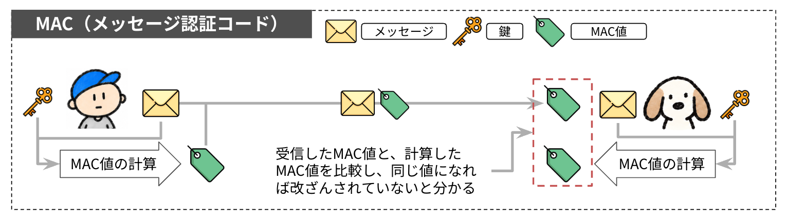
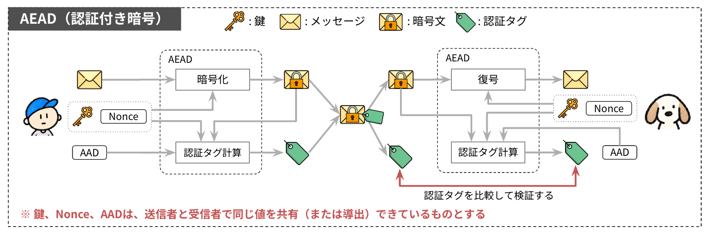

# 認証付き暗号

本ページでは、暗号文の改ざんを検知する仕組みと、TLS 1.3がレコードの保護に使う認証付き暗号（AEAD）を扱います。

## 改ざんの問題

暗号化によって、データの中身を第三者に読まれないようにできます。しかし、暗号化だけでは、データが途中で書き換えられていないことまでは保証できません。

たとえばストリーム暗号では、暗号文は平文と鍵ストリームのXORです。攻撃者が平文のある位置の値を知っていれば、暗号文の対応するビットを反転させることで、復号後の平文を狙った値に変えられます。攻撃者は鍵を知らなくてもこの書き換えができ、受信者は復号した平文を見ても書き換えに気付けません。

改ざんを検知するには、暗号化だけでなく、受信したデータが送信時のままであることを確かめる仕組みが必要です。送信者と受信者が共有する秘密鍵を使えば、第三者が正しく作ることの難しい検査用の値をデータに付けられます。

## メッセージ認証コード（MAC）

共有している鍵を使って、データに検査用の値を付ける仕組みが、MAC（Message Authentication Code：メッセージ認証コード）です。図1は、MACを使って改ざんを検知する流れです。



*MACによる改ざんの検知*

送信者は、メッセージと鍵からMAC値を計算し、メッセージに付けて送ります。受信者は、届いたメッセージと同じ鍵からMAC値を計算し直し、届いたMAC値と比べます。メッセージが書き換えられていれば、通常はMAC値が一致せず、改ざんを検知できます。攻撃者は鍵を知らないため、書き換えたメッセージに対する正しいMAC値を作ることは計算上困難です。

式で書くと、送信者は鍵$K$とメッセージ$M$からMAC値$T$を計算します。

$$
T = \mathrm{MAC}(K, M)
$$

<p class="math-note"><span>K：送信者と受信者が共有する鍵</span><span>M：メッセージ</span><span>T：MAC値</span></p>

受信者は、届いたメッセージ$M'$と鍵$K$からMAC値を計算し直し、届いたMAC値$T'$と一致するかを確かめます。

$$
\mathrm{MAC}(K, M') = T'
$$

<p class="math-note"><span>M'：受信者に届いたメッセージ</span><span>T'：受信者に届いたMAC値</span></p>

MACは特定のアルゴリズム名ではなく、鍵を使ってメッセージを認証する仕組みの総称です。表1は、標準化されている代表的なMACと、その利用シーンです。

| MAC | 定義している文書 | 利用シーン |
|---|---|---|
| HMAC | [RFC 2104](https://datatracker.ietf.org/doc/html/rfc2104) | TLS 1.2とTLS 1.3、SSH、IPsec、JWTの`HS256`、AWSのAPIリクエストの署名 |
| KMAC | [NIST SP 800-185](https://csrc.nist.gov/pubs/sp/800/185/final) | SHA-3を使うシステム向けに標準化されたが、利用例はまだ少ない |
| CMAC | [NIST SP 800-38B](https://csrc.nist.gov/pubs/sp/800/38/b/upd1/final)、[RFC 4493](https://datatracker.ietf.org/doc/html/rfc4493) | LTEや5Gの通信の完全性保護、Bluetooth Low Energyのペアリング、IPsec |
| GMAC | [NIST SP 800-38D](https://csrc.nist.gov/pubs/sp/800/38/d/final) | IPsecやMACsecで、暗号化せずに認証だけを行う設定 |
| Poly1305 | [RFC 8439 §2.5](https://datatracker.ietf.org/doc/html/rfc8439#section-2.5) | ChaCha20-Poly1305の一部として、TLS 1.2とTLS 1.3、SSH、WireGuard |

*標準化されている代表的なMAC*

### 単純なハッシュ値を使った検証は危険

ソフトウェアの配布では、配布元がファイルのハッシュ値をチェックサムとして公開し、利用者がダウンロードしたファイルのハッシュ値と比べて改ざんされていないか確かめることがあります。この方法で改ざんを検知するには、公開されたチェックサム自体が信頼できることが前提です。たとえば、攻撃者が配布ファイルを書き換えられても、信頼できる別の経路で入手したチェックサムは書き換えられない状況なら、両者の比較が役立ちます。

一方、保護されていない通信路で、メッセージと一緒にハッシュ値を送るだけでは改ざんを検知できません。攻撃者はメッセージを書き換えたうえで、書き換えたメッセージのハッシュ値を計算して付け直せるので、受信者は改ざんに気付けません。ハッシュ関数には鍵がなく、誰でも同じ値を計算できるからです。MACは送信者と受信者だけが知る鍵を入力に加えることで、攻撃者が正しいMAC値を作れないようにしています。

## 認証付き暗号（AEAD）

暗号化と改ざん検知を一体として行う仕組みが、AEAD（Authenticated Encryption with Associated Data：認証付き暗号）です。

AEADは暗号化に加えて認証タグを生成し、データが改ざんされていないことを検証します。認証タグは、MAC値に相当する役割を持ちます。図2は、AEADによる暗号化と検証の流れです。



*AEADによる暗号化と検証の流れ*

送信者は、鍵とnonceを使って平文を暗号化します。続けて送信者は、暗号文とAAD（Additional Authenticated Data：追加認証データ）から認証タグを計算し、暗号文に付けて送ります。受信者は、鍵とnonce、届いた暗号文、AADを使って認証タグを検証します。認証タグの計算に暗号文を使うか平文を使うかは、アルゴリズムによって異なります。AES-GCMとChaCha20-Poly1305は、図2のとおり暗号文から認証タグを計算します。

AEADの入出力は、[RFC 5116 §2](https://datatracker.ietf.org/doc/html/rfc5116#section-2)で定義されています。RFC 5116は、AEADの処理として認証付き暗号化と認証付き復号の2つを定義しています。認証付き暗号化の入力は、表2の4つです。AADは暗号化されず、認証タグの計算にだけ使われます。

| 入力 | 意味 |
|---|---|
| 鍵 | 送信者と受信者が共有する秘密の鍵 |
| nonce | 同じ鍵では二度と使わない値。秘密にしなくてよい |
| 平文 | 暗号化するデータ |
| AAD | 暗号化はしないが、改ざん検知の対象にするデータ。秘密にしなくてよい |

*AEADの認証付き暗号化の入力*

MACと同じく、AEADも特定のアルゴリズムの名前ではありません。AEADは、RFC 5116の入出力を持ち、暗号化と改ざん検知を同時に行うアルゴリズムの総称です。AES-GCMやChaCha20-Poly1305などのアルゴリズムが、AEADにあたります。

## TLS 1.3とAEAD

TLS 1.3では、暗号化と改ざん検知にAEADを使うことが必須です（[RFC 9846 §5.2](https://datatracker.ietf.org/doc/html/rfc9846#section-5.2)）。TLS 1.3で定義されている暗号スイートは、表3の5つです（[RFC 9846 §B.4](https://datatracker.ietf.org/doc/html/rfc9846#appendix-B.4)）。

| 暗号スイート | AEADのアルゴリズム | 暗号方式 | 認証（MAC） |
|---|---|---|---|
| `TLS_AES_128_GCM_SHA256` | AES-128-GCM | AES-128（CTRモード） | GHASH（GCM） |
| `TLS_AES_256_GCM_SHA384` | AES-256-GCM | AES-256（CTRモード） | GHASH（GCM） |
| `TLS_CHACHA20_POLY1305_SHA256` | ChaCha20-Poly1305 | ChaCha20 | Poly1305 |
| `TLS_AES_128_CCM_SHA256` | AES-128-CCM | AES-128（CTRモード） | CBC-MAC（CCM） |
| `TLS_AES_128_CCM_8_SHA256` | AES-128-CCM（認証タグ8バイト） | AES-128（CTRモード） | CBC-MAC（CCM） |

*TLS 1.3で定義されている暗号スイート*

[RFC 9846 §9.1](https://datatracker.ietf.org/doc/html/rfc9846#section-9.1)は、TLS 1.3に対応するアプリケーションに、`TLS_AES_128_GCM_SHA256`の実装を必須、`TLS_AES_256_GCM_SHA384`と`TLS_CHACHA20_POLY1305_SHA256`の実装を推奨しています。本書では`TLS_AES_128_GCM_SHA256`を利用できるようにします。

## 実装

鍵を受け取り、AES-GCMの`cipher.AEAD`を返す`newAESGCM`を`aead.go`に書きます。GoでAES-GCMを使うには、標準ライブラリの`crypto/aes`と`crypto/cipher`を組み合わせます。

1. `crypto/aes`の`aes.NewCipher`で、鍵からAESのブロック暗号を作る。
2. `crypto/cipher`の`cipher.NewGCM`で、AESのブロック暗号をGCMモードに包む。

`cipher.NewGCM`が返す`cipher.AEAD`は、認証付き暗号化と認証付き復号を行うインターフェースです。`cipher.AEAD`のメソッドの使い方は、[レコードの暗号化と復号](/05_aead/protection)で扱います。

::: code-group

```go [aead.go]
package tls13

import (
	"crypto/aes"
	"crypto/cipher"
)

func newAESGCM(key []byte) cipher.AEAD {
	block, err := aes.NewCipher(key)
	if err != nil {
		panic(err)
	}
	aead, err := cipher.NewGCM(block)
	if err != nil {
		panic(err)
	}
	return aead
}
```

:::

本書では、正しい長さの鍵を内部で生成して渡すため、`aes.NewCipher`と`cipher.NewGCM`のエラーは`panic`で扱います。一般の入力を受け取る実装では、エラーを呼び出し元に返す設計も必要です。

## 本ページで書いたコード

::: code-group

```[tree]
.
├── cmd/
│   └── main.go
├── go.mod
├── aead.go
├── bytes.go
├── client_hello.go
├── common.go
├── extensions.go
├── handshake.go
├── key_schedule.go
├── record.go
└── server_hello.go
```

```go [aead.go]
package tls13

import (
	"crypto/aes"
	"crypto/cipher"
)

func newAESGCM(key []byte) cipher.AEAD {
	block, err := aes.NewCipher(key)
	if err != nil {
		panic(err)
	}
	aead, err := cipher.NewGCM(block)
	if err != nil {
		panic(err)
	}
	return aead
}
```

:::
