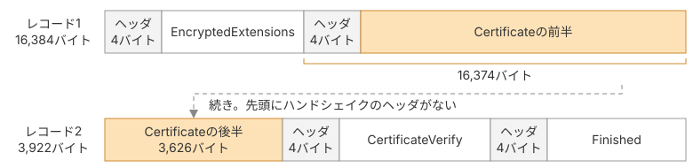
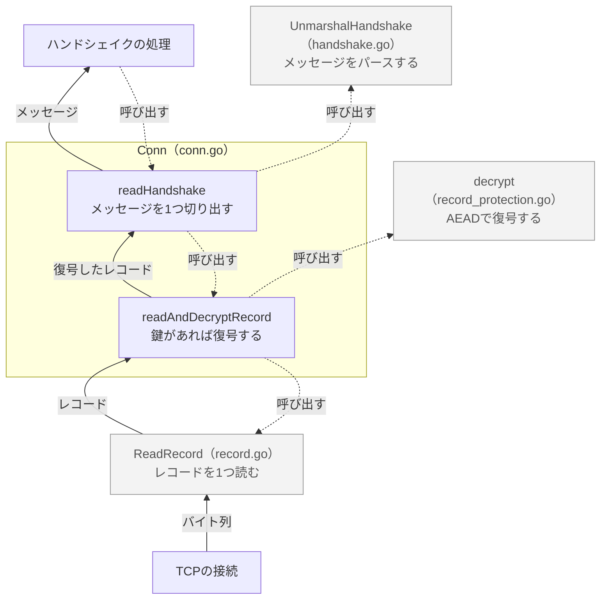

# 暗号化されたレコードからメッセージを取り出す

ServerHelloのあと、サーバーはEncryptedExtensions、Certificate、CertificateVerify、Finishedの4つのハンドシェイクメッセージを、暗号化されたレコードに入れて送ってきます。本ページでは、クライアントが暗号化されたレコードを読んで復号し、中からハンドシェイクメッセージを1つずつ取り出す処理を`conn.go`に書きます。

## 暗号化されたレコードとハンドシェイクメッセージ

クライアントは、サーバーから届くハンドシェイクメッセージを1つずつ受け取り、中身を確認しながらハンドシェイクを進めます。ただし、通信路を流れるデータは、暗号化されたレコードに入っています。そのため、レコードを読み取って復号し、ハンドシェイクメッセージを取り出す処理が必要です。

復号したレコードからメッセージを取り出すうえで問題になるのは、レコードの切れ目とハンドシェイクメッセージの切れ目が一致しないことです。[RFC 9846 §5.1](https://datatracker.ietf.org/doc/html/rfc9846#section-5.1)は、1つのレコードに複数のメッセージを入れることも、1つのメッセージを複数のレコードに分けることも認めています。

### レコードの大きさの上限

[RFC 9846 §5.1](https://datatracker.ietf.org/doc/html/rfc9846#section-5.1)は、レコード1つに入れられる平文の長さを、2<sup>14</sup>バイト（16,384バイト）までと定めています。一方、ハンドシェイクメッセージの本体の長さはヘッダの3バイトで表すので、最大で2<sup>24</sup> − 1バイト（16,777,215バイト）まで書けます。サーバーの証明書と中間証明書を並べて送るCertificateは、16,384バイトを超えることがあります。そのときサーバーは、Certificateを2つ以上のレコードに分けて送ります。図1は、20,000バイトのCertificateを2つのレコードに分けて送る例です。色を付けた2つの箱が、1つのCertificateです。



*Certificateが2つのレコードにまたがる例*

レコード2の先頭にはハンドシェイクメッセージのヘッダがなく、Certificateの途中から始まります。暗号化と認証タグの検証はレコード単位で行うため、クライアントは完全なレコードを読み取ってから復号します。一方、復号したレコードの中には、ハンドシェイクメッセージの一部分だけが入っている場合があります。

## 実装

### 作るものの全体像

レコードを読む`ReadRecord`、復号する`decrypt`、ハンドシェイクメッセージをパースする`UnmarshalHandshake`は、すでに実装しています。本ページでは、これらを組み合わせて受信処理を2段に分けます。`readAndDecryptRecord`はレコードを1つ読み取って復号し、`readHandshake`は復号したデータをバッファに溜め、ハンドシェイクメッセージを1つずつ切り出します。どちらもTCPの接続や受信状態を扱うため、`Conn`構造体のメソッドにします。

図2は、本ページで作るメソッドと、すでにある関数の関係を示したものです。枠で囲んだ2つが本ページで作る`Conn`のメソッドで、灰色の3つがすでにある関数です。実線の矢印はデータが渡る向きを、点線の矢印はどのメソッドがどの関数を呼び出すかを表します。



*受信したバイト列がハンドシェイクメッセージになるまで*

### 接続を表す構造体

`conn.go`を作り、TLSの接続を表す`Conn`構造体を定義します。

::: code-group

```go [conn.go]
type Conn struct {
	conn         net.Conn
	in           *recordProtection
	handshakeBuf []byte
}
```

:::

`conn`フィールドにはTCPの接続を、`handshakeBuf`フィールドにはまだ切り出していないハンドシェイクメッセージのバイト列を保持します。

`in`フィールドには、サーバーから届いたレコードの復号に使う`recordProtection`を入れます。`recordProtection`は、サーバーが送るレコード用の鍵とiv、シーケンス番号を持ち、`decrypt`メソッドでレコードを1つ復号します。ただし、鍵のもとになる`server_handshake_traffic_secret`は、ServerHelloを受け取るまで導き出せません。そのため、`Conn`は`in`フィールドが`nil`の状態で作ります。ハンドシェイクの処理は、`server_handshake_traffic_secret`を導き出したところで、`newRecordProtection`で作った`recordProtection`を`in`フィールドに入れます。つまり、`in`フィールドが`nil`かどうかで、レコードを復号する段階に進んだかを判別できます。

### レコードを1つ読んで復号する

`readAndDecryptRecord`は、レコードを1つ読み、鍵があれば復号して`TLSPlaintext`として返します。

::: code-group

```go [conn.go]
func (c *Conn) readAndDecryptRecord() (rec *TLSPlaintext, err error) {
	for {
		rec, err = ReadRecord(c.conn)
		if err != nil {
			return nil, err
		}
		if rec.Type != ContentTypeChangeCipherSpec {
			break
		}
	}
	if c.in == nil {
		return rec, nil
	}
	if rec.Type != ContentTypeApplicationData {
		return nil, fmt.Errorf("tls13: unexpected plaintext record type %d", rec.Type)
	}
	inner, err := c.in.decrypt(rec)
	if err != nil {
		return nil, err
	}
	return NewTLSPlaintext(inner.contentType, inner.content), nil
}
```

:::

本書では、古い中継機器との互換性のために送られるchange_cipher_specレコードを読み飛ばします。`in`フィールドが`nil`のときは、鍵がまだないので、読んだレコードをそのまま返します。鍵があるときは`decrypt`で復号し、TLSInnerPlaintextに入っていた本当の種別と中身から`TLSPlaintext`を作り直します。鍵があるのに平文のレコードが届いたときは、エラーにします。

### ハンドシェイクメッセージを切り出す

`readHandshake`は、ハンドシェイクメッセージを1つ取り出し、パースした`Handshake`と、transcriptに積むためのバイト列`raw`を返します。

::: code-group

```go [conn.go]
func (c *Conn) readHandshake() (msg *Handshake, raw []byte, err error) {
	for !hasCompleteHandshake(c.handshakeBuf) {
		rec, err := c.readAndDecryptRecord()
		if err != nil {
			return nil, nil, err
		}
		switch rec.Type {
		case ContentTypeHandshake:
			c.handshakeBuf = append(c.handshakeBuf, rec.Payload...)
		case ContentTypeAlert:
			return nil, nil, fmt.Errorf("tls13: received alert record: % x", rec.Payload)
		default:
			return nil, nil, fmt.Errorf("tls13: unexpected record type %d during handshake", rec.Type)
		}
	}
	n := 4 + handshakeBodyLen(c.handshakeBuf)
	raw = c.handshakeBuf[:n]
	c.handshakeBuf = c.handshakeBuf[n:]
	msg, err = UnmarshalHandshake(raw)
	if err != nil {
		return nil, nil, err
	}
	return msg, raw, nil
}

func hasCompleteHandshake(buf []byte) (ok bool) {
	return len(buf) >= 4 && len(buf) >= 4+handshakeBodyLen(buf)
}

func handshakeBodyLen(buf []byte) (bodyLen int) {
	return int(buf[1])<<16 | int(buf[2])<<8 | int(buf[3])
}
```

:::

ハンドシェイクメッセージのヘッダは、1バイトの種別と3バイトの本体の長さから成る4バイトです。`hasCompleteHandshake`は、ヘッダが示す本体の長さを使って、バッファの先頭にメッセージ全体がそろっているかを確かめます。`readHandshake`は、次の順に処理します。

1. `hasCompleteHandshake`で、`handshakeBuf`にメッセージ全体がそろっているかを確かめます。そろっていれば4に進みます
2. `readAndDecryptRecord`でレコードを1つ読み、必要に応じて復号します。種別がhandshake以外ならエラーを返します
3. レコードの中身を`handshakeBuf`の末尾に追加し、1に戻ります
4. `handshakeBuf`の先頭から`n`バイトを`raw`として切り出し、その部分をバッファから除きます
5. `UnmarshalHandshake`で`raw`をパースし、`msg`と`raw`を返します

## 本ページで書いたコード

::: code-group

```[tree]
.
├── cmd/
│   └── main.go
├── go.mod
├── aead.go
├── bytes.go
├── client_hello.go
├── common.go
├── conn.go
├── extensions.go
├── handshake.go
├── key_schedule.go
├── record.go
├── record_protection.go
└── server_hello.go
```

```go [conn.go]
package tls13

import (
	"fmt"
	"net"
)

type Conn struct {
	conn         net.Conn
	in           *recordProtection
	handshakeBuf []byte
}

func (c *Conn) readAndDecryptRecord() (rec *TLSPlaintext, err error) {
	for {
		rec, err = ReadRecord(c.conn)
		if err != nil {
			return nil, err
		}
		if rec.Type != ContentTypeChangeCipherSpec {
			break
		}
	}
	if c.in == nil {
		return rec, nil
	}
	if rec.Type != ContentTypeApplicationData {
		return nil, fmt.Errorf("tls13: unexpected plaintext record type %d", rec.Type)
	}
	inner, err := c.in.decrypt(rec)
	if err != nil {
		return nil, err
	}
	return NewTLSPlaintext(inner.contentType, inner.content), nil
}

func (c *Conn) readHandshake() (msg *Handshake, raw []byte, err error) {
	for !hasCompleteHandshake(c.handshakeBuf) {
		rec, err := c.readAndDecryptRecord()
		if err != nil {
			return nil, nil, err
		}
		switch rec.Type {
		case ContentTypeHandshake:
			c.handshakeBuf = append(c.handshakeBuf, rec.Payload...)
		case ContentTypeAlert:
			return nil, nil, fmt.Errorf("tls13: received alert record: % x", rec.Payload)
		default:
			return nil, nil, fmt.Errorf("tls13: unexpected record type %d during handshake", rec.Type)
		}
	}
	n := 4 + handshakeBodyLen(c.handshakeBuf)
	raw = c.handshakeBuf[:n]
	c.handshakeBuf = c.handshakeBuf[n:]
	msg, err = UnmarshalHandshake(raw)
	if err != nil {
		return nil, nil, err
	}
	return msg, raw, nil
}

func hasCompleteHandshake(buf []byte) (ok bool) {
	return len(buf) >= 4 && len(buf) >= 4+handshakeBodyLen(buf)
}

func handshakeBodyLen(buf []byte) (bodyLen int) {
	return int(buf[1])<<16 | int(buf[2])<<8 | int(buf[3])
}
```

:::
