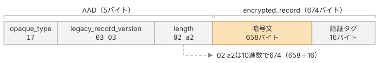

# レコードの暗号化と復号

本ページでは、TLS 1.3がAEADに渡す値を組み立て、レコードを暗号化・復号する処理を`record_protection.go`に実装します。

## TLS 1.3でAEADに入れる値

AEADに渡す値の具体的な決め方は、利用するプロトコルによって異なります。TLS 1.3でAES-128-GCMを使う場合は、表1のとおりです。

| 入力 | 一般的な意味 | TLS 1.3で入れる値 |
|---|---|---|
| 鍵 | 送信者と受信者が共有する秘密の鍵 | traffic secretから導き出す16バイトの`[sender]_write_key` |
| nonce | 同じ鍵では二度と使わない、使い捨ての値 | traffic secretから導き出す12バイトの`[sender]_write_iv`と、シーケンス番号のXOR |
| 平文 | 暗号化するデータ | TLSInnerPlaintext |
| AAD | 暗号化はしないが、改ざん検知の対象にするデータ | TLSCiphertextのヘッダ5バイト |

*TLS 1.3でAEADに入れる値*

`[sender]`には、レコードを送る側に応じて`client`か`server`が入ります。

`newAESGCM`が返す`cipher.AEAD`には、認証付き暗号化を行う`Seal`と、認証付き復号を行う`Open`があります。

```go
ciphertext := aead.Seal(dst, nonce, plaintext, additionalData)
plaintext, err := aead.Open(dst, nonce, ciphertext, additionalData)
```

鍵は`Seal`と`Open`の引数にはありません。`aes.NewCipher`に渡した鍵を、`cipher.AEAD`が中に持っているからです。

`dst`は結果の書き込み先で、`nil`を渡すと`Seal`と`Open`が新しいスライスを作って返します。

本ページでは、表1の鍵とiv、nonce、AADを順に作り、最後に`Seal`と`Open`を呼びます。

## 鍵とiv

本書で使うtraffic secretは32バイトですが、AES-128-GCMでは16バイトの鍵と12バイトのivが必要です。そのため、traffic secretをそのまま鍵にはせず、HKDF-Expand-Labelで`[sender]_write_key`と`[sender]_write_iv`を導き出します。

> ```c
> [sender]_write_key = HKDF-Expand-Label(Secret, "key", "", key_length)
> [sender]_write_iv  = HKDF-Expand-Label(Secret, "iv", "", iv_length)
> ```
>
> 引用元: [RFC 9846 §7.3 Traffic Key Calculation](https://datatracker.ietf.org/doc/html/rfc9846#section-7.3)

### 実装

`trafficKeys`関数を実装し、traffic secretから鍵とivをまとめて取り出します。contextは空なので、`hkdfExpandLabel`に`nil`を渡します。

::: code-group

```go [key_schedule.go]
func trafficKeys(secret []byte) (key, iv []byte) {
	key = hkdfExpandLabel(secret, "key", nil, 16)
	iv = hkdfExpandLabel(secret, "iv", nil, 12)
	return key, iv
}
```

:::

## nonce

nonce（number used once）は、暗号化で鍵と組み合わせて使う値です。同じ鍵で複数のデータを暗号化するときも、nonceを変えることで異なる暗号化結果を生成できます。

AEADでは、同じ鍵とnonceの組を再利用してはいけません。そのため、TLSではレコードごとに異なるnonceを用意する必要があります。一方で、送信者と受信者がそれぞれ同じnonceを生成できなければ、受信者はレコードを復号できません。

そこでTLS 1.3では、レコードごとのシーケンス番号を使ってnonceを生成します。送信者と受信者は、暗号化されたレコードのシーケンス番号をそれぞれ内部で管理し、レコードを処理するたびに1ずつ増やします。TLSはTCPの順序どおりに届くバイト列からレコードを取り出すため、正常な通信では送信側と受信側のシーケンス番号が一致します。
このため、nonceそのものを送らなくても、両者で同じnonceを計算できます。

TLS 1.3では、traffic secretから導出した固定のivとシーケンス番号を組み合わせて、レコードごとのnonceを生成します。具体的な生成方法は、[RFC 9846 §5.3](https://datatracker.ietf.org/doc/html/rfc9846#section-5.3)で定義されています。簡単に説明すると、次の2ステップです。

1. 8バイトのシーケンス番号の左に4バイトのゼロを加え、ivと同じ12バイトにします
2. 12バイトにしたシーケンス番号とivのXORを計算します

$$
\mathit{nonce} = \mathit{iv} \oplus (\texttt{00000000} \parallel \mathit{seq})
$$

<p class="math-note"><span>iv：12バイトの固定値</span><span>seq：8バイトのシーケンス番号</span><span>00000000：左を埋める4バイトのゼロ</span></p>

### 実装

nonceを作るには、レコードを処理するたびに変わるシーケンス番号を、レコードをまたいで覚えておく必要があります。そこで、1方向分のレコードの保護に使う値を、`recordProtection`という構造体にまとめて持たせます。`recordProtection`が持つのは、鍵を中に持つ`cipher.AEAD`、iv、シーケンス番号の3つです。

鍵、iv、シーケンス番号は送信方向と受信方向で別々に管理します。本書では、送信用と受信用で`recordProtection`を1つずつ作り、それぞれが自分のシーケンス番号を数えます。

`newRecordProtection`は、traffic secretから鍵とivを取り出し、`recordProtection`を作ります。シーケンス番号は0から始まるので、`seq`はGoのゼロ値のままにします。

::: code-group

```go [record_protection.go]
type recordProtection struct {
	aead cipher.AEAD
	iv   []byte
	seq  uint64
}

func newRecordProtection(trafficSecret []byte) *recordProtection {
	key, iv := trafficKeys(trafficSecret)
	return &recordProtection{aead: newAESGCM(key), iv: iv}
}
```

:::

ivとシーケンス番号からnonceを作る`nextNonce`メソッドを用意します。`nextNonce`は、ivをコピーした12バイトの末尾8バイトにシーケンス番号をXORしてnonceを作り、シーケンス番号を1つ進めます。

::: code-group

```go [record_protection.go]
func (p *recordProtection) nextNonce() []byte {
	nonce := make([]byte, len(p.iv))
	copy(nonce, p.iv)
	tail := nonce[len(nonce)-8:]
	binary.BigEndian.PutUint64(tail, binary.BigEndian.Uint64(tail)^p.seq)
	p.seq++
	return nonce
}
```

:::

## AAD

TLS 1.3では、TLSCiphertextのヘッダ5バイトをAADにします。

> ```c
> additional_data = TLSCiphertext.opaque_type ||
>                   TLSCiphertext.legacy_record_version ||
>                   TLSCiphertext.length
> ```
>
> 引用元: [RFC 9846 §5.2 Record Payload Protection](https://datatracker.ietf.org/doc/html/rfc9846#section-5.2)



ヘッダをAADにするのは、暗号化せずに送る必要がある一方で、改ざんを検知したいデータだからです。

受信者は、復号する前にヘッダの`length`を読み、TCPで届いたバイト列のどこまでが1つのレコードかを知る必要があります。そのため、送信者はヘッダを暗号化できません。一方で、平文のヘッダは、経路上の攻撃者に書き換えられるおそれがあります。ヘッダをAADに入れておけば、ヘッダが書き換えられたとき、受信者は認証タグの検証が失敗することで改ざんに気づけます。

### 実装

`additionalData`関数は、レコードの種別、バージョン、長さから5バイトのヘッダを組み立て、AADとして返します。送信時の種別は`0x17`、バージョンは`0x0303`です。受信時は、届いたヘッダの値をそのまま渡します。受信した値を固定値で置き換えると、ヘッダが改ざんされても認証タグの検証に反映されません。

::: code-group

```go [record_protection.go]
func additionalData(contentType ContentType, version TLSVersion, length int) []byte {
	return []byte{
		byte(contentType),
		byte(version >> 8), byte(version & 0xff),
		byte(length >> 8), byte(length),
	}
}
```

:::

## 復号と暗号化を実装する

`Open`を使う`decrypt`と、`Seal`を使う`encrypt`を実装します。`decrypt`はヘッダと暗号文を含む`TLSPlaintext`を受け取り、復号した`tlsInnerPlaintext`を返します。`encrypt`はデータの種別と中身を受け取り、暗号文と認証タグを返します。

::: code-group

```go [record_protection.go]
func (p *recordProtection) decrypt(rec *TLSPlaintext) (*tlsInnerPlaintext, error) {
	innerBytes, err := p.aead.Open(nil, p.nextNonce(), rec.Payload, additionalData(rec.Type, rec.Version, int(rec.Length)))
	if err != nil {
		return nil, err
	}
	return parseTLSInnerPlaintext(innerBytes)
}

func (p *recordProtection) encrypt(contentType ContentType, plaintext []byte) (encryptedRecord []byte) {
	inner := &tlsInnerPlaintext{content: plaintext, contentType: contentType}
	innerBytes := inner.marshal()
	ciphertextLen := len(innerBytes) + p.aead.Overhead()
	return p.aead.Seal(nil, p.nextNonce(), innerBytes, additionalData(ContentTypeApplicationData, TLS_VERSION_1_2, ciphertextLen))
}
```

:::

AADの`length`は、暗号文と認証タグを合わせた長さです。`decrypt`は受信レコードの`Length`を使い、`encrypt`はTLSInnerPlaintextの長さに認証タグの長さ（`Overhead()`、AES-GCMでは16バイト）を足します。`Open`は認証タグの検証に失敗すると、平文を返さずにエラーを返します。

## 本ページで書いたコード

::: code-group

```[tree]
.
├── cmd/
│   └── main.go
├── go.mod
├── aead.go
├── bytes.go
├── client_hello.go
├── common.go
├── extensions.go
├── handshake.go
├── key_schedule.go
├── record.go
├── record_protection.go
└── server_hello.go
```

```go [record_protection.go]
package tls13

import (
	"crypto/cipher"
	"encoding/binary"
)

type recordProtection struct {
	aead cipher.AEAD
	iv   []byte
	seq  uint64
}

func newRecordProtection(trafficSecret []byte) *recordProtection {
	key, iv := trafficKeys(trafficSecret)
	return &recordProtection{aead: newAESGCM(key), iv: iv}
}

func (p *recordProtection) nextNonce() []byte {
	nonce := make([]byte, len(p.iv))
	copy(nonce, p.iv)
	tail := nonce[len(nonce)-8:]
	binary.BigEndian.PutUint64(tail, binary.BigEndian.Uint64(tail)^p.seq)
	p.seq++
	return nonce
}

func additionalData(contentType ContentType, version TLSVersion, length int) []byte {
	return []byte{
		byte(contentType),
		byte(version >> 8), byte(version & 0xff),
		byte(length >> 8), byte(length),
	}
}

func (p *recordProtection) decrypt(rec *TLSPlaintext) (*tlsInnerPlaintext, error) {
	innerBytes, err := p.aead.Open(nil, p.nextNonce(), rec.Payload, additionalData(rec.Type, rec.Version, int(rec.Length)))
	if err != nil {
		return nil, err
	}
	return parseTLSInnerPlaintext(innerBytes)
}

func (p *recordProtection) encrypt(contentType ContentType, plaintext []byte) (encryptedRecord []byte) {
	inner := &tlsInnerPlaintext{content: plaintext, contentType: contentType}
	innerBytes := inner.marshal()
	ciphertextLen := len(innerBytes) + p.aead.Overhead()
	return p.aead.Seal(nil, p.nextNonce(), innerBytes, additionalData(ContentTypeApplicationData, TLS_VERSION_1_2, ciphertextLen))
}
```

```go [key_schedule.go]
package tls13

import (
	"crypto/hkdf"
	"crypto/sha256"
	"hash"
)

type transcript struct {
	h hash.Hash
}

func newTranscript() *transcript {
	return &transcript{h: sha256.New()}
}

func (t *transcript) write(msg []byte) {
	t.h.Write(msg)
}

func (t *transcript) sum() []byte {
	return t.h.Sum(nil)
}

func hkdfExtract(salt, ikm []byte) []byte {
	secret, err := hkdf.Extract(sha256.New, ikm, salt)
	if err != nil {
		panic(err)
	}
	return secret
}

func deriveSecret(secret []byte, label string, transcriptHash []byte) []byte {
	return hkdfExpandLabel(secret, label, transcriptHash, sha256.Size)
}

func deriveEarlySecret() []byte {
	zeros := make([]byte, sha256.Size)
	return hkdfExtract(zeros, zeros)
}

func deriveHandshakeSecret(sharedSecret []byte) []byte {
	emptyHash := sha256.Sum256(nil)
	salt := deriveSecret(deriveEarlySecret(), "derived", emptyHash[:])
	return hkdfExtract(salt, sharedSecret)
}

func deriveMainSecret(handshakeSecret []byte) []byte {
	emptyHash := sha256.Sum256(nil)
	salt := deriveSecret(handshakeSecret, "derived", emptyHash[:])
	return hkdfExtract(salt, make([]byte, sha256.Size))
}

type hkdfLabel struct {
	length  uint16
	label   string
	context []byte
}

func newHkdfLabel(label string, context []byte, length int) *hkdfLabel {
	return &hkdfLabel{
		length:  uint16(length),
		label:   "tls13 " + label,
		context: context,
	}
}

func (l *hkdfLabel) marshal() []byte {
	b := appendUint16(nil, l.length)
	b = append(b, withUint8Length([]byte(l.label))...)
	return append(b, withUint8Length(l.context)...)
}

func hkdfExpandLabel(secret []byte, label string, context []byte, length int) []byte {
	hkdfLabel := newHkdfLabel(label, context, length)
	out, err := hkdf.Expand(sha256.New, secret, string(hkdfLabel.marshal()), length)
	if err != nil {
		panic(err)
	}
	return out
}

func trafficKeys(secret []byte) (key, iv []byte) {
	key = hkdfExpandLabel(secret, "key", nil, 16)
	iv = hkdfExpandLabel(secret, "iv", nil, 12)
	return key, iv
}
```

:::
