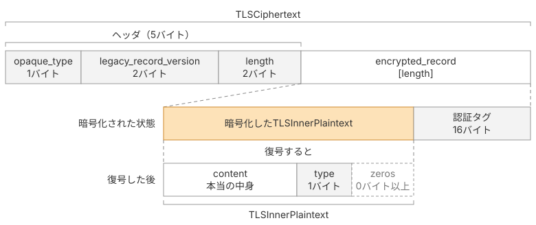

# 暗号化されたレコード

本ページでは、暗号化されたレコードの構造を確認し、暗号化される前の平文を表すTLSInnerPlaintextを、`tlsInnerPlaintext`構造体として実装します。

## 暗号化されたレコードの構造

TLSのレコードには、暗号化されていないデータを入れるTLSPlaintextと、暗号化されたデータを入れるTLSCiphertextがあります。TLSCiphertextの構造は次のとおりです。

TLSCiphertextは、外側のContentTypeを常に23として、暗号文と認証タグを`encrypted_record`に入れます。暗号化する前のデータは、TLSInnerPlaintextという形式で表します。

```
TLSCiphertext
├── opaque_type = 23, version, length       ← 5バイトのヘッダ。平文
└── encrypted_record                        ← 暗号化されている
    └── TLSInnerPlaintext
        ├── content                         ← 本当の中身
        ├── type                            ← 本当の種別（1バイト）
        └── zeros                           ← 詰め物（0バイト以上）
```




### TLSCiphertext

TLSCiphertextの構造はRFCで次のように定義されています。

> ```c
> struct {
>     ContentType opaque_type = application_data; /* 23 */
>     ProtocolVersion legacy_record_version = 0x0303; /* TLS v1.2 */
>     uint16 length;
>     opaque encrypted_record[TLSCiphertext.length];
> } TLSCiphertext;
> ```
>
> 引用元: [RFC 9846 §5.2 Record Payload Protection](https://datatracker.ietf.org/doc/html/rfc9846#section-5.2)

TLSCiphertextは、TLSPlaintextとフィールドの名前や意味が異なりますが、ヘッダとペイロードの並びは同じです。

- `type`は中身に応じて20〜23でしたが、`opaque_type`は常に23（application_data）です。暗号化後は中身がハンドシェイクでもアラートでも、外側は一律application_dataを名乗り、本当の種別を経路上の機器から隠します。
- `fragment`は平文でしたが、`encrypted_record`は暗号文と認証タグです。

バイト列の構造が同じなので、第2章で実装した`ReadRecord`と`TLSPlaintext`をそのまま使えます。`TLSCiphertext`型は作らず、暗号化したバイト列を`ContentTypeApplicationData`付きの`TLSPlaintext`として扱えば済みます。

### TLSInnerPlaintext

TLSInnerPlaintextの構造はRFCで次のように定義されています。外側の`opaque_type`は常に23なので、実際のデータの種別はTLSInnerPlaintextの中に入れます。

> ```c
> struct {
>     opaque content[TLSPlaintext.length];
>     ContentType type;
>     uint8 zeros[length_of_padding];
> } TLSInnerPlaintext;
> ```
>
> 引用元: [RFC 9846 §5.2 Record Payload Protection](https://datatracker.ietf.org/doc/html/rfc9846#section-5.2)

TLSInnerPlaintextは、平文の末尾に実際の種別を1バイト付け、必要に応じて詰め物を加えたものです。復号後に詰め物を取り除き、その直前の1バイトを読むことで、データの種別が分かります。

`zeros`は、レコードの長さから内容を推測されにくくするための詰め物です。送信者は、レコードの長さの上限内で詰め物の量を決められます。本書では付けませんが、受け取る側は剥がす必要があります。

## 実装

### TLSInnerPlaintextを組み立てる

`record.go`に構造体と、バイト列との相互変換を足します。送る側は中身の末尾に種別を1バイト付けるだけです。

::: code-group

```go [record.go]
type tlsInnerPlaintext struct {
	content     []byte
	contentType ContentType
}

func (p *tlsInnerPlaintext) marshal() []byte {
	buf := make([]byte, 0, len(p.content)+1)
	buf = append(buf, p.content...)
	return append(buf, byte(p.contentType))
}
```

:::

受信側は、末尾から種別を取り出します。ただし、末尾に`zeros`が付いている場合があるため、後ろからゼロを読み飛ばし、最初に見つかった非ゼロバイトを種別として扱います。

::: code-group

```go [record.go]
var errInnerPlaintextNoType = errors.New("tls13: inner plaintext missing content type")

func parseTLSInnerPlaintext(data []byte) (*tlsInnerPlaintext, error) {
	i := len(data) - 1
	for i >= 0 && data[i] == 0 {
		i--
	}
	if i < 0 {
		return nil, errInnerPlaintextNoType
	}
	return &tlsInnerPlaintext{
		content:     data[:i],
		contentType: ContentType(data[i]),
	}, nil
}
```

:::

すべてゼロだった場合は種別を特定できないため、`errInnerPlaintextNoType`を返します。

## 本ページで書いたコード

::: code-group

```[tree]
.
├── cmd/
│   └── main.go
├── go.mod
├── common.go
├── record.go
├── handshake.go
├── bytes.go
├── client_hello.go
├── extensions.go
├── server_hello.go
└── key_schedule.go
```

```go [record.go]
package tls13

import (
	"encoding/binary"
	"errors"
	"io"
)

var (
	errPayloadTooLarge      = errors.New("tls13: payload too large")
	errInnerPlaintextNoType = errors.New("tls13: inner plaintext missing content type")
)

type TLSPlaintext struct {
	Type    ContentType
	Version TLSVersion
	Length  uint16
	Payload []byte
}

func NewTLSPlaintext(contentType ContentType, fragment []byte) *TLSPlaintext {
	return &TLSPlaintext{
		Type:    contentType,
		Version: TLS_VERSION_1_2,
		Length:  uint16(len(fragment)),
		Payload: fragment,
	}
}

func (p *TLSPlaintext) Marshal() []byte {
	buf := make([]byte, 5, 5+len(p.Payload))
	buf[0] = byte(p.Type)
	binary.BigEndian.PutUint16(buf[1:], uint16(p.Version))
	binary.BigEndian.PutUint16(buf[3:], p.Length)
	return append(buf, p.Payload...)
}

func ReadRecord(r io.Reader) (*TLSPlaintext, error) {
	hdr := make([]byte, 5)
	if _, err := io.ReadFull(r, hdr); err != nil {
		return nil, err
	}
	length := binary.BigEndian.Uint16(hdr[3:])
	if int(length) > maxPayloadLen {
		return nil, errPayloadTooLarge
	}
	payload := make([]byte, length)
	if _, err := io.ReadFull(r, payload); err != nil {
		return nil, err
	}
	return &TLSPlaintext{
		Type:    ContentType(hdr[0]),
		Version: TLSVersion(binary.BigEndian.Uint16(hdr[1:])),
		Length:  length,
		Payload: payload,
	}, nil
}

type tlsInnerPlaintext struct {
	content     []byte
	contentType ContentType
}

func (p *tlsInnerPlaintext) marshal() []byte {
	buf := make([]byte, 0, len(p.content)+1)
	buf = append(buf, p.content...)
	return append(buf, byte(p.contentType))
}

func parseTLSInnerPlaintext(data []byte) (*tlsInnerPlaintext, error) {
	i := len(data) - 1
	for i >= 0 && data[i] == 0 {
		i--
	}
	if i < 0 {
		return nil, errInnerPlaintextNoType
	}
	return &tlsInnerPlaintext{
		content:     data[:i],
		contentType: ContentType(data[i]),
	}, nil
}
```

:::
