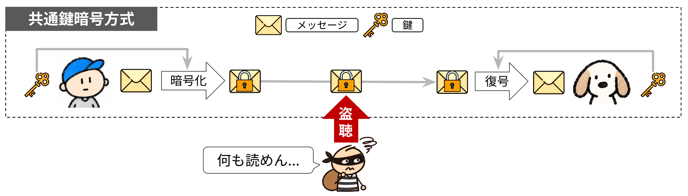
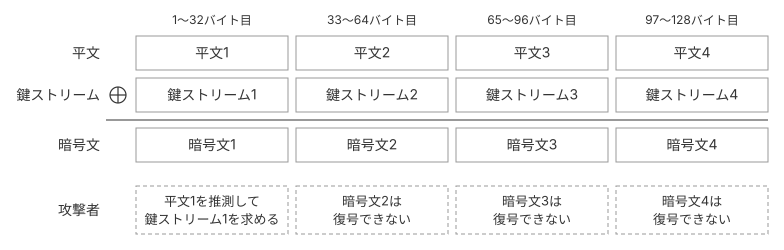
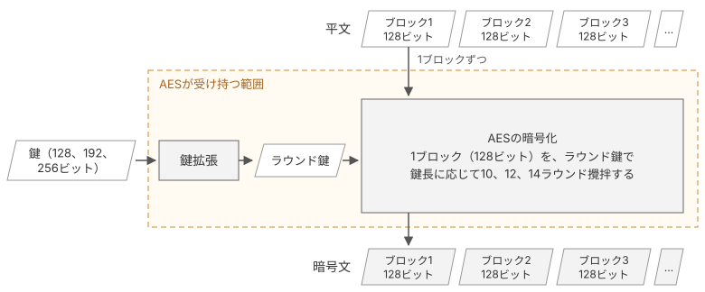
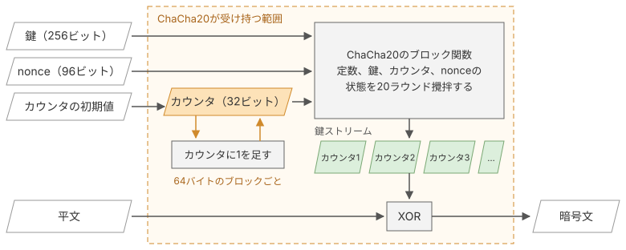
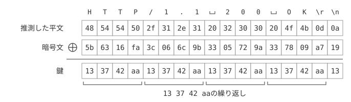

# 共通鍵暗号

[第4章](/04_keysched/schedule)では、HKDFとKey Scheduleを実装し、共有秘密からtraffic secretを導き出しました。本章では、traffic secretから作った鍵で、ServerHelloのあとにサーバーから届く暗号化されたレコードを復号します。共通鍵暗号と、改ざんを検知する認証付き暗号（AEAD）、暗号化されたレコードの構造を学び、レコードを復号する処理を実装します。

## 共通鍵暗号方式

共通鍵暗号は、送信者と受信者が同じ秘密鍵を使って、データを暗号化、復号する方式です。置換、シフト、XORといった軽い演算の繰り返しで組まれており、高速に計算できるため、大量のデータの保護に向いています。TLS 1.3では、鍵交換とKey Scheduleで共通鍵を用意し、その共通鍵を使ってレコードを暗号化、復号します。

*共通鍵暗号方式*

### 簡単な共通鍵暗号を考えてみる

共通鍵暗号のアルゴリズムにはさまざまなものがあります。まずは簡単な例として、XOR（排他的論理和）を用いた暗号を考えてみます。

$$
\begin{cases}
c = m \oplus s \\
m = c \oplus s
\end{cases}
$$

c：暗号文m：平文s：鍵⊕：XOR

平文$m$を文字Aの文字コード`0x41`、鍵$s$を`0x58`として計算すると、暗号文$c$は`0x19`になります。XORは、鍵のビットが1の位置で平文のビットを反転させます。暗号文`0x19`に同じ鍵`0x58`をもう一度XORすると、同じ位置のビットがもう一度反転して、平文の`0x41`に戻ります。送信者と受信者が同じ鍵を持っていれば、送信者が暗号化した暗号文を受信者が復号できます。

実際に使われている共通鍵暗号は、ブロック暗号とストリーム暗号の2種類に大きく分けられます。ストリーム暗号も、本節の例と同じく平文とのXORで暗号文を作ります。違いは、短い鍵とnonceなどから平文と同じ長さの鍵ストリームを作り、平文とXORする点です。ブロック暗号は、XORだけでなく置換などの処理も組み合わせて暗号化します。

### ブロック暗号

ブロック暗号は、平文を固定長のブロックに区切り、ブロック単位で暗号化する方式です。各ブロックの中では、鍵を使ってデータを何度もかき混ぜる（攪拌する）処理を行います。

代表的なアルゴリズムはAESです。AESは、NIST（米国国立標準技術研究所）が標準化した暗号で、仕様は[FIPS 197](https://csrc.nist.gov/pubs/fips/197/final)で定義されています。

AESは、128ビットの平文ブロックを同じ長さの暗号文ブロックに変換します。鍵長は128、192、256ビットの3種類で、鍵長に応じて10、12、14ラウンドの攪拌を繰り返します。

図2は、AESでブロック単位に暗号化する様子です。AESが受け持つのは、128ビットのブロック1つを鍵で暗号化することだけです。平文をブロックに区切ったり、暗号化したブロックを並べたりするのは、AESを使う側の処理です。

*AESによるブロック単位の暗号化*

### ストリーム暗号

ストリーム暗号は、平文を先頭から順に暗号化する方式です。鍵やnonceなどから鍵ストリームと呼ばれるバイト列を作り、平文とXORして暗号文にします。鍵ストリームは、鍵などをシードとして、暗号論的擬似乱数生成器（CSPRNG）を用いて作ります。

代表的なアルゴリズムはChaCha20です。ChaCha20は、Daniel J. Bernsteinが設計した暗号で、仕様は[RFC 8439](https://datatracker.ietf.org/doc/html/rfc8439)で定義されています。

ChaCha20は、256ビットの鍵、96ビットのnonce（1回限りの値）、32ビットのカウンタから、64バイトの鍵ストリームを作ります。カウンタを1ずつ増やしながらこれを繰り返し、平文の長さまで鍵ストリームを伸ばします。カウンタは32ビットなので、1つの鍵とnonceの組から作れる鍵ストリームは232ブロック×64バイト、つまり最大256GBです。これより長いデータを暗号化するときは、nonceを変えて別の鍵ストリームを作ります。図3はこの鍵ストリームの作り方で、鍵、nonce、カウンタをシードとして擬似乱数生成器に入れ、カウンタを更新しながら鍵ストリームを生成します。

*カウンタ方式による鍵ストリームの生成*

ブロック暗号のAESも、鍵ストリームを作る擬似乱数生成器として使えます。本書が使うAES-GCMは、1ずつ増えるカウンタをAESで暗号化し、出力をつなげて鍵ストリームにします。カウンタを暗号化して鍵ストリームを作るAESの使い方を、CTRモード（Counter Mode：カウンタモード）と呼びます。

## 鍵を使い回さない

安全な共通鍵暗号では、同じ鍵ストリームが繰り返し使われないようにする必要があります。まず、単純なXOR暗号で同じ鍵を繰り返し使った場合の問題を確認し、続いてストリーム暗号がどのように防いでいるかを説明します。

### 既知平文攻撃

攻撃者が平文と暗号文の組を知り、その情報から鍵などを求めようとする攻撃を、既知平文攻撃と呼びます。単純なXOR暗号は、既知平文攻撃に弱い方式です。XORは同じ値を2回計算すると元に戻るため、攻撃者は平文と暗号文のXORを計算するだけで、鍵を求めることができてしまいます。

$$
s = m \oplus c
$$

s：鍵m：平文c：暗号文

攻撃者が平文の一部を推測できる状況は、珍しくありません。たとえば、HTTPのレスポンスは`HTTP/1.1 200 OK\r\n`のように、先頭が決まった形式になっています。図4のように、攻撃者は暗号文の先頭17バイトに対応する平文を推測し、その平文と暗号文のXORから鍵を求めることができます。

*既知平文攻撃*

図4では、`13 37 42 aa`の4バイトを繰り返した鍵を使っています。この場合、先頭4バイトの鍵がわかれば、攻撃者はレスポンスの残りもすべて復号できてしまいます。

このように、単純なXOR暗号で同じ鍵ストリームを繰り返し使うと、一部の平文が分かっただけで、ほかの暗号文まで復号されるおそれがあります。図5は、データを32バイトずつに区切り、同じ32バイトの鍵で暗号化した例です。攻撃者は、平文1から求めた鍵を使って、暗号文2から暗号文4も復号できます。

*鍵の使い回しによる全文の復号*

### ワンタイムパッドとストリーム暗号

では、鍵を一度しか使わなければどうでしょうか。攻撃者が既知平文攻撃で鍵を求めても、その鍵はほかの暗号文の復号には使えません。

この考え方を利用した暗号が、ワンタイムパッドです。ワンタイムパッドは、平文と同じ長さの真の乱数を鍵として使い、一度使った鍵を二度と使わないXOR暗号です。

ワンタイムパッドの原型は、ギルバート・バーナムが1919年に特許[^vernam1919]を取得した暗号です。クロード・シャノンは、1949年の論文「Communication Theory of Secrecy Systems」[^shannon1949]で、ワンタイムパッドの暗号文からは平文の情報がまったく漏れないことを証明しました。

ただし、ワンタイムパッドには、送信者と受信者がデータと同じ長さの鍵を事前に共有する必要があるという問題があります。大量のデータをやり取りするインターネット通信では、現実的ではありません。

そこで、短い鍵から長い鍵ストリームを生成するストリーム暗号を使います。ストリーム暗号は、ワンタイムパッドの真の乱数の代わりに、鍵から生成した鍵ストリームで平文を暗号化します。

鍵ストリームは平文と同じ長さだけ生成し、暗号化する位置ごとに異なる部分を使います。図6のように、攻撃者が平文1を推測しても、求められるのは先頭32バイト分の鍵ストリームだけです。33バイト目以降の鍵ストリームを予測できなければ、暗号文2から暗号文4を復号することはできません。

*繰り返さない鍵ストリーム*

ただし、鍵ストリームを繰り返さないだけでは不十分です。鍵ストリームの一部から元の鍵を求められると、攻撃者は残りの鍵ストリームを生成できてしまいます。安全な鍵ストリームには、次の2つの性質が求められます。

1. 鍵ストリームの一部から、元の鍵を求められない
2. 鍵ストリームの一部から、続きを予測できない

本書で使うAES-GCMでは、AESの出力を鍵ストリームとして使います。AESの出力の一部から秘密鍵を求める現実的な攻撃方法は知られていません。鍵ストリームの生成に必要な擬似乱数生成器の性質は、[コラム: 擬似乱数生成器](/09_column/prng)にまとめています。

なお、AES-GCMでは、同じ鍵とnonceの組を再利用すると、同じ鍵ストリームが生成されてしまいます。共通鍵自体は複数のレコードで使いますが、nonceは同じ鍵のもとで重複させてはいけません。

[^vernam1919]: G. S. Vernam, "Secret Signaling System", U.S. Patent 1,310,719, 1919. [Google Patents](https://patents.google.com/patent/US1310719A/en)

[^shannon1949]: C. E. Shannon, "Communication Theory of Secrecy Systems", Bell System Technical Journal, vol. 28, no. 4, 1949. [DOI](https://doi.org/10.1002/j.1538-7305.1949.tb00928.x)
