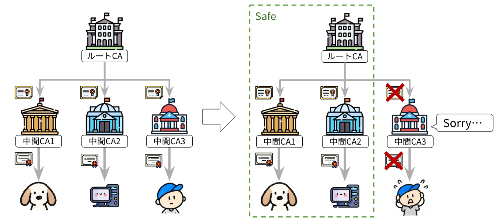
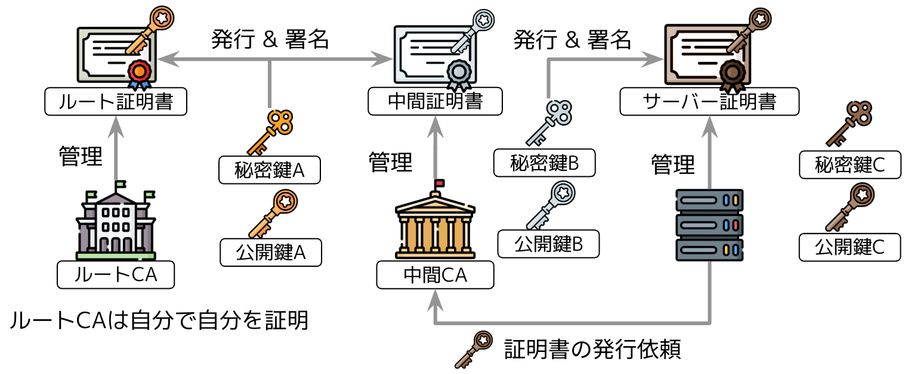

# 認証局と証明書チェーン

## 認証局の種類と階層構造

認証局は、表1のとおり、ルート認証局と中間認証局の2種類に大別されます。

| 種類 | 概要 |
|---|---|
| ルート認証局 | PKIにおける信頼の連鎖の起点となる最上位の認証局。自己署名したルート証明書を持ち、中間認証局に証明書を発行する。  ルート証明書の例：ISRG Root X1、DigiCert Global Root G2 |
| 中間認証局 | ルート認証局または上位の中間認証局から証明書を発行された認証局。下位の中間認証局や、Webサーバー、利用者、機器といったエンドエンティティに対して証明書を発行する。  中間証明書の例：Let's Encrypt Authority X1、Let's Encrypt R10 |

*認証局の種類*

認証局は階層構造になっています。ルート認証局は中間認証局に証明書を発行し、中間認証局が下位の中間認証局やサーバーに証明書を発行します。公に信頼されるルート認証局は、OSやブラウザがあらかじめ信頼するものとして組み込んでいる、限られた認証局だけです。ほとんどのWebサイトは、中間認証局から発行された証明書を使っています。

ルート認証局が直接サーバー証明書を発行すれば1段で済むところを、わざわざ中間認証局を挟んでいるのには、さまざまな理由があります。

### 1. 秘密鍵漏洩時の影響範囲の限定

証明書を発行するには秘密鍵で署名する必要があります。そのため、日常的に証明書を発行する認証局の秘密鍵は、発行処理で利用できる状態にしておかなければなりません。もしルート認証局が直接すべてのサーバー証明書を発行していたら、ルート認証局の秘密鍵を日常的な発行処理に使うことになり、漏洩の危険が高まります。

ルート認証局の秘密鍵が漏洩すると、攻撃者は任意のドメイン名に対して、ルート認証局が発行したように見える証明書を作れるようになります。攻撃者が作った証明書と正規の証明書は署名だけでは見分けられないため、OSやブラウザは、そのルート認証局を信頼の対象から外す必要があります。

OSやブラウザが信頼を取り消すと、図1のように、そのルート認証局を信頼の起点とする証明書チェーンは検証できなくなります。影響を受けた証明書を使うWebサイトでは、ブラウザに証明書のエラーが表示されるようになります。

エラーを解消するには、Webサイトの運営者が別の信頼できる認証局から証明書を取得するなどの対応が必要になり、大きな混乱が生じます。

*ルート認証局の秘密鍵が漏れた場合*

そこで、中間認証局を挟んで証明書を発行する仕組みが使われています。

階層構造にすると、ルート認証局の秘密鍵を使う機会は、中間証明書の発行などに限られます。中間証明書の発行は、サーバー証明書のように毎日のように依頼が届くものではありません。新しい中間認証局を作るときなどに限られるため、日時を決めて計画的に行えます。

そのため、ルート認証局の秘密鍵は、ネットワークから隔離された環境で厳重に保管し、必要なときだけ署名に使うことができます。日常的なサーバー証明書の発行は、中間認証局の秘密鍵で行います。

仮に中間認証局の秘密鍵が漏洩しても、影響を受けるのは基本的にその中間認証局の配下です。中間証明書を失効させ、配下のサーバー証明書を別の中間認証局から再発行するなどの対応が必要になりますが、ほかの中間認証局の配下には影響を広げずに済みます。

もちろん、階層構造にしても、ルート認証局の秘密鍵が漏洩すれば、配下の証明書に広範囲な影響が及ぶことに変わりはありません。しかし、ルート認証局の秘密鍵を日常的な発行処理から切り離せるため、漏洩する危険そのものを減らせます。

*中間認証局の秘密鍵が漏れた場合*

::: tip 規定でも決まっている
この考え方は、パブリック認証局の運用規定として明文化されています。認証局とブラウザベンダーが参加するCA/Browser ForumのBaseline Requirementsは、ルート認証局の秘密鍵で署名してよい証明書を、ルート認証局自身の自己署名証明書、下位認証局の証明書、内部運用用の証明書、OCSP応答検証用の証明書の4種類に限定しています（[TLS Baseline Requirements §6.1.7](https://cabforum.org/working-groups/server/baseline-requirements/requirements/#617-key-usage-purposes-as-per-x509-v3-key-usage-field)）。ルート認証局が直接サーバー証明書を発行することは認められていません。

また、CA/Browser Forumの[Network and Certificate System Security Requirements](https://cabforum.org/working-groups/netsec/requirements/) §1.2.1では、ルート認証局のシステムを、ほかの認証局のシステムとは物理的に分離されたネットワークに配置することが求められています。
:::

### 2. 新規参入と競争

新しい組織がルート認証局として世界中のクライアントに認めてもらうには、数年かかることがあります。一方、既存のルート認証局から中間証明書を発行してもらえば、自分たちのルート証明書が広く信頼されるまで待たずに、サーバー証明書の発行を始められます。

新しい認証局が参入しやすくなると競争が生まれ、証明書の価格や使いやすさの改善にもつながります。

代表例がLet's Encryptです。2015年のサービス開始当時、サーバー証明書は有料で、人手による手続きが必要なのが一般的でした。Let's Encryptは証明書を無料で提供し、ACMEというプロトコルを使って発行と更新を自動化しました。

しかし、開始当初は、運営元のISRGが持つルート証明書であるISRG Root X1が、まだ広く信頼されていませんでした。そこで、すでに広く信頼されていたIdenTrustのルート認証局から、Let's Encryptの中間証明書にクロス署名を受けました。これにより、クライアントがISRG Root X1を信頼していなくても、IdenTrustのルート認証局を経由してLet's Encryptの証明書を検証できるようになりました。

その後、ISRG Root X1が広く信頼されるようになったため、Let's Encryptは既存の認証局への依存を解消していきました。

ほかにも、GoogleはGoogle Trust Servicesという認証局を運営しています。また、CloudflareはLet's EncryptやGoogle Trust Services、SSL.comなどの認証局と提携し、CDN利用者向けに証明書の取得や更新を提供しています。前のページで見たexample.comの証明書で、`Issuer`が`Cloudflare TLS Issuing ECC CA 3`、組織名が`SSL Corporation`になっているのも、こうした連携の例です。

## 証明書チェーン

認証局が階層構造になると、証明書の検証にも影響が出ます。サーバー証明書に署名したのは中間認証局なので、その署名を検証するには中間認証局の公開鍵が必要です。ところが、クライアントが信頼の起点として持っているのはルート認証局の公開鍵です。

では、中間認証局の公開鍵はどこから入手し、それが本物だとどうやって確かめるのでしょうか。

答えは、中間認証局の公開鍵も、ルート認証局が署名した証明書に入っているということです。

ここでは、中間認証局が1段だけの構成を例に考えます。この場合、証明書は表2の3種類に分かれます。

| 証明書 | 発行者 | 発行先 | 入っている公開鍵 |
|---|---|---|---|
| ルート証明書 | ルート認証局 | ルート認証局自身（自己署名） | ルート認証局の公開鍵A |
| 中間証明書 | ルート認証局 | 中間認証局 | 中間認証局の公開鍵B |
| サーバー証明書 | 中間認証局 | サーバー | サーバーの公開鍵C |

*証明書の3種類*

### 発行の流れ

*ルート認証局からサーバーまでの証明書の発行*

証明書の発行は、上から下へ進みます。

1. ルート認証局は鍵ペアAを持ち、自分の公開鍵Aなどを含むデータに秘密鍵Aで署名して、ルート証明書を作ります
2. ルート認証局は、中間認証局の公開鍵Bなどを含むデータに秘密鍵Aで署名して、中間証明書を発行します
3. 中間認証局は、サーバーから発行依頼を受け、サーバーの公開鍵Cなどを含むデータに秘密鍵Bで署名して、サーバー証明書を発行します

こうしてできた3つの証明書は、公開鍵と署名によってつながっています。

サーバー証明書の署名に使われた秘密鍵Bと対になる公開鍵Bは中間証明書に、中間証明書の署名に使われた秘密鍵Aと対になる公開鍵Aはルート証明書に入っています。

つまり、各証明書に入っている公開鍵を使って、1つ下の証明書の署名を検証できます。このように、発行者を遡って辿れる証明書のつながりを証明書チェーンと呼びます。

### 検証の流れ

クライアントは、サーバー証明書と中間証明書を受け取り、ルート証明書はあらかじめ持っています。検証は発行と逆向きに、下から上へ辿ります。

1. サーバー証明書の署名を、中間証明書に入っている公開鍵Bで検証します。成功すれば、サーバー証明書が公開鍵Bに対応する秘密鍵で署名されていることが分かります
2. 中間証明書の署名を、ルート証明書に入っている公開鍵Aで検証します。成功すれば、中間証明書が公開鍵Aに対応する秘密鍵で署名されていることが分かります
3. ルート証明書は、あらかじめ信頼している起点そのものなので、ここで辿るのを終えます

このように2つの署名を検証することで、信頼しているルート認証局から中間認証局を経由して、サーバー証明書までつながることを確かめられます。

ルート証明書の自己署名を検証することは、信頼の根拠にはなりません。ルート証明書は、クライアントがあらかじめ信頼しているものとして扱うためです。

また、実際の検証では署名だけでなく、中間認証局が証明書を発行する権限を持っているかなども確認します。途中の検証に失敗すれば、その証明書チェーンは信頼できません。

重要なのは、信頼の起点となるルート証明書さえ持っていれば、中間認証局の公開鍵をあらかじめ配布する必要がないという点です。中間証明書を受け取り、その署名を検証することで、中間認証局の公開鍵も信頼できるようになります。