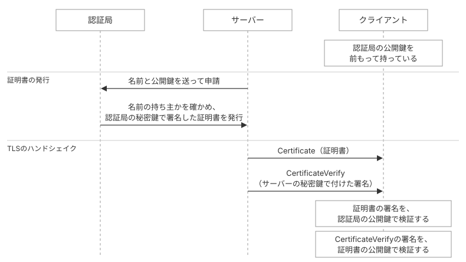

# CertificateVerifyの署名検証を実装する

本ページでは、サーバーが送るCertificateVerifyメッセージを読み取り、署名を検証する処理を実装します。署名を検証することで、通信相手がサーバー証明書の公開鍵に対応する秘密鍵を持っていることを確かめられます。

## CertificateVerifyメッセージの構造

CertificateVerifyは、サーバー証明書の公開鍵に対応する秘密鍵で作成したデジタル署名を送るメッセージです。

> ```c
> struct {
>     SignatureScheme algorithm;
>     opaque signature<0..2^16-1>;
> } CertificateVerify;
> ```
>
> 引用元: [RFC 9846 §4.5.2 Certificate Verify](https://datatracker.ietf.org/doc/html/rfc9846#section-4.5.2)

サーバーが署名するのは、transcriptのハッシュだけではありません。図1のように、`0x20`を64バイト並べたもの、コンテキスト文字列`"TLS 1.3, server CertificateVerify"`、区切りの`0x00`、transcriptのハッシュを順に連結したバイト列です。コンテキスト文字列は、ほかの用途で作成された署名がCertificateVerifyの署名として使い回されるのを防ぐために付けます。



*CertificateVerifyでサーバーが署名するバイト列*

## CertificateVerifyをパースする関数を実装する

CertificateVerifyメッセージの本体をパースする`UnmarshalCertificateVerify`を、`certificate.go`に書きます。

::: code-group

```go [certificate.go]
type CertificateVerify struct {
	Algorithm SignatureScheme
	Signature []byte
}

func UnmarshalCertificateVerify(body []byte) (*CertificateVerify, error) {
	malformed := errors.New("tls13: malformed CertificateVerify")

	algorithm, rest, ok := readUint16(body)
	if !ok {
		return nil, malformed
	}
	signature, rest, ok := readUint16Prefixed(rest)
	if !ok || len(rest) != 0 {
		return nil, malformed
	}
	return &CertificateVerify{
		Algorithm: SignatureScheme(algorithm),
		Signature: append([]byte{}, signature...),
	}, nil
}
```

:::

`UnmarshalCertificateVerify`は、2バイトの署名方式と、2バイトの長さプレフィックスが付いた署名を読み出します。

## CertificateVerifyの署名を検証する関数を実装する

CertificateVerifyの署名を検証する`Verify`メソッドを、`certificate.go`に書きます。`Verify`メソッドは、署名の対象を組み立て、署名方式を`crypto/x509`の署名アルゴリズムに対応づけ、サーバー証明書の公開鍵で署名を検証します。

### 署名の対象を組み立てる

署名の対象は、`0x20`を64バイト並べたあとに、コンテキスト文字列`"TLS 1.3, server CertificateVerify"`、区切りの`0x00`、transcriptのハッシュを続けたバイト列です（[RFC 9846 §4.5.2](https://datatracker.ietf.org/doc/html/rfc9846#section-4.5.2)）。

::: code-group

```go [certificate.go]
func (cv *CertificateVerify) Verify(cert *x509.Certificate, transcriptHash []byte) error {
	content := make([]byte, 0, 64+34+len(transcriptHash))
	for range 64 {
		content = append(content, 0x20)
	}
	content = append(content, "TLS 1.3, server CertificateVerify"...)
	content = append(content, 0)
	content = append(content, transcriptHash...)
	// ...
}
```

:::

`content`の容量に指定した`64+34`は、64バイトの`0x20`、33バイトのコンテキスト文字列、1バイトの`0x00`を合計した長さです。

### 署名方式を対応づける

署名の検証には、`crypto/x509`の`Certificate`型の`CheckSignature`メソッドを使います。`CheckSignature`メソッドは、署名アルゴリズムを`x509.SignatureAlgorithm`型で受け取ります。TLSの署名方式を表す`SignatureScheme`と`x509.SignatureAlgorithm`は別の型なので、`Verify`メソッドで対応する値に変換します。

::: code-group

```go [certificate.go]
func (cv *CertificateVerify) Verify(cert *x509.Certificate, transcriptHash []byte) error {
	// ...
	var algorithm x509.SignatureAlgorithm
	switch cv.Algorithm {
	case RSA_PSS_RSAE_SHA256:
		algorithm = x509.SHA256WithRSAPSS
	case RSA_PSS_RSAE_SHA384:
		algorithm = x509.SHA384WithRSAPSS
	case RSA_PSS_RSAE_SHA512:
		algorithm = x509.SHA512WithRSAPSS
	case ECDSA_SECP256R1_SHA256:
		algorithm = x509.ECDSAWithSHA256
	case ECDSA_SECP384R1_SHA384:
		algorithm = x509.ECDSAWithSHA384
	default:
		return fmt.Errorf("tls13: unsupported signature scheme %#x", uint16(cv.Algorithm))
	}
	// ...
}
```

:::

対応する署名方式は、ClientHelloの`signature_algorithms`拡張で申告した5つです。それ以外の署名方式が届いたときは、エラーを返します。

### 公開鍵で署名を検証する

最後に、サーバー証明書の公開鍵で署名を検証します。

::: code-group

```go [certificate.go]
func (cv *CertificateVerify) Verify(cert *x509.Certificate, transcriptHash []byte) error {
	// ...
	return cert.CheckSignature(algorithm, content, cv.Signature)
}
```

:::

`CheckSignature`には、ハッシュを計算する前の署名対象である`content`を渡します。`CheckSignature`は指定された署名アルゴリズムに応じてハッシュを計算し、証明書の公開鍵を使って署名を検証します。RSA-PSSの場合は、TLS 1.3で要求されるとおり、ソルトの長さがハッシュ値の長さと等しいことも検証します。

`CheckSignature`が確かめるのは、証明書の公開鍵で署名を検証できるかどうかです。証明書自体が信頼できるかは、別途`VerifyCertificate`で証明書チェーンを検証して確かめます。

## 署名の検証を状態機械に組み込む

CertificateVerifyも、メッセージの読み取りと署名の検証を別々の処理にします。`ReadCertificateVerify`でメッセージを読み取り、`VerifyCertificateVerify`で署名を検証します。

### 構造体にフィールドを追加する

`ClientHandshakeState`に、CertificateVerifyを保持する`PeerCertificateVerify`と、署名の検証に使うtranscriptのハッシュを保持する`certificateVerifyTranscriptHash`を追加します。`cmd/main.go`から署名方式などを表示できるように、`PeerCertificateVerify`は公開フィールドにします。あわせて、`NewClientHandshakeState`が引数`roots`で信頼するルート証明書の集合を受け取れるようにします。

::: code-group

```go [handshake_client.go]
type ClientHandshakeState struct {
	// ...

	PeerCertificates                []*x509.Certificate
	VerifiedChains                  [][]*x509.Certificate
	PeerCertificateVerify           *CertificateVerify // [!code ++]
	certificateVerifyTranscriptHash []byte // [!code ++]
}

func NewClientHandshakeState(conn net.Conn, serverName string) *ClientHandshakeState { // [!code --]
func NewClientHandshakeState(conn net.Conn, serverName string, roots *x509.CertPool) *ClientHandshakeState { // [!code ++]
	return &ClientHandshakeState{
		c:          &Conn{conn: conn},
		serverName: serverName,
		roots:      roots, // [!code ++]
		transcript: newTranscript(),
	}
}
```

:::

### CertificateVerifyと署名の対象のハッシュを保存する処理を実装する

`ReadCertificateVerify`は、これまで行っていたメッセージ本体の表示をやめ、CertificateVerifyをパースして`PeerCertificateVerify`フィールドに保存します。

::: code-group

```go [handshake_client.go]
func (hs *ClientHandshakeState) ReadCertificateVerify() error {
	// ...
	if msg.HandshakeType != TypeCertificateVerify {
		return fmt.Errorf("tls13: expected handshake message %d, got %d", TypeCertificateVerify, msg.HandshakeType)
	}
	fmt.Printf("CertificateVerify: %d bytes\n", len(msg.Body)) // [!code --]
	fmt.Print(hex.Dump(msg.Body)) // [!code --]
	cv, err := UnmarshalCertificateVerify(msg.Body) // [!code ++]
	if err != nil { // [!code ++]
		return err // [!code ++]
	} // [!code ++]
	hs.PeerCertificateVerify = cv // [!code ++]
	hs.certificateVerifyTranscriptHash = hs.transcript.sum() // [!code ++]
	hs.transcript.write(raw)
	return nil
}
```

:::

CertificateVerifyの署名に使うtranscriptのハッシュには、Certificateまでのハンドシェイクメッセージを含めます。CertificateVerify自身をtranscriptに追加するとハッシュが変わるため、`ReadCertificateVerify`では、追加する前のハッシュを`certificateVerifyTranscriptHash`フィールドに保存します。

### 署名を検証するメソッドを実装する

`VerifyCertificateVerify`は、`PeerCertificateVerify`に保存した署名をサーバー証明書の公開鍵で検証します。検証には、`ReadCertificateVerify`で保存したtranscriptのハッシュを使います。

::: code-group

```go [handshake_client.go]
func (hs *ClientHandshakeState) VerifyCertificateVerify() error {
	return hs.PeerCertificateVerify.Verify(hs.PeerCertificates[0], hs.certificateVerifyTranscriptHash)
}
```

:::

## 動かす

`cmd/main.go`で証明書チェーンとCertificateVerifyを検証し、受け取った証明書、検証に成功した証明書チェーン、署名の検証結果を表示します。`NewClientHandshakeState`には`roots`として`nil`を渡し、OSのルート証明書ストアを利用します。

::: code-group

```go [cmd/main.go]
package main

import (
	"bytes" // [!code ++]
	"fmt" // [!code ++]
	"net"
	"strings" // [!code ++]

	"tls13"
)

const (
	serverName = "example.com"
	addr       = "example.com:443"
)

var signatureSchemeNames = map[tls13.SignatureScheme]string{ // [!code ++]
	tls13.RSA_PKCS1_SHA256:       "rsa_pkcs1_sha256", // [!code ++]
	tls13.ECDSA_SECP256R1_SHA256: "ecdsa_secp256r1_sha256", // [!code ++]
	tls13.ECDSA_SECP384R1_SHA384: "ecdsa_secp384r1_sha384", // [!code ++]
	tls13.RSA_PSS_RSAE_SHA256:    "rsa_pss_rsae_sha256", // [!code ++]
	tls13.RSA_PSS_RSAE_SHA384:    "rsa_pss_rsae_sha384", // [!code ++]
	tls13.RSA_PSS_RSAE_SHA512:    "rsa_pss_rsae_sha512", // [!code ++]
} // [!code ++]

func main() {
	conn, err := net.Dial("tcp", addr)
	if err != nil {
		panic(err)
	}
	defer conn.Close()

	hs := tls13.NewClientHandshakeState(conn, serverName) // [!code --]
	hs := tls13.NewClientHandshakeState(conn, serverName, nil) // [!code ++]
	if err := hs.GenerateKeyPair(); err != nil {
		panic(err)
	}
	if err := hs.SendClientHello(); err != nil {
		panic(err)
	}
	if err := hs.ReadServerHello(); err != nil {
		panic(err)
	}
	if err := hs.ComputeSharedSecret(); err != nil {
		panic(err)
	}
	hs.EstablishHandshakeKeys()
	if err := hs.ReadEncryptedExtensions(); err != nil {
		panic(err)
	}
	if err := hs.ReadCertificate(); err != nil {
		panic(err)
	}
	if err := hs.VerifyCertificate(); err != nil { // [!code ++]
		panic(err) // [!code ++]
	} // [!code ++]
	if err := hs.ReadCertificateVerify(); err != nil {
		panic(err)
	}
	if err := hs.VerifyCertificateVerify(); err != nil { // [!code ++]
		panic(err) // [!code ++]
	} // [!code ++]

	fmt.Println("received certificates:") // [!code ++]
	for i, cert := range hs.PeerCertificates { // [!code ++]
		fmt.Printf("  [%d] subject=%s\n", i, cert.Subject) // [!code ++]
		fmt.Printf("      issuer=%s\n", cert.Issuer) // [!code ++]
		fmt.Printf("      valid=%s to %s\n", cert.NotBefore.Format("2006-01-02"), cert.NotAfter.Format("2006-01-02")) // [!code ++]
		if len(cert.DNSNames) > 0 { // [!code ++]
			fmt.Printf("      SAN=%s\n", strings.Join(cert.DNSNames, ", ")) // [!code ++]
		} // [!code ++]
	} // [!code ++]

	fmt.Println("verified chain:") // [!code ++]
	for i, cert := range hs.VerifiedChains[0] { // [!code ++]
		from := "trust store" // [!code ++]
		for _, sent := range hs.PeerCertificates { // [!code ++]
			if bytes.Equal(sent.Raw, cert.Raw) { // [!code ++]
				from = "sent by server" // [!code ++]
			} // [!code ++]
		} // [!code ++]
		fmt.Printf("  [%d] %s (%s)\n", i, cert.Subject, from) // [!code ++]
	} // [!code ++]
	fmt.Printf("hostname %q matches the certificate\n", serverName) // [!code ++]

	cv := hs.PeerCertificateVerify // [!code ++]
	fmt.Printf("CertificateVerify: algorithm=%s (%#04x), signature=%d bytes, verified with the server public key\n", // [!code ++]
		signatureSchemeNames[cv.Algorithm], uint16(cv.Algorithm), len(cv.Signature)) // [!code ++]
}
```

:::

::: code-group

```sh [ターミナル]
$ go run ./cmd
received certificates:
  [0] subject=CN=example.com
      issuer=CN=Cloudflare TLS Issuing ECC CA 3,O=SSL Corporation,C=US
      valid=2026-09-26 to 2026-12-25
      SAN=example.com, *.example.com
  [1] subject=CN=Cloudflare TLS Issuing ECC CA 3,O=SSL Corporation,C=US
      issuer=CN=SSL.com TLS Transit ECC CA R2,O=SSL Corporation,C=US
      valid=2025-05-29 to 2035-05-27
  [2] subject=CN=SSL.com TLS Transit ECC CA R2,O=SSL Corporation,C=US
      issuer=CN=SSL.com TLS ECC Root CA 2022,O=SSL Corporation,C=US
      valid=2022-10-21 to 2037-10-17
  [3] subject=CN=SSL.com TLS ECC Root CA 2022,O=SSL Corporation,C=US
      issuer=CN=AAA Certificate Services,O=Comodo CA Limited,L=Salford,ST=Greater Manchester,C=GB
      valid=2025-08-01 to 2028-12-31
verified chain:
  [0] CN=example.com (sent by server)
  [1] CN=Cloudflare TLS Issuing ECC CA 3,O=SSL Corporation,C=US (sent by server)
  [2] CN=SSL.com TLS Transit ECC CA R2,O=SSL Corporation,C=US (sent by server)
  [3] CN=SSL.com TLS ECC Root CA 2022,O=SSL Corporation,C=US (trust store)
hostname "example.com" matches the certificate
CertificateVerify: algorithm=ecdsa_secp256r1_sha256 (0x0403), signature=72 bytes, verified with the server public key
```

:::

出力は3つの部分に分かれます。

`received certificates`は、サーバーがCertificateメッセージで送ってきた証明書です。先頭がサーバー証明書で、`Subject`がexample.com、SANにはexample.comと\*.example.comが入っています。2枚目以降は発行者を遡る順に並んだ証明書で、各証明書の`Issuer`が次の証明書の`Subject`と一致しています。

`verified chain`は、`crypto/x509`による検証に成功した証明書チェーンです。この例では、サーバー証明書から始まり、トラストストアにあるルート証明書で終わっています。サーバーが送ってきた4枚目は、`SSL.com TLS ECC Root CA 2022`が`AAA Certificate Services`から発行を受けた証明書ですが、検証には使われていません。代わりに、トラストストアにある`SSL.com TLS ECC Root CA 2022`の自己署名証明書が使われています。信頼できる起点に到達した時点で、それ以上チェーンを辿る必要はないためです。

最後の行はCertificateVerifyの検証結果です。サーバーは`ecdsa_secp256r1_sha256`で署名しており、サーバー証明書の公開鍵で検証に成功しています。これにより、通信相手が証明書の公開鍵に対応する秘密鍵を持っていることを確認できました。ECDSAの署名は長さが一定ではないため、表示されるバイト数は実行ごとに変わることがあります。

`serverName`を別のドメインに変えると、サーバーから証明書を受け取れた場合は、`VerifyCertificate`のホスト名検証で失敗することがあります。ただし、`serverName`はSNIにも使用しているため、サーバーによっては証明書を受け取る前に接続が終了する場合もあります。

## 本ページで書いたコード

::: code-group

```[tree]
.
├── cmd/
│   └── main.go
├── go.mod
├── aead.go
├── bytes.go
├── certificate.go
├── client_hello.go
├── common.go
├── conn.go
├── extensions.go
├── handshake.go
├── handshake_client.go
├── key_schedule.go
├── record.go
├── record_protection.go
└── server_hello.go
```

```go [certificate.go]
package tls13

import (
	"crypto/x509"
	"errors"
	"fmt"
)

type certificate struct {
	certificateList [][]byte
}

func unmarshalCertificate(body []byte) (*certificate, error) {
	malformed := errors.New("tls13: malformed Certificate")

	_, rest, ok := readUint8Prefixed(body)
	if !ok {
		return nil, malformed
	}
	list, rest, ok := readUint24Prefixed(rest)
	if !ok || len(rest) != 0 {
		return nil, malformed
	}

	cert := &certificate{}
	for len(list) > 0 {
		certData, r, ok := readUint24Prefixed(list)
		if !ok {
			return nil, malformed
		}
		_, r, ok = readUint16Prefixed(r)
		if !ok {
			return nil, malformed
		}
		cert.certificateList = append(cert.certificateList, append([]byte{}, certData...))
		list = r
	}
	return cert, nil
}

type CertificateVerify struct {
	Algorithm SignatureScheme
	Signature []byte
}

func UnmarshalCertificateVerify(body []byte) (*CertificateVerify, error) {
	malformed := errors.New("tls13: malformed CertificateVerify")

	algorithm, rest, ok := readUint16(body)
	if !ok {
		return nil, malformed
	}
	signature, rest, ok := readUint16Prefixed(rest)
	if !ok || len(rest) != 0 {
		return nil, malformed
	}
	return &CertificateVerify{
		Algorithm: SignatureScheme(algorithm),
		Signature: append([]byte{}, signature...),
	}, nil
}

func (cv *CertificateVerify) Verify(cert *x509.Certificate, transcriptHash []byte) error {
	content := make([]byte, 0, 64+34+len(transcriptHash))
	for range 64 {
		content = append(content, 0x20)
	}
	content = append(content, "TLS 1.3, server CertificateVerify"...)
	content = append(content, 0)
	content = append(content, transcriptHash...)

	var algorithm x509.SignatureAlgorithm
	switch cv.Algorithm {
	case RSA_PSS_RSAE_SHA256:
		algorithm = x509.SHA256WithRSAPSS
	case RSA_PSS_RSAE_SHA384:
		algorithm = x509.SHA384WithRSAPSS
	case RSA_PSS_RSAE_SHA512:
		algorithm = x509.SHA512WithRSAPSS
	case ECDSA_SECP256R1_SHA256:
		algorithm = x509.ECDSAWithSHA256
	case ECDSA_SECP384R1_SHA384:
		algorithm = x509.ECDSAWithSHA384
	default:
		return fmt.Errorf("tls13: unsupported signature scheme %#x", uint16(cv.Algorithm))
	}
	return cert.CheckSignature(algorithm, content, cv.Signature)
}
```

```go [handshake_client.go]
package tls13

import (
	"crypto/ecdh"
	"crypto/rand"
	"crypto/x509"
	"errors"
	"fmt"
	"net"
)

type ClientHandshakeState struct {
	c          *Conn
	serverName string
	roots      *x509.CertPool

	transcript *transcript

	privateKey      *ecdh.PrivateKey
	serverPublicKey []byte
	sharedSecret    []byte

	clientHandshakeTrafficSecret []byte
	serverHandshakeTrafficSecret []byte
	handshakeSecret              []byte

	PeerCertificates                []*x509.Certificate
	VerifiedChains                  [][]*x509.Certificate
	PeerCertificateVerify           *CertificateVerify
	certificateVerifyTranscriptHash []byte
}

func NewClientHandshakeState(conn net.Conn, serverName string, roots *x509.CertPool) *ClientHandshakeState {
	return &ClientHandshakeState{
		c:          &Conn{conn: conn},
		serverName: serverName,
		roots:      roots,
		transcript: newTranscript(),
	}
}

func (hs *ClientHandshakeState) GenerateKeyPair() error {
	privateKey, err := ecdh.X25519().GenerateKey(rand.Reader)
	if err != nil {
		return err
	}
	hs.privateKey = privateKey
	return nil
}

func (hs *ClientHandshakeState) SendClientHello() error {
	var random [clientRandomLength]byte
	if _, err := rand.Read(random[:]); err != nil {
		return err
	}

	ch := NewClientHello(random, []Extension{
		SupportedVersionsExtension(),
		ServerNameExtension(hs.serverName),
		SignatureAlgorithmsExtension(),
		SupportedGroupsExtension(),
		KeyShareExtension(hs.privateKey.PublicKey().Bytes()),
	})
	h := NewHandshake(TypeClientHello, ch.Marshal())
	raw := h.Marshal()
	if _, err := hs.c.conn.Write(NewTLSPlaintext(ContentTypeHandshake, raw).Marshal()); err != nil {
		return err
	}
	hs.transcript.write(raw)
	return nil
}

func (hs *ClientHandshakeState) ReadServerHello() error {
	msg, raw, err := hs.c.readHandshake()
	if err != nil {
		return err
	}
	if msg.HandshakeType != TypeServerHello {
		return fmt.Errorf("tls13: expected handshake message %d, got %d", TypeServerHello, msg.HandshakeType)
	}
	sh, err := UnmarshalServerHello(msg.Body)
	if err != nil {
		return err
	}
	if sh.CipherSuite != TLS_AES_128_GCM_SHA256 {
		return fmt.Errorf("tls13: server selected unsupported cipher suite %#x", uint16(sh.CipherSuite))
	}
	if v, ok := sh.SelectedVersion(); !ok || v != TLS_VERSION_1_3 {
		return errors.New("tls13: server did not negotiate TLS 1.3")
	}
	group, serverPublicKey, ok := sh.KeyShare()
	if !ok {
		return errors.New("tls13: server did not send a key share")
	}
	if group != X25519 {
		return fmt.Errorf("tls13: server selected unsupported group %#x", uint16(group))
	}
	hs.serverPublicKey = serverPublicKey
	hs.transcript.write(raw)
	return nil
}

func (hs *ClientHandshakeState) ComputeSharedSecret() error {
	serverPub, err := ecdh.X25519().NewPublicKey(hs.serverPublicKey)
	if err != nil {
		return err
	}
	hs.sharedSecret, err = hs.privateKey.ECDH(serverPub)
	return err
}

func (hs *ClientHandshakeState) EstablishHandshakeKeys() {
	hs.handshakeSecret = deriveHandshakeSecret(hs.sharedSecret)
	transcriptHash := hs.transcript.sum()
	hs.clientHandshakeTrafficSecret = deriveSecret(hs.handshakeSecret, "c hs traffic", transcriptHash)
	hs.serverHandshakeTrafficSecret = deriveSecret(hs.handshakeSecret, "s hs traffic", transcriptHash)
	hs.c.in = newRecordProtection(hs.serverHandshakeTrafficSecret)
}

func (hs *ClientHandshakeState) ReadEncryptedExtensions() error {
	msg, raw, err := hs.c.readHandshake()
	if err != nil {
		return err
	}
	if msg.HandshakeType != TypeEncryptedExtensions {
		return fmt.Errorf("tls13: expected handshake message %d, got %d", TypeEncryptedExtensions, msg.HandshakeType)
	}
	hs.transcript.write(raw)
	return nil
}

func (hs *ClientHandshakeState) ReadCertificate() error {
	msg, raw, err := hs.c.readHandshake()
	if err != nil {
		return err
	}
	if msg.HandshakeType != TypeCertificate {
		return fmt.Errorf("tls13: expected handshake message %d, got %d", TypeCertificate, msg.HandshakeType)
	}
	certificate, err := unmarshalCertificate(msg.Body)
	if err != nil {
		return err
	}
	if len(certificate.certificateList) == 0 {
		return errors.New("tls13: server sent no certificates")
	}
	certs := make([]*x509.Certificate, len(certificate.certificateList))
	for i, der := range certificate.certificateList {
		if certs[i], err = x509.ParseCertificate(der); err != nil {
			return err
		}
	}
	hs.PeerCertificates = certs
	hs.transcript.write(raw)
	return nil
}

func (hs *ClientHandshakeState) VerifyCertificate() error {
	certs := hs.PeerCertificates
	opts := x509.VerifyOptions{
		DNSName:       hs.serverName,
		Roots:         hs.roots,
		Intermediates: x509.NewCertPool(),
		KeyUsages:     []x509.ExtKeyUsage{x509.ExtKeyUsageServerAuth},
	}
	for _, cert := range certs[1:] {
		opts.Intermediates.AddCert(cert)
	}
	chains, err := certs[0].Verify(opts)
	if err != nil {
		return fmt.Errorf("tls13: certificate verification failed: %w", err)
	}
	hs.VerifiedChains = chains
	return nil
}

func (hs *ClientHandshakeState) ReadCertificateVerify() error {
	msg, raw, err := hs.c.readHandshake()
	if err != nil {
		return err
	}
	if msg.HandshakeType != TypeCertificateVerify {
		return fmt.Errorf("tls13: expected handshake message %d, got %d", TypeCertificateVerify, msg.HandshakeType)
	}
	cv, err := UnmarshalCertificateVerify(msg.Body)
	if err != nil {
		return err
	}
	hs.PeerCertificateVerify = cv
	hs.certificateVerifyTranscriptHash = hs.transcript.sum()
	hs.transcript.write(raw)
	return nil
}

func (hs *ClientHandshakeState) VerifyCertificateVerify() error {
	return hs.PeerCertificateVerify.Verify(hs.PeerCertificates[0], hs.certificateVerifyTranscriptHash)
}
```

```go [cmd/main.go]
package main

import (
	"bytes"
	"fmt"
	"net"
	"strings"

	"tls13"
)

const (
	serverName = "example.com"
	addr       = "example.com:443"
)

var signatureSchemeNames = map[tls13.SignatureScheme]string{
	tls13.RSA_PKCS1_SHA256:       "rsa_pkcs1_sha256",
	tls13.ECDSA_SECP256R1_SHA256: "ecdsa_secp256r1_sha256",
	tls13.ECDSA_SECP384R1_SHA384: "ecdsa_secp384r1_sha384",
	tls13.RSA_PSS_RSAE_SHA256:    "rsa_pss_rsae_sha256",
	tls13.RSA_PSS_RSAE_SHA384:    "rsa_pss_rsae_sha384",
	tls13.RSA_PSS_RSAE_SHA512:    "rsa_pss_rsae_sha512",
}

func main() {
	conn, err := net.Dial("tcp", addr)
	if err != nil {
		panic(err)
	}
	defer conn.Close()

	hs := tls13.NewClientHandshakeState(conn, serverName, nil)
	if err := hs.GenerateKeyPair(); err != nil {
		panic(err)
	}
	if err := hs.SendClientHello(); err != nil {
		panic(err)
	}
	if err := hs.ReadServerHello(); err != nil {
		panic(err)
	}
	if err := hs.ComputeSharedSecret(); err != nil {
		panic(err)
	}
	hs.EstablishHandshakeKeys()
	if err := hs.ReadEncryptedExtensions(); err != nil {
		panic(err)
	}
	if err := hs.ReadCertificate(); err != nil {
		panic(err)
	}
	if err := hs.VerifyCertificate(); err != nil {
		panic(err)
	}
	if err := hs.ReadCertificateVerify(); err != nil {
		panic(err)
	}
	if err := hs.VerifyCertificateVerify(); err != nil {
		panic(err)
	}

	fmt.Println("received certificates:")
	for i, cert := range hs.PeerCertificates {
		fmt.Printf("  [%d] subject=%s\n", i, cert.Subject)
		fmt.Printf("      issuer=%s\n", cert.Issuer)
		fmt.Printf("      valid=%s to %s\n", cert.NotBefore.Format("2006-01-02"), cert.NotAfter.Format("2006-01-02"))
		if len(cert.DNSNames) > 0 {
			fmt.Printf("      SAN=%s\n", strings.Join(cert.DNSNames, ", "))
		}
	}

	fmt.Println("verified chain:")
	for i, cert := range hs.VerifiedChains[0] {
		from := "trust store"
		for _, sent := range hs.PeerCertificates {
			if bytes.Equal(sent.Raw, cert.Raw) {
				from = "sent by server"
			}
		}
		fmt.Printf("  [%d] %s (%s)\n", i, cert.Subject, from)
	}
	fmt.Printf("hostname %q matches the certificate\n", serverName)

	cv := hs.PeerCertificateVerify
	fmt.Printf("CertificateVerify: algorithm=%s (%#04x), signature=%d bytes, verified with the server public key\n",
		signatureSchemeNames[cv.Algorithm], uint16(cv.Algorithm), len(cv.Signature))
}
```

:::