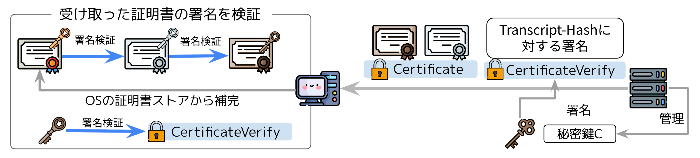

# TLSにおける証明書検証

PKIと証明書の基礎を押さえたところで、本ページではTLSが証明書をどう検証しているかを見ていきます。全体像は図1のとおりです。

*TLSにおける証明書の発行と検証の全体像*

クライアントが行う検証は、大きく2つに分かれます。

1. サーバー証明書の真正性チェック: サーバーから送られてきたサーバー証明書が、信頼された認証局から発行され、かつ有効であることを確かめる
2. CertificateVerifyの検証: サーバー証明書に入っている公開鍵で、CertificateVerifyの署名を検証し、通信相手がサーバー証明書の正式な持ち主か検証する

## 1. サーバー証明書の真正性チェック

サーバー証明書は中間認証局の秘密鍵で署名されているため、中間認証局の公開鍵で検証できます。同様に、中間証明書はルート認証局の秘密鍵で署名されているため、ルート認証局の公開鍵で検証できます。このように、証明書チェーンを信頼されたルート認証局まで辿ることで、サーバー証明書が信頼された認証局から発行されたものかを確かめられます。

ただし、この検証にはサーバー証明書だけでなく、中間証明書とルート証明書も必要です。クライアントは、これらの証明書をどのように入手するのでしょうか。

### トラストストア

信頼の起点となるルート証明書は、OSやブラウザにあらかじめ組み込まれています。こうした信頼する証明書の保管場所をトラストストアと呼びます。トラストストアの内容は、OSやブラウザのアップデートなどによって更新されます。

代表的なOSでは、次の場所で確認できます。

| 環境 | 確認方法 |
|---|---|
| Windows | `certlm.msc`を実行し、「信頼されたルート証明機関」→「証明書」を開く |
| macOS | 「キーチェーンアクセス」アプリの「システムルート」 |
| Ubuntu | `/etc/ssl/certs/` |

*OSのトラストストアの場所*

*macOSのトラストストア（キーチェーンアクセスの「システムルート」）*

どのトラストストアを参照するかは、プログラムによって異なります。Goの`crypto/x509`は基本的にOSのトラストストアを利用します。一方、Pythonの`requests`は通常、certifiが提供する認証局リストを利用します。このように、同じ端末でもプログラムによって信頼する認証局が異なる場合があります。

::: info なぜ認証局に毎回問い合わせないのか

ルート証明書をあらかじめ配布せず、クライアントが証明書を検証するたびに認証局へ問い合わせる設計も考えられます。

しかし、この方法ではTLS接続を確立たびに認証局との通信が必要となり、接続の確立が遅くなります。また、認証局には誰がいつどのサーバーに接続したかが知られてしまいます。認証局のサーバーが停止すれば、証明書の検証もできなくなります。

さらに、認証局から返された応答が本物かどうかを確かめる必要もあります。認証局との通信をTLSで保護しようとしても、今度はその通信相手が本物の認証局なのかを検証しなければならず、同じ問題に戻ってしまいます。

そのため、信頼の起点となるルート証明書などの情報は、TLS接続とは別の信頼できる経路で、あらかじめクライアントに届けておく必要があります。

:::

### 中間証明書はサーバーが送る

前述のとおり、ルート証明書はOSやブラウザにあらかじめ組み込まれているため、クライアントは手元に持っています。

一方、中間証明書は数が多く、ルート証明書に比べて入れ替わる機会も多いため、すべてを事前に保有しておくのは現実的ではありません。

では、中間証明書はどこから入手するのでしょうか。

一般的には、図3に示すようにサーバーから受け取ります。TLSハンドシェイクでは、サーバーがCertificateメッセージにサーバー証明書と必要な中間証明書をまとめて入れて送信します。

*ハンドシェイクでの証明書とCertificateVerifyの検証*

これで検証に必要な証明書が揃います。クライアントは、サーバー証明書の署名を中間証明書の公開鍵で検証し、中間証明書の署名をルート証明書の公開鍵で検証します。

このように署名を順に検証し、信頼されたルート認証局まで証明書チェーンを辿ることで、サーバー証明書が信頼された認証局から発行されたものだと確かめられます。

### 証明書自体の検証

ただし、証明書チェーンの署名が正しく検証できても、それだけでは十分ではありません。

証明書の有効期限が切れていたり、接続先とは異なるホスト名に対して発行されたものだったりする可能性があるからです。また、中間証明書が他の証明書を発行する権限を持っているかも確かめる必要があります。

そのため、クライアントは署名の検証に加えて、次の項目を確認します。

| 検証項目 | 検証内容 |
|---|---|
| 有効期間 | 証明書チェーン上の証明書が有効期間内か |
| 発行者名の一致 | 証明書のIssuerが、親証明書のSubjectと一致するか |
| 署名者の資格 | 親証明書に、他の証明書を発行するための権限があるか |
| ホスト名 | SANの値と接続先ホスト名が一致するか |
| 用途 | 証明書がTLSサーバー認証に使用できるか |
| 失効状態 | 失効情報を確認する場合、証明書が失効していないか |

*チェーンの署名検証に加えてクライアントが確かめる項目*

なお、失効状態の確認方法は実装によって異なります。失効情報をオンラインで毎回取得するとは限らず、確認できなかった場合の扱いも一律ではありません。

署名の検証と必要な項目の確認を終えて、初めてサーバー証明書を接続先のホスト名に対して有効な証明書として扱えます。

## 2. CertificateVerifyの検証

サーバー証明書が有効だと確認できたら、次はCertificateVerifyの検証です。

サーバーは、これまでのハンドシェイクの内容に対して自分の秘密鍵で署名し、その結果をCertificateVerifyメッセージで送ります。

クライアントは、サーバー証明書に含まれる公開鍵で署名を検証します。検証が成功すれば、通信相手がその公開鍵に対応する秘密鍵を持っていることが分かります。

ここまでの検証によって、クライアントは接続先のホスト名に対して有効な証明書を確認でき、さらに通信相手がその証明書に対応する秘密鍵を持っていることも確かめられました。

これにより、通信相手を正当なサーバーとして認証できます。

## 信頼の連鎖の起点

最後に、章の最初で説明した「信頼の受け渡し」の話に戻ります。ここまでの仕組みで、最終的な信頼の起点となっているのは何でしょうか。

それは、OSやブラウザなどが管理するトラストストアです。

OSやブラウザの開発元は、一定の基準を満たした認証局を信頼の対象として選び、そのルート証明書をトラストストアに登録しています。クライアントは、そのルート証明書を起点に、中間証明書、サーバー証明書へと署名を辿って検証します。

つまり、OSやブラウザの開発元が信頼した認証局を起点として、その認証局が保証する中間認証局を信頼し、さらに中間認証局が保証するサーバー証明書を信頼しているのです。

身分証明書の例で見た「信頼している組織が保証した相手を、間接的に信頼する」という考え方と同じです。PKIでは、署名を検証することで、この信頼の連鎖を技術的に確かめられるようにしています。

### 認証局を信頼するということ

ただし、この仕組みには注意すべき点があります。

トラストストアに登録された認証局は、原則として広い範囲のドメインに対する証明書を発行できるということです。証明書の用途や名前に制約が設けられている場合もありますが、多くの認証局は特定のドメインだけに限定されているわけではありません。

たとえば、普段利用しているWebサイトとはまったく関係のない認証局が、そのサイトのドメイン名に対する証明書を発行したとします。

その認証局がクライアントの信頼する認証局であり、証明書チェーンやホスト名などの検証条件を満たしていれば、クライアントはその証明書を有効なものとして受け入れる可能性があります。証明書を発行したのが普段と異なる認証局であるという理由だけでは、拒否されないのです。

トラストストアには多数のルート証明書が登録されています。そのうち1つでも不正な証明書を発行したり、秘密鍵を盗まれたりすると、本来その認証局とは無関係なサイトのなりすましにつながる可能性があります。

つまり、PKIの安全性は、個々のサーバーや認証局だけでなく、信頼の起点として登録された認証局全体の安全性にも左右されるのです。

### 性善説を支える仕組み

もちろん、認証局への信頼は、認証局の善意だけに委ねられているわけではありません。

証明書を発行する手順や秘密鍵の管理方法などには厳格な要件が設けられており、認証局は第三者による監査を受けます。また、OSやブラウザのベンダーは、認証局を信頼の対象として登録するための基準を定めています。基準を満たさない認証局は登録されず、重大な問題が発覚した場合には、信頼の対象から除外されることもあります。

さらに、証明書の不正発行を発見しやすくするために、Certificate Transparency（CT）という仕組みも導入されています。

CTは、認証局が発行する証明書を公開ログに記録し、誰でも確認できるようにする仕組みです。ChromeやFirefoxなどの主要なブラウザは、公開の認証局が発行した証明書に対して、CTログへの登録を示す証拠を要求しています。

これにより、認証局が不正な証明書を発行した場合でも、ドメインの管理者などがログを監視することで、その存在を発見できるようになります。CTの仕組みと導入の経緯は[コラム: Certificate Transparency](/09_column/certificate-transparency)にまとめています。

このように、PKIの信頼はデジタル署名の検証だけで成り立っているわけではありません。信頼の起点となる認証局を慎重に選び、その運用を監査し、問題があれば信頼を取り消す仕組みによって支えられています。