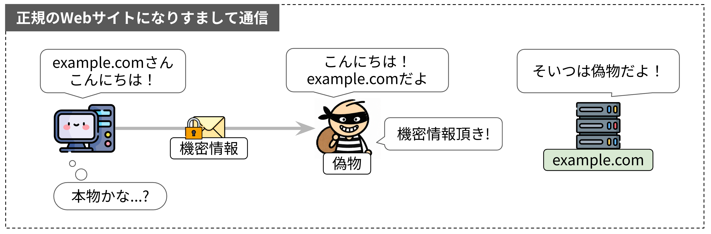
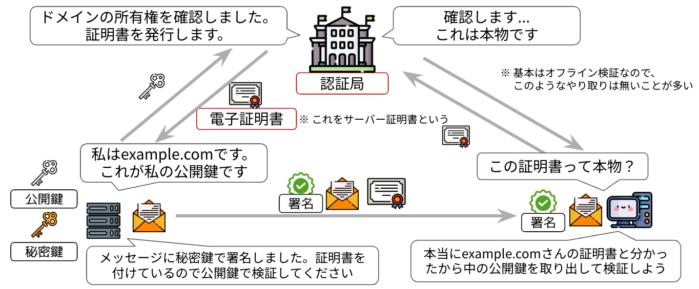

# なりすましの対策とPKI

## なりすましの問題

ここまでで、通信を暗号化し、改ざんも検知できるようになりました。
しかし、まだ問題が残っています。それは、鍵を共有した相手が「本物の通信相手なのか」という点です。

*なりすました相手と鍵交換してしまう例*

鍵交換は相手が誰であっても成立します。本物の通信相手になりすました攻撃者と鍵交換してしまうと、通信が暗号化されていても、その内容は攻撃者に筒抜けになります。
暗号化と改ざん検知だけでは、このようななりすましを検出できません。

本章では、なりすましへの対策となるPKIと証明書検証の仕組みを説明し、章の後半で検証処理を実装します。
実装に必要な概念が多いため、前半は仕組みの説明が中心です。PKIと証明書検証は、TLSを理解するうえで重要な部分です。

## 信頼の受け渡し

PKIはそのまま説明しても理解しにくいので、まず現実世界の例で考えてみましょう。

たとえば、お酒を販売する店員が、購入者が法律で定められた年齢に達しているかどうかを確認する場面を考えます。このとき、どのように年齢を確認するでしょうか。
購入者に年齢を尋ねても、正直に答えてくれるとは限りません。「私はお酒を購入できる年齢です」と書いた紙を渡されても、それだけでは信用できないでしょう。どちらも本人の自己申告にすぎないからです。

では、本人の申告に頼らず、年齢を確かめるにはどうすればよいでしょうか。

一般的には、運転免許証などの公的な身分証明書を提示してもらいます。店員は、身分証明書に記載された生年月日と顔写真を確認して、お酒を販売してもよいか判断します。

しかし、年齢を示す情報が書かれているという点では、本人が書いた紙も身分証明書も同じです。それなのに、なぜ身分証明書に書かれた情報は信頼できるのでしょうか。

それは、身分証明書が政府などの信頼できる機関によって発行されているからです。発行元は、所定の手続きで本人の情報を確認したうえで、身分証明書を発行しています。店員は購入者の申告をそのまま信用しているのではなく、発行元が確認した情報を信用しているのです。つまり、店員は購入者の生年月日を自分で調べなくても、信頼できる第三者の保証を利用することで、購入者の年齢を確認できるという訳です。

しかし、ここで1つ疑問が残ります。提示された身分証明書が、本当にその発行元から発行されたものだと、どうして判断できるのでしょうか。よくできた偽物を渡されている可能性もあります。確かに、身分証明書にはホログラムなどの偽造を防止する仕組みが備わっています。しかし、店員自身がその仕組みを詳しく理解しているわけでも、どれほど偽造が難しいのかを検証したわけでもありません。それでも、こうした仕組みが信頼できると考えるのはなぜでしょうか。

それは、身分証明書の発行元が、信頼できる事業者に製造を依頼し、適切な偽造防止の仕組みが備わるように管理していると考えられるからです。店員は製造を担当した事業者を直接知っているわけではありません。しかし、信頼している発行元が選んだ事業者なら、偽造を防ぐための対策も適切に施しているだろうと考えられます。

つまり、店員は発行元を信頼し、その発行元が信頼している事業者や、事業者が作った仕組みも間接的に信頼しているのです。

このように、ある組織への信頼をもとに、その組織が信頼する相手へと信頼をつなげていく考え方を「信頼の連鎖」と呼びます。
インターネット上でも、これとよく似た考え方で信頼を成り立たせています。信頼できる第三者を起点として、公開鍵とその持ち主の対応を保証し、その保証を検証できるようにします。

その基盤となるのがPKIです。

## PKI（公開鍵基盤）

PKI（Public Key Infrastructure: 公開鍵基盤）とは、公開鍵とその持ち主の対応を保証し、公開鍵を安全に利用するための仕組み全体のことです。信頼できる第三者が、公開鍵と所有者、またはドメイン名などの識別情報の対応を保証します。

PKIの全体像を図にすると、図2のようになります。図の上部にいる認証局が、信頼できる第三者にあたります。用語や仕組みについて順に説明します。

*PKIの登場人物とやり取り*

### 認証局（CA）

電子証明書を発行し、その証明書に署名することで、記載された名前と公開鍵の対応を保証する組織が認証局（CA：Certification Authority）です。マイナンバーカードの場合、カードに格納されている電子証明書を発行している地方公共団体情報システム機構（J-LIS）にあたります。

認証局には、Let's EncryptやDigiCertのように、OSやブラウザのベンダーの審査を通って広く信頼されているパブリック認証局と、組織が自前で立てて限られた範囲で使うプライベート認証局があります。本書で扱うのはパブリック認証局です。

### 電子証明書

電子証明書は、ドメイン名などの識別情報と公開鍵を結びつけ、認証局が署名したデータです。署名が付いているため、中身を書き換えると署名の検証が失敗します。これにより、認証局が保証した情報と公開鍵の対応を確かめられます。

書式にはいくつか種類がありますが、インターネットで一般に使われているのはITU-TのX.509という国際規格に基づくものです。証明書の中身がどんなデータなのかは[X.509証明書](/06_pki/x509)のページで詳しく説明します。

本章で扱うのは、認証局がサーバーに対して発行する証明書で、これをサーバー証明書と呼びます。

## 証明書の発行から検証まで

PKIでは、認証局がサーバーに証明書を発行し、クライアントが証明書を検証します。発行にも検証にも、デジタル署名を使います。デジタル署名は、秘密鍵を持つ者だけが作成でき、対になる公開鍵を使って検証できるデータです。図3は、認証局が1段だけの単純な構成で、証明書の発行から検証までを表したものです。

*証明書の発行から検証まで*

### 証明書の発行

サーバーは、自分のドメイン名と公開鍵を認証局に送り、証明書の発行を申請します。認証局は、申請者がそのドメイン名を管理する権限を持っていることなどを確かめたうえで、ドメイン名と公開鍵を結びつけたデータに自分の秘密鍵で署名し、証明書として発行します。認証局が確認する内容は、[証明書の種類](/06_pki/x509#証明書の種類)によって異なります。

### 証明書を使った検証

TLSのハンドシェイクで、サーバーは証明書をCertificateメッセージで送ります。さらにサーバーは、それまでのハンドシェイクの内容に自分の秘密鍵で署名し、CertificateVerifyメッセージで送ります。クライアントは、次の2つの署名を検証します。

1. 証明書に付いた認証局の署名を、前もって持っている認証局の公開鍵で検証します。検証が通れば、証明書に記載されたドメイン名と公開鍵の対応を、認証局が保証していることが分かります。
2. CertificateVerifyの署名を、証明書に入っている公開鍵で検証します。検証が通れば、通信相手がその公開鍵と対になる秘密鍵を持っていることが分かります。

クライアントが信頼しているのは認証局であって、サーバーではありません。初めて接続するサーバーでも、信頼している認証局が発行した証明書を使って、通信相手を認証できます。

実際のTLSでは、認証局が複数の段に分かれていることがあります。また、クライアントは署名だけでなく、証明書の有効期間や接続先のホスト名との一致なども確認し、意図したサーバーと通信していることを確かめます。