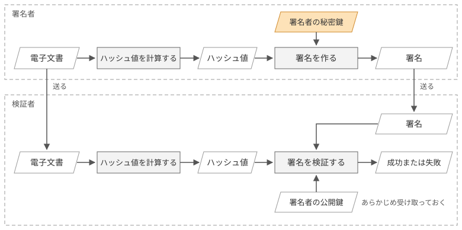
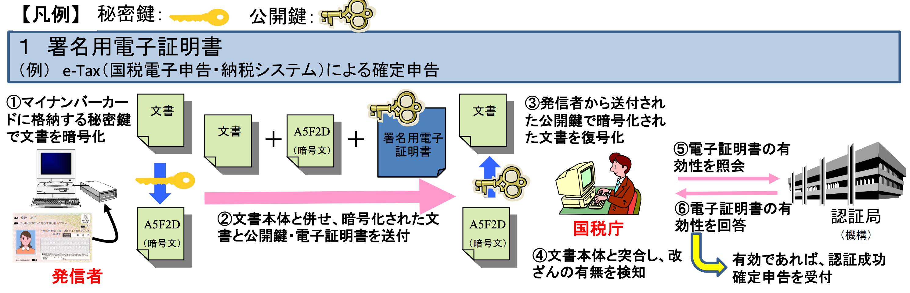

# デジタル署名

現実世界では、身分証明書に記載された情報や顔写真などを確認することで、本人確認を行えます。しかし、インターネット上では、電子証明書を提示するだけでは本人確認になりません。デジタルデータは劣化なく複製できるためです。

認証局が発行した電子証明書も、誰でもコピーして提示できます。そのため、電子証明書を提示した相手が、正当な持ち主であるとは限りません。

そこで必要になるのが、電子証明書が本物であることと、通信相手が証明書に対応する秘密鍵を持っていることの確認です。この確認には、デジタル署名という技術が使われます。

本ページでは、電子署名のうちデジタル署名と呼ばれる技術について説明します。すでにご存知の方は、[証明書チェーンとトラストストア](/06_pki/chain)のページに進んでください。

## デジタル署名と、その仕組み

デジタル署名とは、署名者の秘密鍵と署名対象のデータから、署名アルゴリズムを使って生成する値のことです。受け取った側は、署名者の公開鍵を使って、データがその公開鍵に対応する秘密鍵で署名されたことと、署名後にデータが書き換えられていないことを検証できます（[RFC 4949](https://datatracker.ietf.org/doc/html/rfc4949#section-4)の"digital signature"の定義による）。

公開鍵暗号と同じように公開鍵と秘密鍵のペアを使いますが、デジタル署名では秘密鍵で署名を作り、公開鍵で検証します。

*デジタル署名の生成と検証*

署名の生成と検証は、次の手順で行います。ここでは、文書のハッシュ値を使って署名を作る方式を例に説明します。

1. 署名者は、送りたい電子文書のハッシュ値を計算し、そのハッシュ値と自分の秘密鍵を使って署名を作ります。署名者は電子文書と署名を送り、公開鍵はあらかじめ検証者に渡しておきます
2. 検証者は、受け取った電子文書のハッシュ値を自分で計算します
3. 検証者は、そのハッシュ値、受け取った署名、署名者の公開鍵の3つを使って検証します。署名がその公開鍵に対応する秘密鍵で作られていて、かつ手元で計算したハッシュ値と一致する内容であれば、検証は成功します

検証が成功すると、2つのことが分かります。まず、署名は検証に使った公開鍵に対応する秘密鍵で作られたものです。また、文書が書き換えられていれば署名の検証が失敗するため、署名されたときから文書が改ざんされていないことも分かります。

ただし、検証に使った公開鍵が誰のものかは、署名の検証だけでは分かりません。公開鍵の持ち主は、別の方法で確かめる必要があります。

多くの署名方式で文書のハッシュ値を使うのは、署名アルゴリズムが扱うデータの大きさを抑えられるためです。ハッシュ値は文書の長さによらず固定長なので、長い文書でも一定の大きさのデータを使って署名を計算できます。ただし、Ed25519のように、文書全体を署名アルゴリズムに渡す方式もあります。

::: danger 「秘密鍵で暗号化」という説明について
デジタル署名を「秘密鍵で暗号化し、公開鍵で復号する」と説明する資料がありますが、この説明は正確ではありません。署名は暗号化とは別の操作です。RSAでは、署名の生成と暗号化に似た数学的な演算を使うため、署名を暗号化になぞらえる説明が広まりました。しかし、TLS 1.3で使われるECDSAやEd25519には暗号化の機能がなく、公開鍵で復号するという操作そのものがありません。
:::

## 身近にある署名

デジタル署名はTLSだけで使われるものではなく、身の回りでも広く利用されています。代表例がマイナンバーカードによる電子申告です。図2は、デジタル庁の資料「マイナンバーカードに格納される公的個人認証サービスについて」から、e-Taxで確定申告をするときの流れを引用したものです。

*引用元: [デジタル庁「マイナンバーカードに格納される公的個人認証サービスについて」](https://www.digital.go.jp/assets/contents/node/basic_page/field_ref_resources/1f2fb150-febe-4bee-b691-f02f68c4e8d4/e376536f/20221219_private-businessjpki-introduction_outline_02.pdf)*

発信者はマイナンバーカードに格納された秘密鍵で申告書に署名し、申告書本体と署名、そして公開鍵を含む署名用電子証明書をまとめて国税庁に送ります（①②）。国税庁は証明書の公開鍵で署名を検証して申告書が改ざんされていないことを確かめ（③④）、さらに認証局に証明書の有効性を照会したうえで申告を受け付けます（⑤⑥）。

申告書の署名を検証することで、証明書の公開鍵に対応する秘密鍵が使われたことを確認できます。さらに、証明書の有効性を確認することで、署名に使われた鍵と申告者の対応を確かめられます。

図2では署名を「秘密鍵で暗号化」「公開鍵で復号化」と表現していますが、これは前述のとおり厳密には署名と検証の操作です。TLSでも、サーバーがCertificateVerifyで署名を送り、クライアントが証明書の公開鍵で検証します。署名を使って相手を確かめるという基本的な考え方は共通しています。

## デジタル署名だけでは、不十分

署名の検証には、相手の公開鍵が必要です。先ほどの確定申告の例では、公開鍵は署名用電子証明書に含まれており、国税庁はその証明書が有効かどうかを認証局に照会していました。つまり、届いた公開鍵が本当に発信者のものかを確かめる手順が組み込まれていたのです。

TLSでも、クライアントはexample.comに初めて接続するとき、そのサーバーの公開鍵を事前に知りません。もし公開鍵の正当性を確かめる手順がなかったら、どうなるでしょうか。

仮にTLSが次のような仕組みだったとします。

1. サーバーがハンドシェイク時に自分の公開鍵をクライアントに送る
2. サーバーがハンドシェイクの内容に自分の秘密鍵で署名し、これも送る
3. クライアントは1で受け取った公開鍵で2の署名を検証し、成功すれば接続を続ける

署名を検証できれば、通信相手が確かにその公開鍵に対応する秘密鍵を持っていることが分かります。一見すると、これで相手を確認できたように思えます。

しかし、この仕組みでは、受け取った公開鍵が本当にexample.comのものなのかを確かめられません。

図3に示すように、経路上に割り込んだ攻撃者が、自分の公開鍵をexample.comの公開鍵と称して送り、自分の秘密鍵で署名したとします。すると、クライアントは攻撃者の公開鍵で署名を検証するため、検証は問題なく成功します。

クライアントから見れば、署名は正しく、相手がその公開鍵に対応する秘密鍵を持っていることも間違いありません。ただし、その相手はexample.comではなく、攻撃者なのです。

*デジタル署名の検証が無意味な例*

デジタル署名で確認できるのは、署名が公開鍵に対応する秘密鍵で作られたことまでです。その公開鍵が誰のものなのかは分かりません。署名の検証によって通信相手を認証するには、検証に使う公開鍵が本物の通信相手のものだと確かめられる必要があります。

そのためには、公開鍵と通信相手の対応を、信頼できる第三者に保証してもらう仕組みが必要です。これが、前のページで紹介したPKIの役割です。