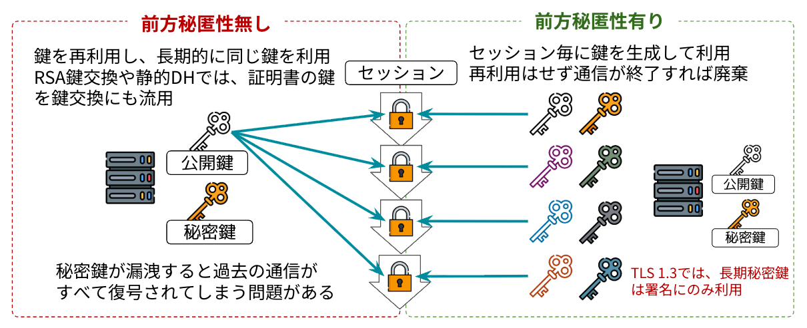
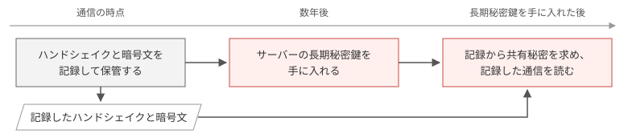

# コラム: 前方秘匿性

前方秘匿性（Forward Secrecy）は、長期秘密鍵が将来漏れても、攻撃者が漏洩より前の通信を復号できない性質です。長期秘密鍵は、証明書の公開鍵に対応する秘密鍵のように、サーバーが何年も使い続ける秘密鍵です。完全前方秘匿性（Perfect Forward Secrecy）とも呼びます。

## 前方秘匿性がない鍵交換とある鍵交換

TLSの鍵交換では、クライアントとサーバーが、共通鍵の材料になる共有秘密を決めます。図1は、前方秘匿性がない鍵交換と、前方秘匿性がある鍵交換の鍵の使い方を比べたものです。中央に並んだ錠前は、1回ごとの接続（セッション）です。

*前方秘匿性の有無による違い*

図1の左側は、前方秘匿性がない鍵交換です。前方秘匿性がない鍵交換では、サーバーが証明書の鍵ペアを鍵交換にも使います。サーバーは証明書の鍵ペアを何年も使い続けるので、すべての接続の共有秘密は、同じ長期秘密鍵1つがあれば求められる値です。TLS 1.2までのRSA鍵交換は、左側の鍵交換です。

図1の右側は、前方秘匿性がある鍵交換です。前方秘匿性がある鍵交換では、サーバーは証明書の鍵ペアを鍵交換に使いません。クライアントとサーバーは、接続のたびに一時的な鍵ペアを作って鍵交換に使い、接続が終わると捨てます。一時的な鍵ペアの秘密鍵を一時秘密鍵、公開鍵を一時公開鍵と呼びます。TLS 1.3のサーバーは、図1の右端にある長期秘密鍵を、CertificateVerifyの署名にだけ使います。長期秘密鍵は共有秘密の計算に関わらないので、攻撃者があとから長期秘密鍵を手に入れても、過去の接続の共有秘密は求められません。TLS 1.3のECDHEは、右側の鍵交換です。

ただし、クライアントやサーバーが一時秘密鍵や共有秘密をどこかに残しておくと、残した値が長期秘密鍵と同じ役割を持ってしまいます。前方秘匿性は、使い終えた値を消すことで初めて成り立ちます。

TLS 1.2では、前方秘匿性がないRSA鍵交換も、前方秘匿性があるECDHEも使えました。[RFC 9846 §1.3](https://datatracker.ietf.org/doc/html/rfc9846#section-1.3)のとおり、TLS 1.3では、公開鍵を使う鍵交換はすべて前方秘匿性を持ちます。

## 前方秘匿性がないと起きる問題

前方秘匿性がない鍵交換では、攻撃者が通信を記録しておき、あとから長期秘密鍵を手に入れると、記録した通信をすべて復号できます。図2は、記録した通信を後から復号する攻撃の流れです。

*記録した通信を後から復号する攻撃*

攻撃者が長期秘密鍵を手に入れる例は、次のとおりです。

- 攻撃者が、サーバーへの侵入やソフトウェアの脆弱性を使って秘密鍵を盗む。2014年に見つかったOpenSSLの脆弱性[Heartbleed](https://heartbleed.com/)（CVE-2014-0160）では、攻撃者がサーバーのメモリから証明書の秘密鍵を読み出せた。
- サーバーが鍵ペアを作るときの乱数を予測できると、攻撃者が秘密鍵を推測できる。2008年に見つかったDebianのOpenSSLの不具合（[DSA-1571-1](https://www.debian.org/security/2008/dsa-1571)）では、乱数を予測できたため、攻撃者が鍵を推測できた。
- 十分な規模の量子コンピュータがあれば、攻撃者は証明書の公開鍵から長期秘密鍵を計算できる。

量子コンピュータがあれば、攻撃者は記録したECDHEの一時公開鍵からも一時秘密鍵を計算できるので、前方秘匿性がある鍵交換でも記録した通信を復号できます。ただし、攻撃者は、長期秘密鍵なら1つ計算するだけで記録したすべての通信を復号できますが、ECDHEでは接続ごとに一時秘密鍵を計算し直す必要があります。対策として、従来の鍵交換に耐量子の方式を組み合わせた、[RFC 10024](https://datatracker.ietf.org/doc/html/rfc10024)のX25519MLKEM768などの鍵交換があります。
