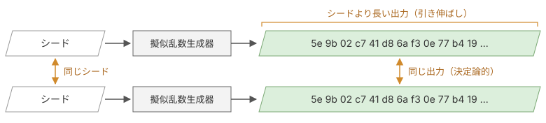
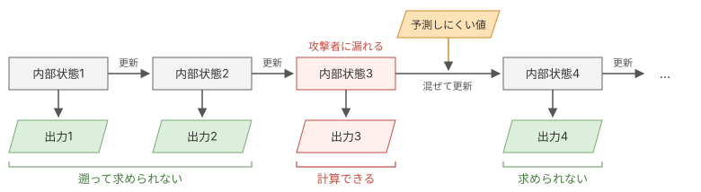

# コラム: 擬似乱数生成器

## 擬似乱数生成器について

PRNG（Pseudo-Random Number Generator：擬似乱数生成器）は、シードと呼ぶ初期値から、決まった計算で乱数のように見える数列を作るアルゴリズムです。NIST SP 800-22は、PRNGを次のように定義しています。

> A deterministic algorithm which, given a truly random binary sequence of length k, outputs a binary sequence of length l >> k which appears to be random. The input to the generator is called the seed, while the output is called a pseudorandom bit sequence.
>   
> 訳）長さkの真の乱数のビット列を与えると、長さl（l >> k）の、乱数のように見えるビット列を出力する決定論的なアルゴリズム。生成器への入力をシード、出力を擬似乱数ビット列と呼ぶ。
>
> 引用元: [NIST SP 800-22 Rev. 1a §1.2 Definitions](https://nvlpubs.nist.gov/nistpubs/Legacy/SP/nistspecialpublication800-22r1a.pdf#page=19)

決定論的なアルゴリズムであることと、長さkのシードからずっと長い長さlの数列を出力できることが、PRNGの2つの性質です。

*擬似乱数生成器の2つの性質*

2つの性質は、どちらもストリーム暗号に欠かせません。同じシードからは必ず同じ数列が出るので、送信側と受信側は、同じ鍵から同じ鍵ストリームを作れます。短いシードから長い数列を作れるので、16バイトの鍵からでも平文と同じ長さの鍵ストリームを作れ、鍵を繰り返して使わずに済みます。

表1は、プログラミング言語の標準ライブラリにあるPRNGの例です。

| PRNG | 使用例 |
|---|---|
| 線形合同法[^knuth1997] | Javaの`java.util.Random` |
| メルセンヌ・ツイスタ[^matsumoto1998] | Pythonの`random`モジュール |
| xorshift128+[^vigna2017] | JavaScriptエンジンV8の`Math.random` |

*PRNGの例*

## 暗号的に安全な擬似乱数生成器について

PRNGの出力は、乱数のように見えても暗号に使えるとは限りません。表1のPRNGは、どれも暗号用ではありません。たとえば、メルセンヌ・ツイスタでは、攻撃者が連続した624個の出力から内部状態を復元でき、その先の出力をすべて計算できます。Goでも、`math/rand`パッケージは暗号用ではなく、暗号には`crypto/rand`パッケージを使います。

CSPRNG（Cryptographically Secure Pseudo-Random Number Generator：暗号論的擬似乱数生成器）は、暗号に使えるPRNGです。表2はCSPRNGの例です。

| CSPRNG | 使用例 |
|---|---|
| ChaCha20 | Linuxの`getrandom`、OpenBSDの`arc4random` |
| NIST SP 800-90Aで定めた生成器 | OpenSSLの`RAND_bytes` |
| AES-CTR | AES-GCMの鍵ストリーム |

*CSPRNGの例*

CSPRNGには、PRNGの2つの性質に加えて、以下2つの性質があります。

### 1. 次のビットを予測できない

次ビット検定[^yao1982]は、出力の先頭kビットを知っている攻撃者が、k+1ビット目を予測できるかを調べる検定です。
CSPRNGの1つ目の性質は、次ビット検定に合格することです。
次ビット検定に合格するとは、図2のように、攻撃者にとって、k+1ビット目が1か0かを1/2より高い確率で当てる現実的な方法がないことです。

*次ビット検定*

SP 800-22も、暗号に使う擬似乱数に、次の出力を予測できないことを求めています。

> Random and pseudorandom numbers generated for cryptographic applications should be unpredictable. In the case of PRNGs, if the seed is unknown, the next output number in the sequence should be unpredictable in spite of any knowledge of previous random numbers in the sequence. This property is known as forward unpredictability.
>   
> 訳）暗号に使うために生成する乱数と擬似乱数は、予測できないものであるべきである。PRNGの場合、シードが分からなければ、数列の前の乱数をどれだけ知っていても、数列の次の出力は予測できないものであるべきである。この性質を前方予測不可能性（forward unpredictability）と呼ぶ。
>
> 引用元: [NIST SP 800-22 Rev. 1a §1.1.2 Unpredictability](https://nvlpubs.nist.gov/nistpubs/Legacy/SP/nistspecialpublication800-22r1a.pdf#page=13)

AES-GCMでは、AESが鍵ストリームを作るCSPRNGとなります。AES-GCMの鍵ストリームは、1ずつ増えるカウンタをAESで暗号化し、出力をつなげたものです。

$$
\mathit{keystream} = \mathrm{AES}(\mathit{key}, \mathit{ctr}) \parallel \mathrm{AES}(\mathit{key}, \mathit{ctr}+1) \parallel \cdots
$$

keystream：鍵ストリームkey：鍵ctr：1ずつ増えるカウンタ

AESの出力から鍵や続きの出力を求める現実的な方法は、見つかっていません。攻撃者は、HTTPのレスポンスの先頭のように平文の一部を推測して鍵ストリームの一部を得ても、残りの鍵ストリームを予測できません。

### 2. 状態侵害拡張攻撃への耐性がある

PRNGの出力は、内部状態から計算した値です。内部状態は、出力のたびに次の値に変わります。状態侵害拡張攻撃[^kelsey1998]は、漏れた内部状態を手がかりに、攻撃者がほかの出力を求める攻撃です。状態侵害拡張攻撃への耐性には、漏洩より前の出力を守ることと、漏洩より後の出力を守ることの2つがあります。

DRBG（Deterministic Random Bit Generator：決定論的乱数ビット生成器）は、NIST SP 800-90Aが暗号用に定めたPRNGです。SP 800-90Aでの2つの耐性の定義は、次のとおりです。

> Backtracking resistance means that a compromise of the DRBG internal state has no effect on the security of prior outputs.
>
> （中略）
>
> Prediction resistance means that a compromise of the DRBG internal state has no effect on the security of future DRBG outputs.
>   
> 訳）backtracking resistanceとは、DRBGの内部状態が侵害されても、侵害より前の出力の安全性に影響しないことである。（中略）prediction resistanceとは、DRBGの内部状態が侵害されても、侵害より後のDRBGの出力の安全性に影響しないことである。
>
> 引用元: [NIST SP 800-90A Rev. 1 §8.8 Prediction Resistance and Backtracking Resistance](https://nvlpubs.nist.gov/nistpubs/SpecialPublications/NIST.SP.800-90Ar1.pdf#page=32)

図3は、状態侵害拡張攻撃への耐性を持つPRNGの例です。内部状態の更新は逆にたどれない計算なので、内部状態3が漏れても、攻撃者は出力1と出力2を遡って求められません。攻撃者は内部状態3から出力3を計算できますが、内部状態4は内部状態3に予測しにくい値を混ぜた値なので、出力4以降は求められません。

*状態侵害拡張攻撃への耐性*

OSのCSPRNGは、ハードウェアから集めた予測しにくい値を、内部状態に混ぜ続ける仕組みになっています。

ストリーム暗号では、鍵とカウンタがそのまま内部状態です。内部状態が漏れることは鍵が漏れることと同じなので、攻撃者は過去の暗号文も復号できます。状態侵害拡張攻撃への耐性が意味を持つのは、鍵や乱数を作るためのCSPRNGです。

## TLSでCSPRNGを使う値

TLSでCSPRNGを使う値は、表3の3つです。

| 値 | 作り方 |
|---|---|
| ClientHelloとServerHelloの`random` | OSのCSPRNGから読む |
| X25519の秘密鍵 | OSのCSPRNGから読む |
| レコードを暗号化する鍵ストリーム | 鍵とnonceをシードにして、AESやChaCha20で作る |

*TLSでCSPRNGを使う値*

RFC 9846は、実装者向けの注意をまとめた付録Cで、`random`や秘密鍵のような乱数を作るにはCSPRNGが必要だと述べています。

> TLS requires a cryptographically secure pseudorandom number generator (CSPRNG).
>   
> 訳）TLSは、暗号論的擬似乱数生成器（CSPRNG）を必要とする。
>
> 引用元: [RFC 9846 §C.1 Random Number Generation and Seeding](https://datatracker.ietf.org/doc/html/rfc9846#appendix-C.1)

`random`は平文で送る値ですが、表3のとおり、秘密鍵と同じOSのCSPRNGから読んだ値です。出力から内部状態を求められる生成器では、攻撃者が`random`から秘密鍵まで計算できる場合があります。

鍵ストリームは、送信側と受信側が同じ鍵とnonceから同じ値を作り直す必要があるので、OSのCSPRNGではなく、AESやChaCha20で作る値です。

本書のクライアントは、`random`と秘密鍵を`crypto/rand`パッケージで作り、レコードの暗号化にAES-GCMを使います。

[^knuth1997]: D. E. Knuth, "The Art of Computer Programming, Volume 2: Seminumerical Algorithms", 3rd ed., Addison-Wesley, 1997.

[^matsumoto1998]: M. Matsumoto, T. Nishimura, "Mersenne Twister: A 623-Dimensionally Equidistributed Uniform Pseudo-Random Number Generator", ACM Transactions on Modeling and Computer Simulation, 1998. [DOI](https://doi.org/10.1145/272991.272995)

[^vigna2017]: S. Vigna, "Further Scramblings of Marsaglia's xorshift Generators", Journal of Computational and Applied Mathematics, 2017. [DOI](https://doi.org/10.1016/j.cam.2016.11.006)

[^yao1982]: A. C. Yao, "Theory and Application of Trapdoor Functions", 23rd Annual Symposium on Foundations of Computer Science, 1982. [DOI](https://doi.org/10.1109/SFCS.1982.45)

[^kelsey1998]: J. Kelsey, B. Schneier, D. Wagner, C. Hall, "Cryptanalytic Attacks on Pseudorandom Number Generators", Fast Software Encryption, 1998. [DOI](https://doi.org/10.1007/3-540-69710-1_12)
